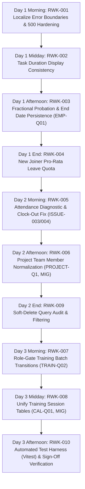

# Document 07: Final Pre-Rework Implementation Plan

**Project:** `flow-desk-main`  
**Planned Execution Start:** 1 November 2026  
**Auditor:** Antigravity (Strictly Read-Only Planning Mode)  
**Status:** Definitive Pre-Rework Baseline (All Stakeholder Decisions Approved)  

---

## 1. Executive Summary

This document establishes the authoritative, dependency-aware implementation sequence for the FlowDesk rework starting **1 November 2026**. Following the formal approval of all four outstanding stakeholder decisions (`TRAIN-Q02`, `EMP-Q01`, `PROJECT-Q1`, `CAL-Q01`) on 31 October 2026, **zero tasks remain blocked by stakeholder decisions**.

Tasks are strictly partitioned into six operational categories:
1. **Ready to Start (Unblocked, Fully Specified Implementation Tasks)**
2. **Blocked by Technical Investigation (Diagnostic Sessions Required Before Fix)**
3. **Blocked by Stakeholder Decision (ZERO — All Decisions Resolved)**
4. **Requires Data Migration (Schema & Data Backfill Prerequisites)**
5. **Deferred to Future Phase (Student Training Management Initiative)**
6. **Permanently Excluded (Zero Code Action — Schema Dropped via Migration)**

---

## 2. Category 1: Ready to Start Tasks

### Task RWK-001: Localize Error Boundaries & Resolve Cold-Hydration 500 Vulnerability
- **Task ID:** `RWK-001`
- **Issue Reference:** `ISSUE-002`
- **Module:** Runtime / Error Boundary / App Router
- **Priority:** High
- **Approved Expected Behavior:** Direct browser refresh on any route (`/app`, `/app/projects`, `/app/attendance`, etc.) must cleanly hydrate without triggering a full-screen "500 Something went wrong" crash. Individual widget or query failures must be caught by local component-level error boundaries, displaying an inline retry card rather than crashing the workspace.
- **Required Changes:**
  1. Author route-level and widget-level error boundaries around `<MyDayPage>` and workspace sub-views.
  2. Guard against synchronous null/undefined property dereferences during cold mount in `MyDayPage.tsx`.
  3. Ensure `VITE_AUTH_MODE` defaults safely to `legacy` in environment configuration.
- **Dependencies:** None (Foundation tier — First task).
- **Acceptance Criteria:**
  - Direct browser refresh on `/app` with an active session loads cleanly 10 consecutive times without tripping the full-screen `<ErrorBoundary>`.
  - Simulating an uncaught error in a single widget renders an inline fallback card; sidebar navigation remains operational.
- **Required Regression Tests:** Direct page refresh across all top-level routes (`/app`, `/app/employees`, `/app/attendance`, `/app/leave`, `/app/training/batches`).
- **Data Migration Requirements:** None.

---

### Task RWK-002: Resolve Task Duration Display Inconsistency on My Day
- **Task ID:** `RWK-002`
- **Issue Reference:** `ISSUE-001`
- **Module:** My Day / Task Timer
- **Priority:** High
- **Approved Expected Behavior:** The duration displayed on a task card on the My Day page must consistently show the authoritative total accumulated duration (e.g. `7h 39m`) before and after browser page refresh. The confusing `0h 0m (Total: 7h 39m)` split label must be removed.
- **Required Changes:**
  1. Remove the conditional split rendering `totalHrsNum > secondsToday / 3600 && totalHrsFormatted && (Total: ...)` in `TaskWidget` (`MyDayPage.tsx:1623-1650`, `1744-1771`).
  2. Standardize duration display strictly on `totalHrsFormatted` (derived from `t.totalHoursWorked || t.actualHours`).
  3. Reconcile `localStorage` timer state mapping to avoid overwriting today's date stamp before evaluating duration.
- **Dependencies:** None.
- **Acceptance Criteria:**
  - A task with 7.65 hours logged displays `7h 39m` on initial load.
  - After browser refresh (Cmd+R / F5), the exact same task displays `7h 39m`.
  - Running task timers continue incrementing seconds accurately without mutating historical totals.
- **Required Regression Tests:** Starting, pausing, and resuming a task timer; reloading page during an active running timer.
- **Data Migration Requirements:** None.

---

### Task RWK-003: Implement Fractional Probation Calculation & Authoritative End Date
- **Task ID:** `RWK-003`
- **Business Rule Reference:** `BR-EMP-001`, `BR-EMP-002`, `BR-EMP-003`, `EMP-Q01`
- **Module:** Employee Directory / Employee Lifecycle
- **Priority:** High
- **Approved Expected Behavior:**
  1. Support fractional probation durations (e.g. `2.5`, `2.9` months), whole months, and `0` (no probation).
  2. Compute Probation End Date using calendar months + day-proportion of remaining fractional month, rounding fractional days using round-half-up.
  3. **Probation End Date is the authoritative stored value in the database (`EMP-Q01`).**
  4. Probation Duration must be calculated dynamically from the End Date.
  5. Displayed decimal duration rounded to one decimal place; display rounding must never modify the authoritative End Date.
  6. Editing and saving an employee record must preserve the original End Date unless an authorized user explicitly changes it.
  7. Automatically complete probation on scheduled date, even for Suspended employees, without altering suspended status.
- **Required Changes:**
  1. Author a dedicated date calculation utility (`src/shared/utils/probation.ts`) implementing confirmed calendar-month forward and reverse formulas.
  2. Update `EmployeeModal.tsx` inputs to accept decimal duration and bind bidirectional recalculation.
  3. Update `useEmployee.ts` and `employee.service.ts` to persist authoritative End Date and evaluate automated completion.
- **Dependencies:** None (Baseline approved under `EMP-Q01`).
- **Acceptance Criteria:**
  - Joining Date Jan 15 with 2.5 months calculates Probation End Date March 30 (non-leap year).
  - Explicitly entering End Date March 30 displays 2.5 months; saving and reopening preserves March 30 exactly.
  - Joining Date Jan 15 with duration 0 sets Probation End Date to null and enables immediate leave accrual.
- **Required Regression Tests:** Employee creation, employee profile editing, status list rendering.
- **Data Migration Requirements:** None (Columns exist on `flwdsk_employees`).

---

### Task RWK-004: Implement New Joiner Pro-Rata Leave Formula & Probation Exclusion
- **Task ID:** `RWK-004`
- **Business Rule Reference:** `BR-LEAVE-011`, `BR-LEAVE-013`, `LEAVE-Q4A`
- **Module:** Leave Management
- **Priority:** High
- **Approved Expected Behavior:**
  1. Baseline entitlement: 1 day/month (12 days/year ending March 31). Zero leave accrues during probation.
  2. Leave Accrual Start Date begins immediately following the final day of probation (or Joining Date if 0 probation).
  3. Partial initial month accrual calculated via confirmed formula: `(eligible days / month days) * 1`, rounded to nearest 0.5 day with minimum 0.5 day positive allocation (0.25 &rarr; 0.5, 0.50 &rarr; 0.5, 0.75 &rarr; 1.0).
- **Required Changes:**
  1. Author `src/shared/utils/leave-accrual.ts` implementing confirmed formula and rounding logic.
  2. Wire `LeaveService` to calculate initial quota based on `Leave Accrual Start Date` through March 31.
  3. Prevent leave application submission prior to Leave Accrual Start Date.
- **Dependencies:** `RWK-003` (Probation End Date / Leave Accrual Start Date).
- **Acceptance Criteria:**
  - Employee completing probation on April 14 receives full remaining months + pro-rated April allocation rounded to 0.5 day.
  - Zero balance shown during probation period.
- **Required Regression Tests:** Leave balance display, leave application submission, manager approval deduction.
- **Data Migration Requirements:** None.

---

### Task RWK-007: Role-Gate Training Batch Lifecycle Transitions
- **Task ID:** `RWK-007`
- **Business Rule Reference:** `BR-TRN-002`, `TRAIN-Q02`
- **Module:** Training Batches
- **Priority:** High
- **Approved Expected Behavior:**
  - Authorized roles for changing Training Batch status are: **Managers**, **Admins**, and **Assigned Trainers**.
  - All three roles may transition a batch through: `Scheduled → In Progress → Completed → Closed`.
  - Unauthorized users or trainers not assigned to the batch are restricted from modifying batch status.
- **Required Changes:**
  1. Update `BatchManagement.tsx` status change actions to verify user role (`Category 1: Admin/Manager`) or check if user ID matches `assignedTrainerId`.
  2. Add role validation in `training.service.ts` before persisting status updates.
- **Dependencies:** None (Approved under `TRAIN-Q02`).
- **Acceptance Criteria:**
  - Assigned trainer can transition batch from `Scheduled` to `In Progress`.
  - Non-assigned trainer cannot change status.
  - Manager and Admin can transition any batch through all stages.
- **Required Regression Tests:** Batch creation, batch status progression, batch list filtering by status.
- **Data Migration Requirements:** None.

---

### Task RWK-009: Enforce Soft-Delete (`deleted_at IS NULL`) Filter on Direct Supabase Queries
- **Task ID:** `RWK-009`
- **Issue Reference:** `ISSUE-007`
- **Module:** Application-Wide UI Views
- **Priority:** Medium
- **Approved Expected Behavior:** All application queries must exclude soft-deleted records. Soft-deleted announcements, expense claims, or attendance entries must never appear in lists, summaries, or dropdowns.
- **Required Changes:**
  1. Audit and patch direct `supabase.from(...)` queries across `AnnouncementsBoard.tsx`, `ExpenseClaims.tsx`, and `AttendanceLogPage.tsx` to include `.is('deleted_at', null)`.
  2. Route direct queries through designated repository classes wherever feasible.
- **Dependencies:** None.
- **Acceptance Criteria:** Soft-deleting a record immediately removes it from user-facing views upon refresh.
- **Required Regression Tests:** Announcements list, expense claims list, attendance log history.
- **Data Migration Requirements:** None.

---

### Task RWK-010: Author Automated Unit Test Harness with Vitest
- **Task ID:** `RWK-010`
- **Issue Reference:** `ISSUE-008`
- **Module:** Testing & QA / DevOps
- **Priority:** Medium
- **Approved Expected Behavior:** Automated test suite running in Vite environment validating pure business logic calculations without requiring a live database or browser session.
- **Required Changes:**
  1. Install `vitest` as devDependency in `package.json`.
  2. Author comprehensive test suites for:
     - `src/shared/utils/probation.test.ts` (Validating calendar-month forward & reverse calculation, clamping, round-half-up).
     - `src/shared/utils/leave-accrual.test.ts` (Validating partial month formula, 0.5 day rounding, leap year dates).
     - Task timer worklog duration helpers.
  3. Add `npm run test` script to `package.json`.
- **Dependencies:** `RWK-003`, `RWK-004`.
- **Acceptance Criteria:** `npm run test` executes cleanly and passes all test suites in < 5 seconds.
- **Required Regression Tests:** CI / local test script execution.
- **Data Migration Requirements:** None.

---

## 3. Category 2: Blocked by Technical Investigation Tasks

### Task RWK-005: Investigate & Resolve Attendance Time Clock Anomalies (ISSUE-003 & ISSUE-004)
- **Task ID:** `RWK-005`
- **Issue Reference:** `ISSUE-003` (Duplicate Popups), `ISSUE-004` (Clock-Out Incomplete)
- **Module:** Attendance / Clock-In, Clock-Out & Break Management
- **Priority:** High
- **Current Status:** Blocked by Technical Investigation (Diagnostic session required).
- **Approved Expected Behavior:**
  1. Starting a break must display exactly one confirmation notification.
  2. Clocking out must reliably update `flwdsk_attendance_records.status` to `clocked_out`, write timestamp, auto-pause active tasks, and update UI state without hanging.
- **Prerequisite Diagnostic Plan:**
  - Execute diagnostic inspection and live reproduction testing in a single combined Attendance session.
  - Trace `startBreak()` and `clockOut()` handlers in `MyDayPage.tsx`, `useAttendance.ts`, and `supabase-attendance.repository.ts`.
  - Verify whether event listeners or toast subscriptions are firing twice.
  - Keep root causes and fixes strictly isolated between `ISSUE-003` and `ISSUE-004`.
- **Dependencies:** None (Diagnostic session scheduled for Day 2 Morning).
- **Acceptance Criteria:** Break start produces exactly 1 toast; 10 consecutive clock-out attempts complete and persist within 1 second.
- **Required Regression Tests:** Attendance daily status, task auto-pause on break/out, weekly rollups.
- **Data Migration Requirements:** None.

---

## 4. Category 3: Blocked by Stakeholder Decision

**Current Status:** **ZERO (0) TASKS BLOCKED.**  
All four previous questions (`TRAIN-Q02`, `EMP-Q01`, `PROJECT-Q1`, `CAL-Q01`) were formally approved by stakeholders on 31 October 2026.

---

## 5. Category 4: Requires Data Migration Tasks

### Task RWK-006: Normalize Project Team Storage
- **Task ID:** `RWK-006`
- **Decision & Issue Reference:** `PROJECT-Q1`, `ISSUE-006`, `BR-PRJ-009`
- **Module:** Projects & Resource Scheduler
- **Priority:** High
- **Approved Expected Behavior:**
  - `flwdsk_resource_allocations` is the single canonical source of truth for Project Membership.
  - Existing Employees must be assigned to Projects.
  - Project Members receive approved permissions to create tasks, view relevant tasks, and access relevant project reports scoped to their assigned project.
  - `flwdsk_projects.member_ids` may be deprecated only after dependency review, data validation, and migration planning.
  - Do not independently redesign the existing security or permission architecture.
- **Required Changes:**
  1. Audit existing `flwdsk_projects.member_ids` JSON arrays in the database.
  2. Author a versioned migration (`20261102000000_backfill_project_allocations.sql`) to backfill any members currently only in `member_ids` into `flwdsk_resource_allocations` with default role `'Member'` and allocation `100%`.
  3. Refactor `ProjectModal.tsx` to read and write allocations via `flwdsk_resource_allocations`.
  4. Retain `member_ids` as an inert or synchronized column during the transition period before final deprecation.
- **Dependencies:** Migration execution and validation.
- **Acceptance Criteria:** Team members added via Project Modal appear in Resource Scheduler; team members added in Resource Scheduler appear in Project Details.
- **Required Regression Tests:** Project creation, member assignment, task assignment dropdown filtered by project members.
- **Data Migration Requirements:** **YES.** Schema backfill migration required.

---

### Task RWK-008: Unify Training Session Tables
- **Task ID:** `RWK-008`
- **Decision & Issue Reference:** `CAL-Q01` (Option B), `ISSUE-005`, `BR-CAL-010`
- **Module:** Training Calendar / My Day / Attendance
- **Priority:** High
- **Approved Expected Behavior:**
  - `flwdsk_schedule_sessions` becomes the single canonical table for Training Calendar planning, scheduling, and attendance.
  - Add necessary planning fields to canonical table via migration.
  - Preserve all existing Calendar session records and Attendance records.
  - Trainer My Day, Training Calendar, and Attendance Log must use the same canonical session records.
  - Preserve existing security policies and RLS.
  - Review all dependencies before changing existing workflows.
  - Validate migration and regression tests before deprecating `flwdsk_calendar_sessions`.
- **Required Changes:**
  1. Author a versioned migration (`20261103000000_unify_training_sessions.sql`) to add columns (`session_title`, `start_time`, `end_time`, `venue`, `mode`, `color`) to `flwdsk_schedule_sessions`.
  2. Backfill existing records from `flwdsk_calendar_sessions` into `flwdsk_schedule_sessions`.
  3. Refactor `TrainingCalendar.tsx` to query and upsert to `flwdsk_schedule_sessions`.
  4. Ensure `MyDayPage.tsx` trainer session query and `AttendanceLogPage.tsx` query the unified canonical table.
  5. Remove in-memory dual-table merging from `training.service.ts`.
- **Dependencies:** Migration execution and data validation.
- **Acceptance Criteria:** A session scheduled on Training Calendar immediately displays on the assigned trainer's My Day dashboard and is immediately selectable for attendance.
- **Required Regression Tests:** Calendar session creation, drag-and-drop reschedule, My Day trainer session display, attendance taking.
- **Data Migration Requirements:** **YES.** Schema expansion and data backfill migration required.

---

### Task MIG-001: Execute Removal of Permanently Excluded Modules Tables
- **Task ID:** `MIG-001`
- **Module:** Database Schema Maintenance
- **Priority:** Low / Maintenance
- **Approved Expected Behavior:** Permanently drop tables associated with excluded modules (`flwdsk_budgets`, `flwdsk_vendors`, `flwdsk_purchase_orders`, `flwdsk_assets`, `flwdsk_salary_structures`) to maintain clean database hygiene.
- **Existing Migration Prepared:** `supabase/migrations/20261029000000_remove_excluded_modules_tables.sql`.
- **Execution Mandate:** Execute only during scheduled database maintenance window after verifying zero foreign key references from active modules.
- **Dependencies:** Verification completed during Phase 4 audit.
- **Acceptance Criteria:** Tables dropped; all in-scope modules continue functioning with zero broken relations.
- **Data Migration Requirements:** **YES.** Destructive DDL migration.

---

## 5. Category 5: Deferred to Future Product Phase

* **Student Training Management Capabilities:**
  - Student Lifecycle management (`StudentLifecycle.tsx`, `flwdsk_student_records`).
  - Coursework Assessment Board (`AssessmentBoard.tsx`, `flwdsk_assessments`).
  - Public Student Exam Portal (`ExamSubmissionPage.tsx`, `/submit-exam`, `flwdsk_vouchers`, `flwdsk_exam_attempts`).
  - Commercial enrollment and fee management (`flwdsk_enrollments`).
* **Implementation Mandate:** Strictly retain existing code and data structures inert in the repository. Do not implement new features, refactor, or delete during FlowDesk rework.

---

## 6. Category 6: Permanently Excluded Scope

* **Excluded Functional Domains:**
  1. Budget Management (Budget Allocation, Variance Tracking, Rollover).
  2. Procurement and Purchase Orders (Vendor Management, PO Workflows).
  3. Asset Management (Hardware/Software Inventory, Physical Verification).
  4. Payroll Processing (Salary Structures, Base Pay, Payslip Generation).
* **Implementation Mandate:** All UI pages, navigation, and service hooks are already removed. Zero rework action permitted.

---

## 7. Master Implementation Sequence (1 November – 3 November 2026)

---

## 8. Exact First Task Recommended for Tomorrow (1 November 2026)

### **First Task: RWK-001 — Localize Error Boundaries & Cold-Hydration 500 Hardening**
* **Why First:**  
  `RWK-001` eliminates the full-screen "500 Something went wrong" crash that currently threatens developer verification on direct page refresh. Once component-level error boundaries are in place, any minor rendering glitch in subsequent rework tasks will be caught inline without interrupting the entire application workspace.
* **Target Files:** [`src/app/ErrorBoundary.tsx`](file:///Users/apple/Downloads/flow-desk-main/src/app/ErrorBoundary.tsx), [`src/app/router.tsx`](file:///Users/apple/Downloads/flow-desk-main/src/app/router.tsx), [`src/app/pages/workspaces/MyDayPage.tsx`](file:///Users/apple/Downloads/flow-desk-main/src/app/pages/workspaces/MyDayPage.tsx).
* **Estimated Execution Time:** 2 to 3 hours.
* **Followed Immediately By:** `RWK-002` (My Day Task Duration display reconciliation).
