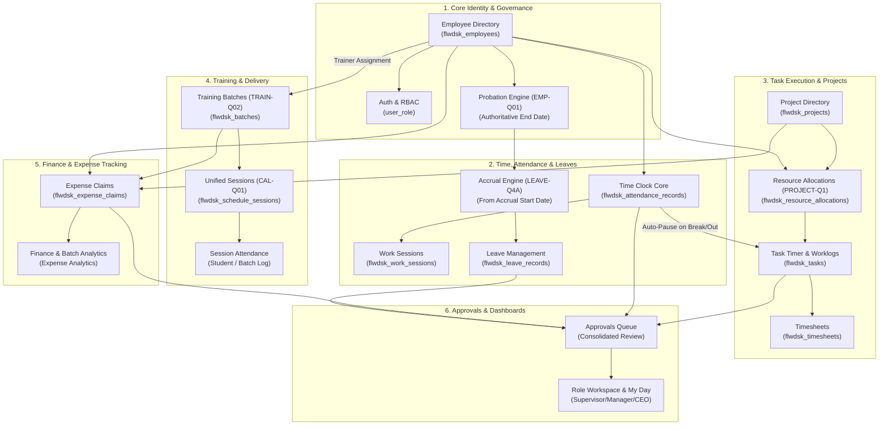

# Document 12: Cross-Module Dependency & Workflow Interaction Audit

**Project:** `flow-desk-main`  
**Audit Date:** 31 October 2026  
**Auditor:** Antigravity (Strictly Read-Only Mode)  
**Status:** Complete Cross-Module Topology Trace  

---

## 1. Executive Summary

FlowDesk is an integrated business application where events in one module trigger cascading workflows, status transitions, and data rollups across multiple downstream domains. This document traces all primary inter-module data flows, identifies points of brittle coupling or missing synchronization, and maps the critical dependencies affected by the upcoming rework tasks.

---

## 2. Master Cross-Module Workflow Topology

---

## 3. Deep-Dive Workflow Dependency Traces

### Chain 1: Employee Probation &rarr; Leave Accrual Start Date &rarr; Pro-Rata Leave Quota
* **Upstream:** Employee Directory (`flwdsk_employees`).
* **Intermediary:** Probation calculation engine (`src/shared/utils/probation.ts`).
* **Downstream:** Leave Management (`src/modules/leave/leave.service.ts`).
* **Workflow Integrity Trace:**
  1. An employee is created with `date_of_joining` and `probation_duration` (or explicit `probation_end_date`).
  2. Under approved decision `EMP-Q01`, `probation_end_date` is the authoritative stored database value.
  3. `leave_accrual_start_date` is determined as the calendar day immediately following the probation end date (`BR-EMP-002`, `BR-LEAVE-011`).
  4. `LeaveService.getLeaveBalance` uses `leave_accrual_start_date` to compute pro-rata annual leave through March 31 via `BR-LEAVE-013`.
* **Breakage Risk:** If `probation_end_date` is missing from the database (`ISSUE-010`), `LeaveService` falls back to granting 1 day/month from April 1, giving new joiners on probation unearned leave.

---

### Chain 2: Attendance Time Clock &rarr; Active Task Timer &rarr; Timesheet Aggregation
* **Upstream:** Time Clock Core (`src/modules/attendance/hooks/useAttendance.ts`).
* **Intermediary:** Task Timer Store (`src/app/pages/workspaces/MyDayPage.tsx`, `taskTimerStore`).
* **Downstream:** Timesheet Tracker (`src/modules/project/pages/TimesheetTracker.tsx`).
* **Workflow Integrity Trace:**
  1. An employee clocks in (`status = 'present'`) and starts an assigned project task.
  2. When the employee starts an official break or clocks out, `pauseRunningTasks()` automatically pauses the task timer, calculates duration minutes, and attaches a progress update note (`BR-ATT-003`).
  3. Paused task sessions write to `flwdsk_task_work_sessions`.
  4. At week's end, `TimesheetTracker` queries `flwdsk_task_work_sessions` to aggregate actual billable hours by project.
* **Breakage Risk:** If clock-out fails due to foreign key violations (`ISSUE-004`), the attendance session and task timer remain in an open state, generating inflated worklogs over weekends.

---

### Chain 3: Project Definition &rarr; Resource Allocation &rarr; Task Scoping
* **Upstream:** Projects Directory (`src/modules/project/pages/ProjectModal.tsx`).
* **Canonical Store:** `flwdsk_resource_allocations` (Decision `PROJECT-Q1`).
* **Downstream:** Task Form Modal (`src/modules/project/forms/TaskFormModal.tsx`) & Resource Scheduler.
* **Workflow Integrity Trace:**
  1. A Project is created with code and supervisor.
  2. Team members are allocated with assigned roles and capacity percentages in `flwdsk_resource_allocations`.
  3. Under `PROJECT-Q1`, `flwdsk_resource_allocations` is the single canonical source of project membership.
  4. In `TaskFormModal`, the "Assignee" dropdown filters employees strictly by those allocated to the selected project.
  5. In My Day, employees only see tasks belonging to projects where they are assigned members.
* **Breakage Risk:** Divergence between `flwdsk_projects.member_ids` and `flwdsk_resource_allocations` (`ISSUE-006`) previously caused employees added via Project Edit to be invisible in Resource Scheduler. Unification in `RWK-006` permanently resolves this disconnect.

---

### Chain 4: Training Batch &rarr; Calendar Scheduling &rarr; My Day Assigned Sessions &rarr; Attendance
* **Upstream:** Batch Management (`src/modules/training/pages/BatchManagement.tsx`).
* **Canonical Store:** `flwdsk_schedule_sessions` (Decision `CAL-Q01`, Option B).
* **Downstream:** Trainer My Day Dashboard (`src/app/pages/workspaces/MyDayPage.tsx`) & Attendance Log.
* **Workflow Integrity Trace:**
  1. An Operations Manager creates a Training Batch and assigns a primary Trainer (`flwdsk_batches.trainer_id`).
  2. Under `TRAIN-Q02`, Managers, Admins, and the Assigned Trainer are authorized to advance the batch through `Scheduled → In Progress → Completed → Closed`.
  3. Classes are scheduled on `TrainingCalendar.tsx`. Under `CAL-Q01` (Option B), calendar entries write directly to `flwdsk_schedule_sessions` with visual fields (`session_title`, `start_time`, `end_time`, `venue`, `mode`, `color`).
  4. On the scheduled date, `MyDayPage.tsx` queries `flwdsk_schedule_sessions WHERE trainer_id = ? AND date = CURRENT_DATE`. The assigned session renders cleanly on the trainer's dashboard.
  5. The trainer clicks "Mark Attendance", opening `StudentAttendance.tsx` against the exact same canonical session record.
* **Breakage Risk:** Previously, the split between `flwdsk_calendar_sessions` and `flwdsk_schedule_sessions` (`ISSUE-005`) caused calendar sessions to be completely invisible on My Day.

---

### Chain 5: Expense Claims &rarr; Batch & Project Cost Allocations &rarr; Approvals Queue
* **Upstream:** Expense Claims (`src/modules/finance/pages/ExpenseClaims.tsx`).
* **Intermediary:** Approvals Queue (`src/modules/attendance/pages/ApprovalsQueue.tsx`).
* **Downstream:** Expense Analytics (`ExpenseAnalyticsPage.tsx`) & Batch Expense Details Drawer.
* **Workflow Integrity Trace:**
  1. An employee submits an expense claim, optionally linking it to a `project_id` or `batch_id`.
  2. Claims require two-tier approval (`ReportingManager → CEO`).
  3. Once approved, `ExpenseAnalyticsPage` aggregates claim amounts against project budgets and batch cost centers.
  4. In `BatchExpenseDetailsDrawer.tsx`, the system queries enrolled student count from `flwdsk_enrollments` to calculate "Cost Per Student".
* **Breakage Risk:** If soft-deleted claims are not filtered (`ISSUE-007`), purged expenses distort batch cost metrics.

---

## 4. Disconnected Tables and Missing Synchronization Summary

| Source Entity | Dependent Entity | Synchronization Issue | Planned Resolution |
|---|---|---|---|
| `flwdsk_calendar_sessions` | `flwdsk_schedule_sessions` | Disjoint tables with zero automated data sync. Calendar events do not populate My Day. | Consolidate into canonical `flwdsk_schedule_sessions` (`CAL-Q01`, `RWK-008`). |
| `flwdsk_projects.member_ids` | `flwdsk_resource_allocations` | JSON string array diverges from relational allocation table. | Standardize on `flwdsk_resource_allocations`; deprecate `member_ids` (`PROJECT-Q1`, `RWK-006`). |
| `flwdsk_employees` | `flwdsk_leave_records` | Missing probation columns on employee record prevents dynamic leave quota calculation. | Author migration adding probation columns (`ISSUE-010`, `RWK-003`). |
| `flwdsk_attendance_records` | `flwdsk_work_sessions` | Foreign key deletion conflicts cause child sessions to remain open after clock-out. | Reorder sync logic to update child records in-place (`ISSUE-004`). |
| `flwdsk_tasks` | `ApprovalsQueue.tsx` | Task assignment rejection permanently deletes the task instead of transitioning status. | Refactor rejection handler to set status `rejected` (`ISSUE-009`). |

