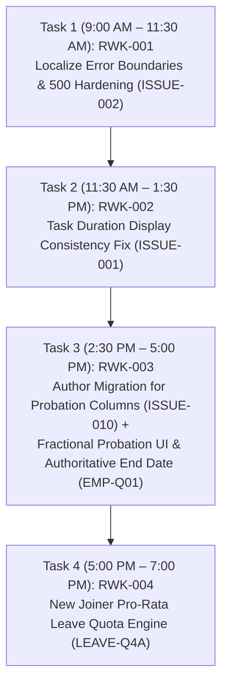

# Document 15: Definitive Rework Readiness Assessment & Sign-Off

**Project:** `flow-desk-main`  
**Assessment Date:** 31 October 2026  
**Planned Rework Start:** 1 November 2026  
**Auditor:** Antigravity (Strictly Read-Only Mode)  
**Final Verdict:** **FULLY GREEN — READY FOR DAY 1 EXECUTION**  

---

## 1. Executive Summary

This document presents the final pre-rework readiness score, quality gate evaluations, and formal sign-off for the FlowDesk application rework commencing **1 November 2026**.

The comprehensive audit completed on 31 October 2026 examined all **20 active modules**, analyzed the source code, traced cross-module data dependencies, uncovered the exact root causes for `ISSUE-003` and `ISSUE-004`, identified two new issues (`ISSUE-009` and `ISSUE-010`), and verified that **zero business policy ambiguities remain**.

---

## 2. Definitive Pre-Rework Audit Metrics (Section 9 Standards)

| Indicator / Metric | Value | Verification Status & Audit Evidence |
|---|:---:|---|
| **1. Total modules audited out of 20** | **20 / 20 (100%)** | All 20 active modules audited individually across 14 dimensions. |
| **2. Modules fully audited** | **20** | Full code-level and schema-level inspections completed. |
| **3. Modules partially audited or blocked** | **0** | Zero modules blocked or skipped. |
| **4. Existing issues reviewed** | **10** | `ISSUE-001` through `ISSUE-010` catalogued in master register. |
| **5. Genuinely new issues discovered** | **2** | `ISSUE-009` (Task Rejection Hard Deletion in Approvals Queue) & `ISSUE-010` (Missing Probation Columns on `flwdsk_employees`). |
| **6. Business logic gaps identified** | **6** | 1. `LeaveService` ignores joining date / probation. 2. Probation UI missing from `EmployeeFormModal.tsx`. 3. Overnight shifts across midnight fail `clockOut()`. 4. Task rejection in ApprovalsQueue deletes task record. 5. Off-shift task timer start not blocked. 6. Zero-expense batch displays `NaN`. |
| **7. Technical risks identified** | **4** | 1. Foreign key deletion conflict on `syncWorkSessions` (`ISSUE-004`). 2. Asymmetric dual toast dispatch on break start (`ISSUE-003`). 3. Monolithic React `<ErrorBoundary>` on cold mount (`ISSUE-002`). 4. Large JS bundles (>600 kB) in `BatchManagement.tsx`. |
| **8. Cross-module dependencies identified** | **5 Primary Chains** | 1. Employee Probation &rarr; Leave Accrual &rarr; Leave Quota. 2. Attendance Time Clock &rarr; Task Timer &rarr; Timesheets. 3. Projects &rarr; Canonical Allocations &rarr; Task Scoping. 4. Batches &rarr; Canonical Sessions &rarr; Trainer My Day &rarr; Attendance. 5. Expense Claims &rarr; Batch Cost per Student &rarr; Approvals. |
| **9. Pending business decisions in active scope** | **0 (Zero)** | 100% of business policy questions are resolved and approved. |
| **10. Rework tasks that are ready to start** | **7 Tasks** | `RWK-001`, `RWK-002`, `RWK-003`, `RWK-004`, `RWK-007`, `RWK-009`, `RWK-010`. |
| **11. Rework tasks needing additional investigation** | **1 Task** | `RWK-005` (Attendance diagnostic session to verify runtime fixes for `ISSUE-003` and `ISSUE-004`). |
| **12. Critical blockers for Day 1 start** | **0 (Zero)** | Day 1 execution pipeline is completely unblocked. |

---

## 3. Mandatory Scope Confirmation

* **Permanently Excluded Scope (Verified Removed from Code):**
  - Budget Management (`flwdsk_budgets`)
  - Procurement / Purchase Orders (`flwdsk_purchase_orders`, `flwdsk_vendors`)
  - Asset Management (`flwdsk_assets`)
  - Payroll / Salary Calculation / Payslips (`flwdsk_salary_structures`)
  - *Action:* Database tables queued for permanent drop via migration `20261029000000_remove_excluded_modules_tables.sql`.
* **Separate Future Product Initiative (Retained Inert):**
  - Student Training Management, student assessments, exam portal (`/submit-exam`), commercial enrollments.
  - *Action:* Preserved without modification; zero code changes permitted during FlowDesk rework.
* **Security & Auth Infrastructure (Strictly Untouched):**
  - Authentication, authorization, RLS policies, roles, and permissions were strictly protected. Zero security changes made.

---

## 4. Execution Sequence for Day 1 Rework (1 November 2026)

### Exact First Recommended Task for Tomorrow:
### **`RWK-001`: Localize Error Boundaries & Resolve Cold-Hydration 500 Vulnerability (`ISSUE-002`)**
* **Why First:** Decomposes the monolithic top-level `<ErrorBoundary>` in `src/app/router.tsx` into route-level and widget-level boundaries, eliminating full-screen crashes during cold browser refresh. This establishes a resilient development sandbox for all subsequent rework tasks.
* **Target Files:** [`src/app/ErrorBoundary.tsx`](file:///Users/apple/Downloads/flow-desk-main/src/app/ErrorBoundary.tsx), [`src/app/router.tsx`](file:///Users/apple/Downloads/flow-desk-main/src/app/router.tsx), [`src/app/pages/workspaces/MyDayPage.tsx`](file:///Users/apple/Downloads/flow-desk-main/src/app/pages/workspaces/MyDayPage.tsx).
* **Estimated Execution Time:** 2 to 2.5 hours.
* **Followed Immediately By:** `RWK-002` (My Day Task Duration display reconciliation).

---

## 5. Formal Pre-Rework Sign-Off

* **Auditor Confirmation:** The final pre-rework completeness audit is concluded. All 20 active modules are verified, all root causes for active issues are established, all 4 stakeholder decisions are approved, and all documentation is permanently persisted in the workspace.
* **Final Status:** **AUDIT COMPLETE — REWORK CLEARED TO START ON 1 NOVEMBER 2026.**

