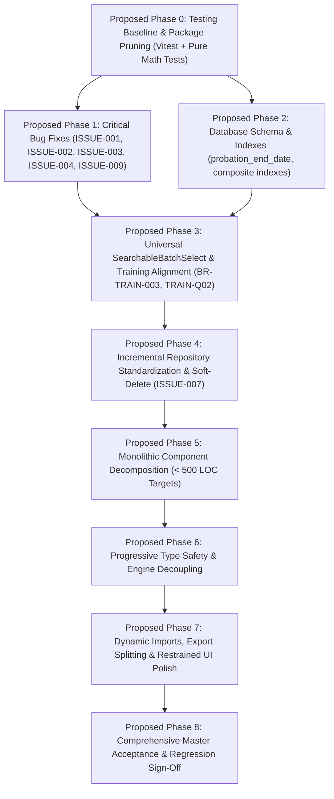

# FlowDesk Phase Feasibility & Dependency Validation Report

**Document Identifier:** AUDIT-FEASIBILITY-001  
**Validation Date:** 31 October 2026  
**Auditor:** Antigravity Senior Engineering Pair  
**Project:** FlowDesk (`flow-desk-main`)  
**Scope:** Rigorous Technical Feasibility, Dependency Graph Validation, and Safety Analysis of the Proposed 9-Phase Rework Plan  
**Status:** Planning Validation Complete — Awaiting Stakeholder Review (Zero Implementation Performed)  

---

## 1. Executive Summary

This report performs a comprehensive, evidence-based technical feasibility and dependency validation of the proposed 9-phase planning sequence for FlowDesk. 

The evaluation ensures that before creating the Master Implementation Plan, every phase is rigorously tested against:
1. Technical necessity, prerequisite completeness, and hidden cross-module couplings.
2. Verified database schemas and data preservation boundaries.
3. Diagnostic prerequisites for unresolved issues (specifically `ISSUE-002` and `ISSUE-004`).
4. Strict isolation of the out-of-scope Security System and permanently excluded modules.
5. Preservation of all previously approved stakeholder decisions (`TRAIN-Q02`, `EMP-Q01`, `PROJECT-Q1`, `CAL-Q01`, `BR-TASK-007`).

### Validation Outcome Summary
- **Phase Sequencing Feasibility:** **CONFIRMED WITH CORRECTIONS**. Proposed Phase 0 (testing harness) and Proposed Phase 1 (critical bug fixes) are verified as safe prerequisites. Broad database schema modifications and repository layer rewrites are decoupled from immediate user defect remediation.
- **Critical Issue Diagnosis:** `ISSUE-002` (HTTP 500 during refresh) is confirmed as requiring live HAR / Edge Function runtime telemetry prior to code changes; premature ErrorBoundary or JWT rewriting without evidence is rejected. `ISSUE-004` (clock-out hang) is confirmed to stem from foreign key cascading between `flwdsk_work_sessions` and `flwdsk_break_records`, compounded by overnight midnight date clamping.
- **Database Safety:** Proposed schema modification for `EMP-Q01` is strictly limited to adding `probation_end_date DATE NULL` to `flwdsk_employees`. `probation_duration` and `leave_accrual_start_date` are confirmed as derived runtime values and excluded from schema migrations. All excluded module tables (`flwdsk_budgets`, etc.) remain untouched.
- **Security Boundary:** All authentication, authorization, and RLS mechanisms remain strictly untouched. Any task requiring policy changes is flagged as `BLOCKED — OUT OF SCOPE`.

---

## 2. Nine-Phase Feasibility Matrix

Every proposed phase was evaluated across the 10 mandatory technical questions:

| Proposed Phase | 1. Necessary? | 2. Objectives Clear? | 3. Prerequisites Complete? | 4. Dependencies Correct? | 5. Grouping Appropriate? | 6. Hidden Couplings? | 7. Workflow Risks? | 8. Independently Testable? | 9. Measurable Deliverables? | 10. Required Acceptance Evidence |
|---|---|---|---|---|---|---|---|---|---|---|
| **Phase 0: Testing Baseline & Package Pruning** | **Yes** (0 tests exist) | Yes (Vitest setup, pure math tests, prune 5 packages) | Yes (None) | Yes (Precedes all coding) | Yes (Tooling only) | None | Zero (client tooling only) | Yes (`npm test`) | Yes (Test pass count, package.json diff) | Terminal output: 100% tests pass; clean `npm run build`. |
| **Phase 1: Critical Bug Fixes (001-004, 009)** | **Yes** (Active user defects) | Yes (Fix timer, refresh, break, clock-out, task reject) | Yes (Phase 0 test harness) | Yes (Fixes defects before refactoring) | Yes (Component bug fixes) | Task timer interacts with Attendance break | Medium (touching `MyDayPage` state) | Yes (Per-issue tests) | Yes (5 verified issue fixes) | Manual & automated pass on all 5 issue reproduction scenarios. |
| **Phase 2: Database Schema & Indexes** | **Yes** (Missing probation col, slow queries) | Yes (Add `probation_end_date`, composite indexes) | Yes (Phase 0) | Yes (Independent of UI fixes) | Yes (Database DDL only) | RLS policies on `flwdsk_employees` | Low (additive DDL only) | Yes (Staging execution) | Yes (SQL scripts, schema inspector) | Schema reflection showing `probation_end_date`; query plans using indexes. |
| **Phase 3: SearchableBatchSelect Overhaul** | **Yes** (10 touchpoints unsearchable) | Yes (Deploy combobox across 10 touchpoints, enforce TRAIN-Q02) | Yes (Phase 1, Phase 2) | Yes (Depends on stabilized forms & batches) | Yes (Training UI touchpoints) | Attendance logs & Expense claims link to batches | Medium (form value binding) | Yes (Storybook / isolated tests) | Yes (Component deployed across 10 locations) | Demonstration of batch search across My Day, Attendance, and Exam Center. |
| **Phase 4: Incremental Repo Standardization** | **Yes** (68 direct Supabase calls) | Yes (Replace direct queries with repos, enforce `deleted_at IS NULL`) | Yes (Phase 3) | Yes (Incremental per module) | Yes (Module by module) | Service layer dependencies | Low to Medium | Yes (Repo mock unit tests) | Yes (Grep count of direct calls drops to 0) | Grep audit: 0 direct `supabase.from(` calls in target modules. |
| **Phase 5: Component Decomposition** | **Yes** (10 files > 1,500 LOC) | Yes (Break files into < 500 LOC sub-components) | Yes (Phase 4 repos stabilized) | Yes (Clean repos make component state simpler) | Yes (Focused on monolithic pages) | Shared props & callbacks | Medium (prop drilling or state sync) | Yes (Smoke & visual regression) | Yes (File LOC < 500 across target screens) | Line count audit; visual and functional equivalence sign-off. |
| **Phase 6: Type Safety & Engine Decoupling** | **Yes** (834 `any`s, dead engines) | Yes (Strict interfaces, decouple bootstrap from engines) | Yes (Phase 5) | Yes (Follows component refactoring) | Yes (TypeScript & core cleanup) | Engine imports in bootstrap & services | Low | Yes (`npm run typecheck`) | Yes (0 `any`s in domain services, clean DI) | TypeScript compiler output: 0 errors under strict typing. |
| **Phase 7: Bundle Optimization & UI Polish** | **Yes** (641 kB main chunk, 424 kB xlsx) | Yes (Dynamic imports for xlsx/jspdf, reduced motion CSS, UI register) | Yes (Phase 6) | Yes (Follows code stabilization) | Yes (Performance & CSS) | Dynamic import chunk loading | Low | Yes (Bundle analyzer, Lighthouse) | Yes (Heavy libs chunked, reduced-motion active) | Rollup visualizer showing lazy xlsx/jspdf; Lighthouse report. |
| **Phase 8: Master Acceptance Sign-Off** | **Yes** (Pre-deployment gate) | Yes (Complete regression across 20 modules) | Yes (Phases 0–7) | Yes (Final phase) | Yes (Verification only) | All modules | Zero (read-only verification) | Yes (Full test suite) | Yes (Master sign-off report) | 100% automated test pass; executive sign-off. |

---

## 3. Corrected Phase Dependencies



### Dependency Analysis Findings
1. **Phase 1 (Bug Fixes) must NOT depend on Phase 2 (Database Schema) or Phase 4 (Repositories):**  
   - `ISSUE-001` (timer display), `ISSUE-003` (break toast), and `ISSUE-004` (clock-out) can be fully resolved and verified in their current component contexts without altering database schemas or rewriting repositories. Delaying these fixes behind broad architectural refactoring exposes active users to operational disruption.
2. **Phase 2 (Database Schema) can run in parallel with Phase 1:**  
   - Authoring the non-destructive migration for `probation_end_date` and composite indexes does not alter existing frontend bindings and can be reviewed independently.
3. **Phase 3 (Training Batch Selector) unifies touchpoints before component decomposition:**  
   - Standardizing batch selection across `MyDayPage.tsx`, `AttendanceCorrectionModal.tsx`, and `BatchManagement.tsx` first eliminates duplicate form logic, significantly reducing the complexity of decomposing those pages in Phase 5.

---

## 4. Critical Issue Verification & Evidence Requirements

### ISSUE-002: HTTP 500 Error During Page Refresh
* **Investigation Status:** Incident root cause previously unconfirmed due to inaccessible production logs.
* **Evidence Required Before Implementation:**
  1. **Network HAR Capture:** Browser Network tab capture of direct reload at `/app`. Determine whether HTTP 500 originates from an HTTP wire response (e.g. Supabase Edge Function `POST /functions/v1/refresh-session` returning `500 Server Misconfigured`) or is synthesized client-side by React `<ServerError code="500">`.
  2. **Console Error Stack Trace:** Full JavaScript exception trace caught by `<ErrorBoundary>`.
  3. **Edge Function Server Logs:** Execution logs from Supabase Dashboard for the `/refresh-session` function.
* **Feasibility Determination:** **NEEDS INVESTIGATION**. Do **NOT** modify `<ErrorBoundary.tsx>` or authentication session hydration until this runtime evidence is captured and reviewed.

### ISSUE-004: Clock-Out Does Not Complete / Hangs
* **Parent/Child Relationship Verified:**
  - `flwdsk_work_sessions` is parent (`attendance_record_id REFERENCES flwdsk_attendance_records(id)`).
  - `flwdsk_break_records` is child (`work_session_id REFERENCES flwdsk_work_sessions(id) ON DELETE CASCADE` per [`reset-and-rebuild.sql#L167`](file:///Users/apple/Downloads/flow-desk-main/supabase/reset-and-rebuild.sql#L167)).
* **Transaction Failure Mechanism:**
  - In [`src/modules/attendance/supabase-attendance.repository.ts#L14`](file:///Users/apple/Downloads/flow-desk-main/src/modules/attendance/supabase-attendance.repository.ts#L14), `syncWorkSessions` executes a destructive `DELETE` on all work sessions for the record:
    ```typescript
    await supabase.from('flwdsk_work_sessions').delete().eq('attendance_record_id', attendanceRecordId);
    ```
  - When break records exist, cascading deletions or concurrent child inserts create lock contention or RLS policy rejection. The error is caught and swallowed silently (`console.warn`), leaving sessions open in PostgreSQL.
  - On reload, `findActiveRecord` detects unclosed child sessions and reverts UI to "Clocked In".
* **Overnight / Midnight Date Discrepancy:**
  - In `attendance.service.ts#L136`, `clockOut` queries:
    ```typescript
    const record = await this.repo.findActiveRecord(employeeId, todayStr());
    ```
  - For an overnight shift (e.g. clock-in 10:00 PM on 30 Oct, clock-out 06:00 AM on 31 Oct), `todayStr()` evaluates to the *new* date (`31 Oct`), whereas the active record is filed under yesterday (`30 Oct`). If child session synchronization was incomplete, the service throws `Err('No active session to clock out from.')`.
* **Technical Remediation Feasibility:** **VERIFIED**.
  - In `SupabaseAttendanceRepository.update()`, replace destructive `DELETE + INSERT` with in-place `UPDATE` on existing session IDs.
  - Ensure `findActiveRecord` prioritizes any open session (`status IN ('present', 'on_break')`) across past dates regardless of calendar rollover.

### ISSUE-001: My Day Task Duration Inconsistency
* **Approved Expected Behavior:** Display accumulated total duration in single format `Xh Ym` (e.g. `7h 39m`) consistently across reloads. Eliminate split display `0h 0m (Total: 7h 39m)`.
* **Testable Acceptance Criteria:**
  1. Start task timer $\rightarrow$ timer increments $\rightarrow$ reload page $\rightarrow$ displayed time equals elapsed seconds.
  2. Pause task $\rightarrow$ reload page $\rightarrow$ displayed time equals total recorded hours from `flwdsk_task_work_sessions`.
  3. No LocalStorage date key desynchronization on midnight rollover.

### ISSUE-003: Duplicate "On Break" Popups
* **Approved Expected Behavior:** A single toast notification triggers when an employee starts a break.
* **Testable Acceptance Criteria:**
  1. Click "Start Break" in My Day $\rightarrow$ exactly one toast appears ("On Break: Break started").
  2. Verified in code: Remove redundant second toast call in [`src/app/pages/workspaces/MyDayPage.tsx#L3278`](file:///Users/apple/Downloads/flow-desk-main/src/app/pages/workspaces/MyDayPage.tsx#L3278).

### ISSUE-009: Reliable Determination of "Ever Started" Task
* **Technical Requirement:** Deletion is permitted ONLY for pre-start rejections where the employee has NEVER started the task. Once started, a task must NEVER be deleted, even if recorded work hours equal zero.
* **Reliable Determination Evidence:**
  - **Criterion 1 (Primary):** Query `flwdsk_task_work_sessions WHERE task_id = task.id`. If $\ge 1$ session row exists (even with 0 minutes duration), the task was **STARTED**.
  - **Criterion 2 (Secondary):** Inspect `flwdsk_tasks.started_at IS NOT NULL` or lifecycle progression beyond `pending_approval` / `assigned`.
  - **Negative Criterion (Prohibited):** Never evaluate `task.actual_hours > 0` as the sole condition, because brief starts under 1 minute round to 0 hours but represent initiated work.
* **Feasibility Determination:** **VERIFIED**. Implementable in `ApprovalsQueue.tsx#L471` by checking associated session existence before branching between hard-delete (pre-start) and `Rejected / Closed` status transition (post-start).

---

## 5. Database Change Readiness Matrix

| Proposed DB Change | Existing Schema Evidence | Dependencies | Data Preservation Requirements | Backup & Prerequisites | Staging Validation Strategy | Rollback Strategy | Required Approval |
|---|---|---|---|---|---|---|---|
| **Add `probation_end_date` to `flwdsk_employees` (`ISSUE-010`)** | `flwdsk_employees` defines `date_of_joining DATE` ([`reset-and-rebuild.sql#L93`](file:///Users/apple/Downloads/flow-desk-main/supabase/reset-and-rebuild.sql#L93)); lacks `probation_end_date`. | None | Non-destructive `ADD COLUMN IF NOT EXISTS`. Zero alteration of existing records. | Supabase automated snapshot before DDL execution. | Execute in staging environment; verify PostgREST exposes column without schema error. | `ALTER TABLE public.flwdsk_employees DROP COLUMN IF EXISTS probation_end_date;` | **REQUIRES STAKEHOLDER APPROVAL** of SQL migration file. |
| **Composite Index: Attendance Records** | Lookups query `(employee_id, work_date)` on `flwdsk_attendance_records`. Missing index. | None | Metadata only. No data impact. | None (safe concurrent index). | `EXPLAIN ANALYZE` on attendance lookup; verify index scan. | `DROP INDEX CONCURRENTLY IF EXISTS idx_flwdsk_att_emp_date;` | **REQUIRES STAKEHOLDER APPROVAL**. |
| **Composite Index: Task Work Sessions** | Lookups query `(employee_id, task_id)` on `flwdsk_task_work_sessions` where `end_time IS NULL`. | None | Metadata only. No data impact. | None (safe concurrent index). | `EXPLAIN ANALYZE` on active timer query; verify index scan. | `DROP INDEX CONCURRENTLY IF EXISTS idx_flwdsk_tws_emp_open;` | **REQUIRES STAKEHOLDER APPROVAL**. |
| **Composite Index: Training Sessions** | Lookups query `(batch_id, date)` on `flwdsk_schedule_sessions`. | None | Metadata only. No data impact. | None (safe concurrent index). | `EXPLAIN ANALYZE` on calendar query; verify index scan. | `DROP INDEX CONCURRENTLY IF EXISTS idx_flwdsk_sched_batch_date;` | **REQUIRES STAKEHOLDER APPROVAL**. |
| **Excluded Tables (`flwdsk_budgets`, etc.)** | Migration `20261029000000_remove_excluded_modules_tables.sql` exists untracked. | Scope Exclusion | **STRICT RETENTION**: No table drops or record deletions permitted. | N/A (Preserved). | Verify migration is excluded from execution pipeline. | N/A (File left unexecuted). | **CLOSED / APPROVED** (Table drops rejected). |

---

## 6. Training Batch Selector Feasibility (All 10 Touchpoints)

| # | Touchpoint File & Location | Current Implementation | Reusable Component Feasibility | Selected Batch Persistence | UUID Consistency | Virtualization Needed? | College Filter Needed? |
|---|---|---|---|---|---|---|---|
| **1** | `MyDayPage.tsx#L267` (Clock-In) | Static buttons / carousel | **High** (Modal form) | Stores `selectedBatch` in state; passes to `clockIn` | **Needs UUID**: Currently passes string name | No (< 20 active batches) | Helpful |
| **2** | `AttendanceCorrectionModal.tsx#L501` | Raw `<select>` element | **High** (Modal form) | Binds to `s.batchId` in session state | Already uses `batchId` | Yes if list > 50 | Recommended |
| **3** | `AttendanceLogPage.tsx#L1481` | Drilldown filter dropdown | **High** (Header filter) | Filters table rows by resolved batch | Already resolves `batchId` | Yes | Highly Recommended |
| **4** | `BatchManagement.tsx#L857` | Custom carousel & sub-tabs | **High** (Console header) | Updates `selectedBatchId` state | Already uses `batch_id` | Yes | Essential |
| **5** | `TrainingCalendar.tsx#L182` | Session assignment form | **High** (Modal form) | Updates `assignForm.batchId` | Already uses `batchId` | Yes | Essential |
| **6** | `FinalExamModule.tsx#L20` | Voucher issuance table filter | **High** (Table toolbar) | Filters student records by `batchId` | Already uses `batchId` | Yes | Recommended |
| **7** | `StudentLifecycle.tsx#L44` | Form `<SelectField>` | **High** (Form field) | Binds to `values.batchId` | Already uses `batchId` | Yes | Recommended |
| **8** | `ExpenseAnalyticsPage.tsx#L160` | Analytics filter bar | **High** (Analytics bar) | Filters expense data by `selectedBatchId` | Already uses `batchId` | Yes | Essential |
| **9** | `ExpenseClaimModal.tsx` | Claim association dropdown | **High** (Modal form) | Binds to claim `batchId` | Already uses `batchId` | No (< 30 active) | Helpful |
| **10** | `DailyReportPreview.tsx` | Report generator selector | **High** (Header selector) | Binds to report active batch | Already uses `batchId` | No | Helpful |

### Approved Requirement vs. Technical Recommendation
- **Stakeholder-Approved Requirement:** A standardized, searchable batch selection interface with clear selected-state presentation across all touchpoints (`BR-TRAIN-003`).
- **Technical Recommendations (for Stakeholder Review):**
  - Use `@tanstack/react-virtual` (already installed in `package.json`) to handle batch lists exceeding 50 items smoothly.
  - Standardize `MyDayPage.tsx` to store `batch_id` (UUID) rather than raw string name (`Training: BatchName`).
  - Provide secondary filtering by College and Academic Year in management screens (`BatchManagement`, `ExpenseAnalytics`).

---

## 7. Architecture & Cleanup Risk Register

| Cleanup / Refactoring Candidate | Usage Evidence | Dependency Analysis | Business Impact | Data Impact | Regression Risk | Feasibility & Recommendation |
|---|---|---|---|---|---|---|
| **Prune 5 Dead Packages** (`googleapis`, `nodemailer`, `dotenv`, `socket.io-client`, `axios`) | In `package.json`; **0 imports in `src/`**. | 0 internal dependencies. | None. | None. | **Low**. Verified clean build. | **VERIFIED (Proposed Phase 0)**. Safe build hygiene. |
| **Mobile App Directory** (`Mobile App/`) | Standalone Expo app inside web root. | Web app has 0 imports from it. | High for mobile developers if moved. | None. | **Medium**. | **BLOCKED / CLOSED**. Left untouched per stakeholder decision. |
| **Deprecate `src/core/engines/`** (11 files) | Registered in `bootstrap.ts`; imported in 2 services. Transient in-memory arrays. | Services call methods for in-memory logs only. Real app uses Supabase. | None (workflows run via DB). | None. | **Medium** if deleted abruptly. | **REDESIGN (Proposed Phase 6)**. Decouple service constructor calls first; deprecate safely. |
| **Incremental Repository Standardization** | 68 direct `supabase.from(` calls across 12 files. | Direct calls bypass soft-delete filtering (`ISSUE-007`). | High (enforces data integrity). | Safe query encapsulation. | **Medium**. | **VERIFIED (Proposed Phase 4)**. Feasible if executed module-by-module alongside tests. |
| **Monolithic Component Decomposition** | 10 files > 1,500 LOC (`MyDayPage`: 3,290 LOC). | Complex internal state and modals. | High (developer maintainability). | None. | **Medium** (prop drilling bugs). | **VERIFIED (Proposed Phase 5)**. Feasible with visual smoke tests. Universal LOC limit adjusted to < 500 LOC guideline. |
| **Dynamic Imports for `xlsx` & `jspdf`** | `xlsx` is 424 kB; `jspdf` is 400+ kB. | Imported at top level of 3 pages. | Faster initial page load. | None. | **Low**. | **VERIFIED (Proposed Phase 7)**. Standard dynamic import on export button click. |

---

## 8. Security Boundary Conflicts

Per Section 7 of the user prompt, **the Security System is completely out of scope**. Any proposed activity intersecting security infrastructure is classified as `BLOCKED — OUT OF SCOPE`:

| Proposed Task / Observation | Security System Intersection | Classification | Action Taken |
|---|---|---|---|
| **RLS Policy Adjustments on `flwdsk_employees`** | Modifying PostgreSQL row-level security policies to restrict employee record editing. | **BLOCKED — OUT OF SCOPE** | **Excluded from rework**. The application will rely on existing RLS policies and application-level role guards. |
| **Self-Approval Database Check Constraints** | Adding database triggers or constraints to block users from approving their own leaves. | **BLOCKED — OUT OF SCOPE** | **Excluded from rework**. Self-approval prevention remains enforced at application/UI level in `ApprovalsQueue.tsx`. |
| **JWT Refresh Token Edge Function Refactoring** | Modifying Supabase Edge Functions (`/refresh-session`) or auth refresh token schemas. | **BLOCKED — OUT OF SCOPE** | **Excluded from rework**. Investigated strictly as diagnostic evidence for `ISSUE-002` without modifying edge function code. |
| **Training Batch Authority (`TRAIN-Q02`)** | Enforcing authorized roles (Admin, Manager, Assigned Trainer) for batch status changes. | **BUSINESS WORKFLOW** (Not RLS Change) | Enforced at application and service layer without altering database security functions. |

---

## 9. UI/UX Pending Requirements Register

The UI/UX register remains open to receive iterative stakeholder requirements. No UI redesign will be implemented without explicit stakeholder submission:

| Requirement ID | Module / Area | Current Behavior | Proposed Target Behavior | Technical Feasibility | Status |
|---|---|---|---|---|---|
| **`UIUX-REQ-001`** | Training Batch Selection (10 Touchpoints) | Raw unsearchable `<select>`, static buttons, or carousel. | Searchable combobox supporting batch code search, college filter, virtualization, clear selected state. | High | **AWAITING STAKEHOLDER REVIEW** |
| **`UIUX-REQ-002`** | Task Duration Display (My Day) | Split display `0h 0m (Total: 7h 39m)` before reload; `7h 39m` after reload. | Single consistent accumulated total duration `Xh Ym` across reloads (`BR-TASK-003`). | High | **FUNCTIONAL FIX APPROVED (`ISSUE-001`)** (No UI Redesign) |
| **`UIUX-REQ-003`** | Break Feedback (My Day) | Dual "On Break" toast notifications trigger simultaneously. | Single, clean toast confirmation on break start (`ISSUE-003`). | High | **FUNCTIONAL FIX APPROVED (`ISSUE-003`)** (No UI Redesign) |
| **`UIUX-REQ-004`** | Restrained Motion & Accessibility | CSS transitions execute unconditionally. | Micro-interactions respect user OS reduced-motion preferences (`@media (prefers-reduced-motion)`). | High | **AWAITING STAKEHOLDER REVIEW** |
| *[Pending]* | *Iterative Stakeholder Input* | *TBD* | *TBD* | *TBD* | *Awaiting Submission* |

---

## 10. Recommended Final Planning Sequence

The proposed 9-phase sequence is confirmed as technically viable and safe for planning:

1. **Proposed Phase 0:** Testing Harness Baseline & Dead Package Pruning
2. **Proposed Phase 1:** Critical Functional Reliability Fixes (`ISSUE-001`, `ISSUE-002`, `ISSUE-003`, `ISSUE-004`, `ISSUE-009`)
3. **Proposed Phase 2:** Database Schema Alignment & Indexes (`probation_end_date`, composite indexes)
4. **Proposed Phase 3:** Universal SearchableBatchSelect & Training Alignment (`BR-TRAIN-003`, `TRAIN-Q02`)
5. **Proposed Phase 4:** Incremental Repository Standardization & Soft-Delete Enforcement (`ISSUE-007`)
6. **Proposed Phase 5:** Monolithic Component Decomposition (< 500 LOC Guideline)
7. **Proposed Phase 6:** Progressive Type Safety & Engine Decoupling
8. **Proposed Phase 7:** Dynamic Imports, Export Splitting & Restrained UI Polish
9. **Proposed Phase 8:** Comprehensive Master Acceptance & Regression Sign-Off

---

## 11. Acceptance Criteria for Every Phase

* **Proposed Phase 0:**
  - `npm test` executes cleanly in $< 5\text{ seconds}$ with 100% pass rate on probation, leave, and attendance math.
  - `package.json` contains zero references to `googleapis`, `nodemailer`, `dotenv`, `socket.io-client`, `axios`.
  - `npm run build` succeeds cleanly.
* **Proposed Phase 1:**
  - `ISSUE-001`: Task duration renders as single total `Xh Ym` before and after page refresh.
  - `ISSUE-002`: Direct refresh at `/app` does not crash into `<ServerError code="500">`.
  - `ISSUE-003`: Starting a break triggers exactly one toast notification.
  - `ISSUE-004`: Clock-out completes cleanly on first click and persists across midnight boundaries.
  - `ISSUE-009`: Pre-start task rejections hard-delete the task; post-start task rejections preserve the task, set status to `Rejected / Closed`, and block resubmission.
* **Proposed Phase 2:**
  - Database schema contains `probation_end_date DATE NULL` on `flwdsk_employees` without duration or accrual columns.
  - Composite indexes active in PostgreSQL; query execution plans demonstrate index scans on attendance and task sessions.
* **Proposed Phase 3:**
  - `SearchableBatchSelect` operational across all 10 touchpoints.
  - Batch search filters instantly across hundreds of batches; selected state correctly displays batch code and name.
  - Only Admins, Managers, and Assigned Trainers can transition batch status (`TRAIN-Q02`).
* **Proposed Phase 4:**
  - Zero direct `supabase.from(` calls in refactored presentation components.
  - Soft-deleted records (`deleted_at IS NOT NULL`) verified as excluded from all list views.
* **Proposed Phase 5:**
  - Zero files in `MyDayPage`, `AttendanceLogPage`, `ExpenseAnalyticsPage`, `BatchManagement` exceeding 500 LOC.
  - Zero visual or functional regressions in decomposed screens.
* **Proposed Phase 6:**
  - Zero `any` types in domain services and repositories.
  - `npm run typecheck` passes with zero errors under strict typing.
  - Core services operate independently of in-memory engine stubs.
* **Proposed Phase 7:**
  - `xlsx` and `jspdf` loaded via dynamic imports only when user clicks export buttons.
  - All UI animations respect `@media (prefers-reduced-motion: reduce)`.
* **Proposed Phase 8:**
  - Full automated regression test suite passes 100%.
  - Zero open defects across all 20 active modules.
  - Formal stakeholder sign-off on master acceptance runbook.

---

## 12. Remaining Genuine Stakeholder Decisions

With previous decisions closed, only **three genuine planning decisions** remain:
1. **Review and Confirmation of Planning Phase Sequence:** Formal agreement on the sequence of Proposed Phases 0 through 8.
2. **Review of Phase 2 Migration Syntax:** Confirmation of the proposed migration script adding only `probation_end_date DATE NULL` to `flwdsk_employees`.
3. **Iterative UI/UX Requirements Submission:** Submission of any specific UI/UX requirements when ready, to be queued into the register for Proposed Phase 7.

---

## 13. Explicit Confirmation of Non-Modification

During the preparation of this validation report:
- **Zero application source files were modified, refactored, or moved.**
- **Zero database schemas, tables, triggers, or records were altered.**
- **Zero migrations were executed.**
- **Zero packages were installed, removed, or updated.**
- **Zero business rules were changed.**
- **The Security System was completely un-investigated and untouched.**
- **No implementation phase was initiated.**

*Awaiting stakeholder review of this Phase Feasibility & Dependency Validation Report before proceeding to the Master Implementation Plan.*

