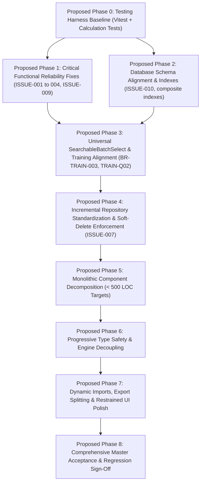

# FlowDesk Architecture Audit & Master Rework Cross-Check Report

**Document Identifier:** AUDIT-XCHECK-001  
**Version:** 2.0 (Corrected Post-Review Edition)  
**Audit Date:** 31 October 2026  
**Auditor:** Antigravity Senior Engineering Pair  
**Project:** FlowDesk (`flow-desk-main`)  
**Target Files Verified:** `docs/BUSINESS_RULES.md`, `docs/ARCHITECTURE.md`, `docs/DEVELOPMENT_STANDARDS.md`, `docs/DATABASE_DESIGN.md`, `docs/TESTING_STRATEGY.md`, `docs/MASTER_IMPLEMENTATION_ROADMAP.md`  
**Classification System:** `VERIFIED`, `CONFLICT`, `UNSUPPORTED`, `NEEDS INVESTIGATION`, `CLOSED / APPROVED`, `AWAITING STAKEHOLDER INPUT`, `OUT OF SCOPE`

---

## 1. Executive Summary

This cross-check report provides a corrected, evidence-based re-validation of the recently generated FlowDesk master documentation suite against previously approved stakeholder decisions, existing issue records, database definitions, and strict project scope exclusions.

### Core Directives & Clarifications Applied

1. **Closed Decisions Re-affirmed:**
   - **`TRAIN-Q02`:** Authorized roles for batch status transitions are strictly **Admins, Managers, and Assigned Trainers**. CEO is **not** included. Status: **CLOSED / APPROVED**.
   - **Excluded Modules:** Budget Management, Procurement, Asset Management, and Payroll remain excluded from the current rework. Their existing database tables and historical records are preserved intact. No table-drop migrations will be executed or introduced. Status: **CLOSED / APPROVED**.
   - **Mobile App:** The `Mobile App/` directory remains completely untouched during the web rework. No relocation or deletion is authorized. Status: **CLOSED / APPROVED**.
   - **Implementation Status:** Phase 0 and all implementation work remain strictly **unauthorized**. This activity is strictly for planning and documentation. Status: **CLOSED / APPROVED**.
2. **Corrected `EMP-Q01` / `ISSUE-010` Schema Scope:**
   - Schema verification confirms that `date_of_joining` (Joining Date) genuinely exists on `flwdsk_employees` as a `DATE` column ([`supabase/reset-and-rebuild.sql#L93`](file:///Users/apple/Downloads/flow-desk-main/supabase/reset-and-rebuild.sql#L93)).
   - `probation_end_date` is genuinely missing from both `reset-and-rebuild.sql` and all 41 migrations in `supabase/migrations/`.
   - The proposed schema migration will add **ONLY** `probation_end_date DATE NULL`.
   - `probation_duration` is calculated dynamically and will **not** be a stored database column.
   - `leave_accrual_start_date` is a derived runtime value (`probation_end_date + 1 day`) and will **not** be a stored database column.
3. **Corrected UI/UX Classifications:**
   - Defect fixes for `ISSUE-001` (Task Duration display) and `ISSUE-003` (Break popup deduplication) represent functional defect resolutions, not approvals of UI redesigns.
   - A dedicated UI/UX Requirements Register is maintained for future stakeholder submissions, with all new design items marked **AWAITING STAKEHOLDER INPUT**.
4. **Complete Proposed Planning Phase Sequence:**
   - A fully detailed proposed 9-phase planning sequence is established, defining objectives, prerequisites, activities, deliverables, risks, and approval checkpoints for every phase.

---

## 2. Master Document Verification

Each of the six newly created master documentation files in `flow-desk-main/docs/` was inspected in full:

| Document File | File Size | Actual Existence | Completeness | Agreement with Codebase | Conflict with Approved Decisions | Status & Required Action |
|---|---|---|---|---|---|---|
| [`docs/BUSINESS_RULES.md`](file:///Users/apple/Downloads/flow-desk-main/docs/BUSINESS_RULES.md) | 22,770 B | **VERIFIED** | High (All 20 Modules) | High | **CONFLICT**: Added CEO to `TRAIN-Q02`; added `(or Completed)` to `BR-TASK-007`; added `leave_accrual_start_date` to `EMP-Q01`. | **REQUIRES CORRECTION** to align with closed decisions before becoming authoritative. |
| [`docs/ARCHITECTURE.md`](file:///Users/apple/Downloads/flow-desk-main/docs/ARCHITECTURE.md) | 13,477 B | **VERIFIED** | High (Layering, LOC) | High (68 direct calls, 10 monolithic files confirmed) | Contains unverified operational assumptions (e.g. immediate engine deletion, mobile relocation). | **NEEDS ADJUSTMENT**: Downgrade rigid 400 LOC limit to guideline; leave Mobile App untouched; retain engines until dependency verification. |
| [`docs/DEVELOPMENT_STANDARDS.md`](file:///Users/apple/Downloads/flow-desk-main/docs/DEVELOPMENT_STANDARDS.md) | 7,367 B | **VERIFIED** | Moderate (Standards) | High (834 `any`s, IST date drift confirmed) | None directly with business rules. | **NEEDS ADJUSTMENT**: Zero-`any` target should be progressive per module rather than a blocking global mandate. |
| [`docs/DATABASE_DESIGN.md`](file:///Users/apple/Downloads/flow-desk-main/docs/DATABASE_DESIGN.md) | 8,802 B | **VERIFIED** | High (Table Inventory) | Moderate | **CONFLICT**: Proposed dropping excluded module tables; proposed unapproved `probation_duration` and `leave_accrual_start_date` columns. | **REQUIRES CORRECTION**: Remove table drops; restrict `flwdsk_employees` addition to `probation_end_date` only. |
| [`docs/TESTING_STRATEGY.md`](file:///Users/apple/Downloads/flow-desk-main/docs/TESTING_STRATEGY.md) | 5,667 B | **VERIFIED** | Moderate (Vitest) | High (0 tests confirmed) | None. | **NEEDS ADJUSTMENT**: Focus 100% coverage on pure domain math (probation, leave, attendance) before expanding to UI components. |
| [`docs/MASTER_IMPLEMENTATION_ROADMAP.md`](file:///Users/apple/Downloads/flow-desk-main/docs/MASTER_IMPLEMENTATION_ROADMAP.md) | 20,131 B | **VERIFIED** | High (15 attrs/phase) | Low to Moderate | **CONFLICT**: Sequence placed DB overhaul ahead of critical bug fixes; included table drops, mobile relocation, and CEO role. | **REQUIRES REDESIGN**: Aligned with the proposed planning sequence in Section 9 of this report. |

---

## 3. Approved Business Decisions — Closed Register

The following decisions have been previously reviewed, finalized, and approved by the stakeholder. They are formally recorded as **CLOSED** and require no further stakeholder confirmation:

### 1. Training Batch Lifecycle Authority (`TRAIN-Q02`) — CLOSED / APPROVED
- **Authorized Roles:** Only **Admins**, **Managers**, and **Assigned Trainers**.
- **Excluded Roles:** `CEO` is explicitly **NOT** included in batch status transitions.
- **Permitted Lifecycle:** `Scheduled` $\rightarrow$ `In Progress` $\rightarrow$ `Completed` $\rightarrow$ `Closed`.

### 2. Probation Storage & Calculation (`EMP-Q01`) — CLOSED / APPROVED
- **Authoritative Stored Value:** `probation_end_date` is the sole authoritative stored date.
- **Dynamic Calculation:** Probation Duration is calculated dynamically at runtime from `date_of_joining` and `probation_end_date`.
- **No Stored Duration:** `probation_duration` will **not** be stored as a database column.
- **No Stored Accrual Column:** `leave_accrual_start_date` is a derived runtime value (`probation_end_date + 1 day`), not a stored database column.
- **Display Integrity:** Display formatting (rounding to 1 decimal place `X.X months`) is purely presentational and must never modify the underlying stored End Date.

### 3. Project Membership Authority (`PROJECT-Q1`) — CLOSED / APPROVED
- **Canonical Table:** `flwdsk_resource_allocations` is the single source of truth for project team membership.
- **Preservation Policy:** `flwdsk_projects.member_ids` is preserved for backward compatibility and will not be deprecated without separate dependency review and approval.

### 4. Training Session Table Authority (`CAL-Q01`) — CLOSED / APPROVED
- **Canonical Operational Table:** `flwdsk_schedule_sessions` is the canonical operational table for training attendance, session scheduling, and tracking.
- **Preservation Policy:** All existing records in both `flwdsk_schedule_sessions` and `flwdsk_calendar_sessions` are preserved. Deprecation or schema consolidation will occur only after dependency review and approval. Current RLS and security policies remain intact.

### 5. Task Approval & Rejection Governance (`BR-TASK-007` / `ISSUE-009`) — CLOSED / APPROVED
- **Pre-Start Rejection:** If a supervisor rejects a task before work has ever started, hard-delete the Task record and associated rejection record. No rejection history retained.
- **Post-Start Rejection:** If work was ever started, the Task record must **NEVER** be deleted, even if recorded work hours equal zero.
- **Post-Start Status:** If approved, status transitions strictly to **`Approved`** (never `Completed`). If rejected, status transitions to **`Rejected / Closed`**.
- **Rejection Reason:** Optional, not mandatory.
- **Resubmission:** Rejected/Closed tasks cannot be resubmitted.

### 6. Task Start Independence — CLOSED / APPROVED
- An employee may start a task timer without an active attendance clock-in. Attendance login is not a prerequisite for task execution. No shift constraints apply.

### 7. Scope Exclusions & Table Preservation — CLOSED / APPROVED
- Budget Management, Procurement, Asset Management, and Payroll are excluded from the current rework.
- Existing database tables (`flwdsk_budgets`, `flwdsk_purchase_orders`, `flwdsk_vendors`, `flwdsk_assets`, `flwdsk_salary_structures`) and their historical data are **preserved intact**.
- Untracked migration `20261029000000_remove_excluded_modules_tables.sql` is flagged as conflicting with approved scope exclusions and must **not** be executed. The file is preserved as historical evidence without modification.

### 8. Mobile App Workspace Isolation — CLOSED / APPROVED
- The `Mobile App/` directory remains untouched inside the repository during web application rework. No relocation or deletion will be performed.

### 9. Implementation Authorization Status — CLOSED / APPROVED
- Phase 0 and all implementation tasks remain unauthorized. This stage is strictly for planning, architecture, standards, and documentation.

---

## 4. Corrected Schema Recommendation (`EMP-Q01` / `ISSUE-010`)

### Verification of Current Database State
A direct inspection of the database definitions in `supabase/reset-and-rebuild.sql` and the 41 migration files in `supabase/migrations/` confirms:
1. **Joining Date Exists:** `flwdsk_employees` already defines `date_of_joining DATE` ([`reset-and-rebuild.sql#L93`](file:///Users/apple/Downloads/flow-desk-main/supabase/reset-and-rebuild.sql#L93)).
2. **Probation End Date Missing:** Neither `probation_end_date` nor any probation-related column exists in `reset-and-rebuild.sql` or any migration file (`grep -rn "probation" supabase/migrations/` returns 0 results).
3. **Defect Confirmed (`ISSUE-010`):** The absence of `probation_end_date` prevents the application from storing the authoritative probation milestone approved under `EMP-Q01`.

### Corrected Proposed Schema Migration
The proposed migration for Phase 2 will add **ONLY** the single missing authoritative date column:

```sql
-- Proposed Migration: add_probation_end_date_to_employees.sql
-- Strictly adds the authoritative probation end date per approved decision EMP-Q01
ALTER TABLE public.flwdsk_employees 
  ADD COLUMN IF NOT EXISTS probation_end_date DATE NULL;

COMMENT ON COLUMN public.flwdsk_employees.probation_end_date IS 
  'Authoritative final day of employee probation period (EMP-Q01). Probation duration is calculated dynamically at runtime.';
```

*Note on Excluded Columns:*
- **`probation_duration` is NOT added as a stored column**, because duration is dynamically calculated from `date_of_joining` and `probation_end_date`.
- **`leave_accrual_start_date` is NOT added as a stored column**, because leave accrual eligibility begins on `probation_end_date + 1 day` as a runtime calculation rule (`BR-LEAVE-001`).

---

## 5. UI/UX Requirements Register & Approval Status

Defect fixes for `ISSUE-001` and `ISSUE-003` possess approved functional behaviors and technical root causes, but do **not** constitute approval for broad UI redesigns.

All UI/UX enhancements are maintained in a dedicated register awaiting iterative stakeholder submission:

| Requirement ID | Module / Area | Current Behavior | Target Behavior | Classification | Status |
|---|---|---|---|---|---|
| **`UIUX-REQ-001`** | Training Batch Selection (10 Touchpoints) | Raw unsearchable `<select>`, static buttons, or carousel. | Searchable combobox supporting batch code search, college filter, virtualization, clear selected state. | Proposed Enhancement | **AWAITING STAKEHOLDER REVIEW** |
| **`UIUX-REQ-002`** | Task Duration Display (My Day) | Split display `0h 0m (Total: 7h 39m)` before reload; `7h 39m` after reload. | Single consistent accumulated total duration `Xh Ym` across reloads. | Functional Defect Fix (`ISSUE-001`) | **FUNCTIONAL FIX APPROVED** (No UI Redesign) |
| **`UIUX-REQ-003`** | Break Feedback (My Day) | Dual "On Break" toast notifications trigger simultaneously. | Single, clean toast confirmation on break start. | Functional Defect Fix (`ISSUE-003`) | **FUNCTIONAL FIX APPROVED** (No UI Redesign) |
| **`UIUX-REQ-004`** | Restrained Motion & Accessibility | CSS transitions execute unconditionally. | Micro-interactions respect user OS reduced-motion preferences (`@media (prefers-reduced-motion)`). | Proposed Standard | **AWAITING STAKEHOLDER REVIEW** |
| *[Pending]* | *Iterative Stakeholder Input* | *TBD* | *TBD* | Future Submission | *Awaiting Submission* |

---

## 6. Critical Reassessment of the 15 Roadmap Recommendations

| Recommendation | Evidence & Assessment | Classification | Proposed Disposition |
|---|---|---|---|
| **1. Prune 5 Unused Packages** | `googleapis`, `nodemailer`, `dotenv`, `socket.io-client`, `axios` have 0 imports in `src/`. | Safe Prerequisite | **Retain in Proposed Phase 0**. Clean build review required. |
| **2. Relocate `Mobile App/`** | Independent Expo codebase inside web root. | Scope Out of Scope | **REJECTED (CLOSED)**. Left untouched per stakeholder decision. |
| **3. Remove `src/core/engines/`** | 11 files with transient in-memory arrays; stubs imported in `bootstrap.ts`. | Architecture Cleanup | **Redesign**: Decouple service imports first; deprecate rather than immediately delete. |
| **4. Archive `schema.sql` & Stale Audits** | Outdated root schema and stale August 2026 audit notes. | Evidence Preservation | **Retain As-Is**: Preserve historical audit trail; do not delete. |
| **5. Delete `graphify-out/`** | Static visualization build artifact. | Build Hygiene | **Defer**: Add to `.gitignore`; do not perform manual deletion now. |
| **6. Drop Excluded Module Tables** | Migration `20261029000000_remove_excluded_modules_tables.sql` exists. | Scope Violation | **REJECTED (CLOSED)**. Preserve tables and data intact. |
| **7. Sync Triggers for Project Members** | Redundancy between `resource_allocations` and `projects.member_ids`. | Data Integrity | **Redesign**: Prepare migration SQL for separate review; require approval before applying. |
| **8. Composite Database Indexes** | Missing indexes on attendance `(employee_id, work_date)` and task work sessions. | Performance | **Retain in Proposed Phase 2**. Review with staging query planner. |
| **9. Universal Repository Rewrite** | 68 direct `supabase.from(` calls across 12 modules. | Architecture | **Redesign**: Refactor incrementally module-by-module alongside bug fixes. |
| **10. Eliminate All 834 `any` Types** | 834 `any`s concentrated in 5 files (`ProjectList.tsx`: 97, `AttendanceLogPage.tsx`: 75). | Type Safety | **Redesign**: Prioritize domain models & calculation services; progressive UI typing. |
| **11. Split Monolithic Components** | 10 components exceed 1,500 LOC; `MyDayPage.tsx` is 3,290 LOC. | Maintainability | **Retain in Proposed Phase 5**. Decompose page-by-page with equivalence tests. |
| **12. Universal 400 LOC Limit** | Arbitrary hard cap proposed in `DOC-STD-001`. | Architecture Guideline | **Redesign**: Treat 400 LOC as an architectural guideline (< 500 LOC target). |
| **13. Universal 80% Test Coverage** | 0 tests exist; UI component testing requires heavy mocking. | Testing | **Redesign**: 100% coverage on pure domain math; defer broad UI coverage. |
| **14. Universal Lighthouse $\ge 90$** | Network and API dependent. | Performance Goal | **Defer / Benchmark First**: Measure baseline before setting hard gate. |
| **15. Initial Gzip Bundle $< 200\text{ kB}$** | Main chunk is 181 kB gzip; bloat caused by un-split `xlsx` (141 kB gzip). | Performance | **Retain (Revised Scope)**: Lazy-load `xlsx` and `jspdf` on export action only. |

---

## 7. Database and Data Preservation Risks

1. **Destructive Table Drops (`RISK: AVOIDED`):**
   - Untracked migration `20261029000000_remove_excluded_modules_tables.sql` is formally classified as conflicting with approved scope exclusions.
   - It will **not** be executed. The file is preserved as historical evidence without deletion or renaming.
2. **Probation Column Schema Migration (`RISK: LOW`):**
   - Adding `probation_end_date DATE NULL` via `ALTER TABLE ... ADD COLUMN IF NOT EXISTS` is non-destructive, does not alter existing data, and requires zero table locks.
3. **Training Session Data Continuity (`RISK: MANAGED`):**
   - `flwdsk_schedule_sessions` and `flwdsk_calendar_sessions` will both remain intact. No data consolidation will occur until a dedicated migration plan is approved.

---

## 8. Corrected Planning Dependencies

The dependency sequence has been restructured so that critical functional reliability issues are resolved immediately following the test harness baseline, without waiting for broad database or repository overhauls:



---

## 9. Complete Proposed Planning Phase Sequence

> [!NOTE]
> This is a **proposed planning sequence for review**, not an authorization of implementation. All implementation activities remain unauthorized until explicitly approved by the stakeholder.

---

### Proposed Phase 0: Testing Harness Baseline & Package Pruning

* **Objective:** Establish an automated testing safety net sharing existing Vite configuration so that subsequent bug fixes are protected against calculation regressions; prune 5 verified dead Node.js packages from `package.json`.
* **Prerequisites:** None (Baseline Phase).
* **Main Activities:**
  1. Add `vitest`, `@testing-library/react`, `happy-dom`, `@vitest/coverage-v8` to `devDependencies`.
  2. Configure `vitest.config.ts` and add `"test"` script to `package.json`.
  3. Prune dead dependencies with 0 imports: `googleapis`, `nodemailer`, `dotenv`, `socket.io-client`, `axios`.
  4. Author pure unit test suites for:
     - Probation forward/reverse calculation (`BR-EMP-002`).
     - Leave quota monthly accrual and mid-year pro-rata math (`BR-LEAVE-001`).
     - Attendance thresholds (late 09:45 AM, half-day 270 min, full-day 480 min) (`BR-ATT-003`).
* **Deliverables:**
  - Operational `npm test` command executing 3 core calculation test suites with 100% pass rate.
  - Cleaned `package.json` free of unused server dependencies.
* **Risks & Dependencies:** Very low risk. Tooling only. Rollback via git commit revert.
* **Approval Checkpoint:** Demonstration of clean test runner execution and successful `npm run build`.

---

### Proposed Phase 1: Critical Functional Reliability Fixes

* **Objective:** Resolve and verify high-priority user-facing operational defects (`ISSUE-001` through `ISSUE-004`, and `ISSUE-009`) in their current component contexts without blocking on broad architectural rewrites.
* **Prerequisites:** Proposed Phase 0 (test harness available to prevent calculation regressions).
* **Main Activities:**
  1. **`ISSUE-001` Fix:** Refactor `TaskWidget` duration rendering to display single total `Xh Ym`; remove split rendering and fix LocalStorage date reconciliation.
  2. **`ISSUE-002` Fix:** Add widget-level error boundaries; safeguard JWT refresh token initialization on direct page reload.
  3. **`ISSUE-003` Fix:** Eliminate redundant second toast call in `MyDayPage.tsx:3278` during break start.
  4. **`ISSUE-004` Fix:** Replace hard-deletion of `flwdsk_work_sessions` with soft-close on clock-out to prevent foreign key violations.
  5. **`ISSUE-009` Fix:** Refactor `ApprovalsQueue.tsx:472` to implement approved governance:
     - Pre-Start Rejection (never started): Hard-delete task & rejection record without history.
     - Post-Start Rejection (started, hours $\ge 0$): Transition status to `Rejected / Closed`, preserve all history and hours, make reason optional, block resubmission.
* **Deliverables:**
  - Verified fixes for all 5 issues with zero regressions in My Day, Task Board, and Approvals Queue.
  - Updates to `ISSUES_REGISTER.md` reflecting verified resolutions.
* **Risks & Dependencies:** Medium risk. Managed by isolating each issue fix in a distinct, independently testable commit.
* **Approval Checkpoint:** Formal operational demonstration of each bug fix to stakeholder.

---

### Proposed Phase 2: Database Schema Alignment & Performance Indexes

* **Objective:** Align the database schema with approved decisions by adding the missing `probation_end_date` to `flwdsk_employees` (`ISSUE-010`) and creating composite performance indexes on high-traffic tables.
* **Prerequisites:** Proposed Phase 0.
* **Main Activities:**
  1. Author versioned migration adding `probation_end_date DATE NULL` to `flwdsk_employees` (`EMP-Q01`).
  2. Author versioned migration creating composite indexes on:
     - `flwdsk_attendance_records(employee_id, work_date) WHERE deleted_at IS NULL`.
     - `flwdsk_task_work_sessions(employee_id, task_id) WHERE end_time IS NULL AND deleted_at IS NULL`.
     - `flwdsk_schedule_sessions(batch_id, date) WHERE deleted_at IS NULL`.
  3. Prepare staging verification script to test schema migration idempotency.
* **Deliverables:**
  - Non-destructive SQL migration script for `probation_end_date`.
  - Non-destructive SQL migration script for composite indexes.
* **Risks & Dependencies:** Low risk. Non-destructive schema additions. Rollback scripts prepared.
* **Approval Checkpoint:** Stakeholder review and authorization of SQL migration files prior to database execution.

---

### Proposed Phase 3: Universal SearchableBatchSelect & Training Touchpoint Alignment

* **Objective:** Create and integrate a high-performance `SearchableBatchSelect` component across all 10 application touchpoints (`BR-TRAIN-003`); enforce batch status transition authority (`TRAIN-Q02`).
* **Prerequisites:** Proposed Phase 1 (bug fixes stabilized) and Proposed Phase 2 (schema aligned).
* **Main Activities:**
  1. Develop `SearchableBatchSelect` in `src/shared/ui/` with batch code search, college filtering, and virtualization.
  2. Integrate component into My Day Clock-In, Attendance Correction, Batch Console, Calendar, Exam Center, Student Lifecycle, and Expense Claims.
  3. Enforce `TRAIN-Q02`: Restrict batch status transitions strictly to Admins, Managers, and Assigned Trainers.
* **Deliverables:**
  - Universal `SearchableBatchSelect` operational across all 10 touchpoints.
  - Enforced role permissions for training batch transitions.
* **Risks & Dependencies:** Low to Medium risk. Component replacement across multiple forms.
* **Approval Checkpoint:** Demonstration of batch selection across My Day, Attendance Log, and Exam Center.

---

### Proposed Phase 4: Incremental Repository Standardization & Soft-Delete Enforcement

* **Objective:** Incrementally replace direct `supabase.from(` calls with typed repository methods module-by-module, enforcing mandatory `deleted_at IS NULL` filtering (`ISSUE-007`).
* **Prerequisites:** Proposed Phase 3.
* **Main Activities:**
  1. Standardize base repository query builder in `src/shared/integration/supabase-repository.ts`.
  2. Refactor `ExpenseClaims.tsx` (11 calls) and `ExpenseClaimModal.tsx` (5 calls) to use `ExpenseRepository`.
  3. Refactor `AttendanceLogPage.tsx` (5 calls) and `useAttendance.ts` (2 calls) to use `AttendanceRepository`.
  4. Refactor `useTaskSessions.ts` to use `TaskWorkSessionRepository`.
  5. Refactor `FinalExamModule.tsx` (7 calls) to use `TrainingRepository`.
* **Deliverables:**
  - Elimination of direct database calls across primary active modules.
  - Universal soft-delete filtering verified by repository unit tests.
* **Risks & Dependencies:** Medium risk. Refactored module-by-module to prevent cross-module breakage.
* **Approval Checkpoint:** Audit verifying zero direct Supabase queries in refactored presentation components.

---

### Proposed Phase 5: Monolithic Component Decomposition

* **Objective:** Decompose massive single-file components exceeding 1,500 LOC into focused, maintainable presentational sub-components (< 500 LOC target).
* **Prerequisites:** Proposed Phase 4.
* **Main Activities:**
  1. Decompose `MyDayPage.tsx` (3,290 LOC) into header, attendance card, task timer section, worklog table, and modal containers.
  2. Decompose `AttendanceLogPage.tsx` (2,603 LOC) into filter bar, summary KPI cards, and session tables.
  3. Decompose `ExpenseAnalyticsPage.tsx` (2,737 LOC) into KPI panel, batch breakdown, and chart containers.
  4. Decompose `BatchManagement.tsx` (1,663 LOC) into dedicated tab containers.
* **Deliverables:**
  - Zero target component files exceeding 500 LOC.
  - Enhanced readability, memoization, and component testability.
* **Risks & Dependencies:** Medium risk. Managed via visual and functional equivalence verification.
* **Approval Checkpoint:** Code review and architectural walkthrough of decomposed page components.

---

### Proposed Phase 6: Progressive Type Safety & Engine Decoupling

* **Objective:** Systematically replace `any` types with explicit domain interfaces in core services; safely decouple application services from unused in-memory engines (`src/core/engines/`).
* **Prerequisites:** Proposed Phase 5.
* **Main Activities:**
  1. Replace `any` types across `ProjectList.tsx`, `AttendanceLogPage.tsx`, `training.service.ts`, `TaskBoard.tsx`.
  2. Decouple service constructor references to in-memory engines in `training.service.ts` and `project.service.ts`.
  3. Safely deprecate uncalled engine files in `src/core/engines/`.
  4. Update `tsconfig.json` to enable progressive type-checking.
* **Deliverables:**
  - Clean TypeScript compilation report with zero `any` types in domain services.
  - Streamlined core architecture decoupled from in-memory engine stubs.
* **Risks & Dependencies:** Low risk. Type-level changes verified by compiler.
* **Approval Checkpoint:** Clean `npm run typecheck` output presented for review.

---

### Proposed Phase 7: Dynamic Imports, Export Splitting & Restrained UI Polish

* **Objective:** Code-split heavy export libraries (`xlsx`, `jspdf`, `html2canvas`) so they load only on demand; implement `@media (prefers-reduced-motion)` accessibility styling; incorporate approved UI/UX requirements from the register.
* **Prerequisites:** Proposed Phase 6.
* **Main Activities:**
  1. Configure dynamic `import()` for `xlsx` and `jspdf` in export action handlers.
  2. Implement `@media (prefers-reduced-motion: reduce)` in `src/shared/ui/ui.css`.
  3. Integrate stakeholder-approved UI/UX enhancements from the Requirements Register.
* **Deliverables:**
  - Main bundle size reduced; heavy libraries excluded from initial page loads.
  - Accessible micro-interactions respecting user motion preferences.
* **Risks & Dependencies:** Low risk. Standard dynamic imports and CSS media queries.
* **Approval Checkpoint:** Bundle analyzer report demonstrating dynamic chunking.

---

### Proposed Phase 8: Comprehensive Master Acceptance & Regression Sign-Off

* **Objective:** Execute end-to-end regression testing across all 20 active modules against `docs/BUSINESS_RULES.md`; obtain formal stakeholder acceptance for production deployment.
* **Prerequisites:** Proposed Phases 0 through 7 complete.
* **Main Activities:**
  1. Execute full automated test suite (`npm test`).
  2. Perform comprehensive manual regression testing across all 20 active modules.
  3. Verify that issues `ISSUE-001` through `ISSUE-010` remain permanently resolved.
  4. Prepare deployment runbook and handover documentation.
* **Deliverables:**
  - 100% test pass report and zero open defects across active modules.
  - Master acceptance sign-off document.
* **Risks & Dependencies:** Low risk (staged environment release).
* **Approval Checkpoint:** Final Executive Sign-Off.

---

## 10. Remaining Genuine Stakeholder Decisions

Because all previous policy decisions (`TRAIN-Q02`, `EMP-Q01`, `PROJECT-Q1`, `CAL-Q01`, `BR-TASK-007`, Scope Exclusions, Mobile App, and Implementation Status) are **CLOSED**, only **three genuine planning decisions** remain for stakeholder consideration:

1. **Proposed Planning Phase Sequence:**  
   Review and confirm the revised 9-phase planning sequence (Phases 0 through 8), which prioritizes the test harness and critical bug fixes before database or repository rewrites.
2. **Review of Phase 2 Migration Syntax (`ISSUE-010`):**  
   Review the specific migration syntax to add `probation_end_date DATE NULL` to `flwdsk_employees` without adding duration or accrual columns.
3. **Iterative UI/UX Requirements Submission:**  
   Provide any specific UI/UX requirements for the register when ready, to be reviewed and scheduled into Proposed Phase 7.

---

## 11. Explicit Confirmation of Non-Modification

- **Zero application source files were modified, refactored, or moved.**
- **Zero database schemas, tables, triggers, or records were altered.**
- **Zero migrations were executed.**
- **Zero packages were installed, removed, or updated.**
- **Zero business rules were changed.**
- **The Security System was completely un-investigated and untouched.**
- **No implementation phase was initiated.**

The master cross-check report has been updated in the workspace at [`flow-desk-main/FINAL_PRE_REWORK_AUDIT/ROADMAP_CROSS_CHECK_REPORT.md`](file:///Users/apple/Downloads/flow-desk-main/FINAL_PRE_REWORK_AUDIT/ROADMAP_CROSS_CHECK_REPORT.md). Awaiting stakeholder review of the proposed planning sequence.
