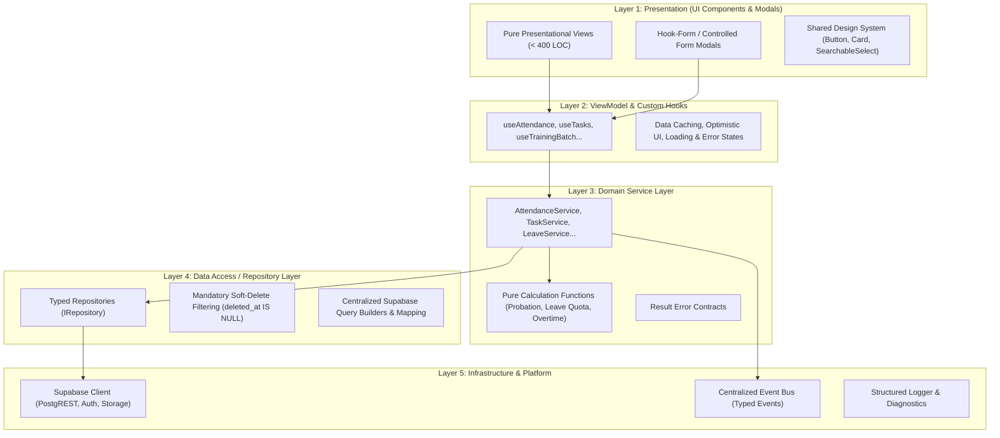

# FlowDesk Software Architecture Assessment & Target Specification

**Document Identifier:** DOC-ARCH-001  
**Version:** 2.0  
**Status:** Architecture Proposal & Baseline Audit  
**Effective Date:** 2026-10-31  
**Project:** FlowDesk (`flow-desk-main`)

---

## 1. Executive Summary & Architectural Evaluation

FlowDesk is a client-side Single Page Application (SPA) built with **React 19**, **Vite 7**, **TypeScript 5**, and **Tailwind CSS 4**, backed by **Supabase PostgreSQL** via PostgREST and Supabase Auth.

An exhaustive inspection of the codebase indicates that the application was generated incrementally through rapid prompting, resulting in a hybrid architectural state:
- A formally intended 4-tier modular architecture (`UI -> Service -> Repository -> Supabase`) was established in directory structures.
- **Architectural Erosion:** Over 68 direct `supabase.from(` database calls bypass the Service and Repository layers entirely, executing raw database queries directly inside React components and custom hooks.
- **Over-Abstraction:** An entire 11-engine dependency injection subsystem in `src/core/engines/` was scaffolded with in-memory array storage that is completely decoupled from real database persistence and largely uncalled by the active modules.
- **Monolithic Components:** Critical pages exceed 1,500 to 3,200 lines of code, conflating data fetching, local UI state, business validation, metric calculations, and modal rendering.

---

## 2. Current Architecture vs. Target Clean Architecture

### Current Architectural State (Anti-Pattern: Layer Leakage & Over-Abstraction)

```mermaid
flowchart TD
    subgraph UI_Layer["React UI & Page Layer (Monolithic: 1500 - 3300 LOC)"]
        MyDay["MyDayPage.tsx (3,290 LOC)"]
        AttLog["AttendanceLogPage.tsx (2,603 LOC)"]
        ExpPage["ExpenseAnalyticsPage.tsx (2,737 LOC)"]
        BatchMgmt["BatchManagement.tsx (1,663 LOC)"]
        DirectCalls["68 Direct supabase.from() Queries"]
    end

    subgraph Broken_Engines["Over-Engineered Core Engines (In-Memory Array Stubs)"]
        Engines["11 Engines: workflow, approval, activity, scheduler, audit, automation..."]
        Registry["DI Container (src/core/registry.ts)"]
    end

    subgraph Service_Repo["Partial Service & Repository Layer"]
        Services["attendance.service.ts, project.service.ts..."]
        Repos["supabase-attendance.repository.ts..."]
    end

    subgraph Database["Supabase PostgreSQL (44 Tables)"]
        DB["PostgREST API + Realtime + Storage"]
    end

    MyDay --> DirectCalls
    AttLog --> DirectCalls
    ExpPage --> DirectCalls
    DirectCalls --> DB
    
    MyDay -.-> Services
    Services --> Repos
    Repos --> DB
    
    Registry -.-> Engines
    Engines -.->|In-Memory Logs (Lost on Refresh)| Engines
```

### Key Architectural Weaknesses Identified

1. **Layer Leakage (Service/Repository Bypass):**
   - 68 direct calls to `supabase.from(` reside inside presentation files such as [`ExpenseClaims.tsx`](file:///Users/apple/Downloads/flow-desk-main/src/modules/finance/pages/ExpenseClaims.tsx) (11 calls), [`FinalExamModule.tsx`](file:///Users/apple/Downloads/flow-desk-main/src/modules/training/pages/FinalExamModule.tsx) (7 calls), [`AttendanceLogPage.tsx`](file:///Users/apple/Downloads/flow-desk-main/src/modules/attendance/pages/AttendanceLogPage.tsx) (5 calls), and custom hooks like [`useTaskSessions.ts`](file:///Users/apple/Downloads/flow-desk-main/src/modules/project/hooks/useTaskSessions.ts).
   - This bypasses domain validation, audits, and soft-delete filtering (`deleted_at IS NULL`), causing bugs such as `ISSUE-007`.

2. **Dead Abstraction Layer (`src/core/engines/`):**
   - 11 engine implementations: [`activity.ts`](file:///Users/apple/Downloads/flow-desk-main/src/core/engines/activity.ts), [`ai.ts`](file:///Users/apple/Downloads/flow-desk-main/src/core/engines/ai.ts), [`approval.ts`](file:///Users/apple/Downloads/flow-desk-main/src/core/engines/approval.ts), [`audit.ts`](file:///Users/apple/Downloads/flow-desk-main/src/core/engines/audit.ts), [`automation.ts`](file:///Users/apple/Downloads/flow-desk-main/src/core/engines/automation.ts), [`document.ts`](file:///Users/apple/Downloads/flow-desk-main/src/core/engines/document.ts), [`notification.ts`](file:///Users/apple/Downloads/flow-desk-main/src/core/engines/notification.ts), [`reporting.ts`](file:///Users/apple/Downloads/flow-desk-main/src/core/engines/reporting.ts), [`scheduler.ts`](file:///Users/apple/Downloads/flow-desk-main/src/core/engines/scheduler.ts), [`template.ts`](file:///Users/apple/Downloads/flow-desk-main/src/core/engines/template.ts), [`workflow.ts`](file:///Users/apple/Downloads/flow-desk-main/src/core/engines/workflow.ts).
   - These engines maintain in-memory JavaScript array state (`private logs: ActivityLog[] = []`) that is destroyed on page reload.
   - Core workflows (approvals, task state, notifications) execute via direct database rows or component state, ignoring these engines completely.

3. **Massive Monolithic Files:**
   - [`MyDayPage.tsx`](file:///Users/apple/Downloads/flow-desk-main/src/app/pages/workspaces/MyDayPage.tsx): 3,290 lines.
   - [`ExpenseAnalyticsPage.tsx`](file:///Users/apple/Downloads/flow-desk-main/src/modules/finance/pages/ExpenseAnalyticsPage.tsx): 2,737 lines.
   - [`training.service.ts`](file:///Users/apple/Downloads/flow-desk-main/src/modules/training/training.service.ts): 2,697 lines.
   - [`AttendanceLogPage.tsx`](file:///Users/apple/Downloads/flow-desk-main/src/modules/attendance/pages/AttendanceLogPage.tsx): 2,603 lines.
   - [`ChatChannels.tsx`](file:///Users/apple/Downloads/flow-desk-main/src/modules/communication/pages/ChatChannels.tsx): 2,205 lines.
   - [`ProjectList.tsx`](file:///Users/apple/Downloads/flow-desk-main/src/modules/project/pages/ProjectList.tsx): 1,884 lines.
   - [`TaskBoard.tsx`](file:///Users/apple/Downloads/flow-desk-main/src/modules/project/pages/TaskBoard.tsx): 1,786 lines.
   - [`BatchManagement.tsx`](file:///Users/apple/Downloads/flow-desk-main/src/modules/training/pages/BatchManagement.tsx): 1,663 lines.
   - [`ExpenseClaims.tsx`](file:///Users/apple/Downloads/flow-desk-main/src/modules/finance/pages/ExpenseClaims.tsx): 1,582 lines.
   - [`TrainingCalendar.tsx`](file:///Users/apple/Downloads/flow-desk-main/src/modules/training/pages/TrainingCalendar.tsx): 1,559 lines.

4. **Circular & Tangled Coupling:**
   - Cross-module dependencies are tangled: Attendance imports Training Batches; Projects imports Attendance work sessions; Training imports Employee profiles directly via SQL; Finance imports Training Batches via ad-hoc queries.

---

## 3. Recommended Target Architecture

FlowDesk will transition to a **Strict Layered Domain-Driven Architecture**:



### Architectural Principles of the Target State

1. **Strict Dependency Rule:** Dependencies point inward and downward only (`L1 -> L2 -> L3 -> L4 -> L5`). No layer may skip an intermediate tier.
2. **Zero Direct Supabase Queries in UI:** No React component or custom hook may call `supabase.from(` directly. All data access must flow through a typed Repository.
3. **Pure Business Logic Extraction:** Domain formulas (such as probation forward/reverse calculation, leave pro-rata, and attendance late evaluation) must reside in pure, testable TypeScript functions with 100% unit test coverage.
4. **Structured Error Handling:** All service methods must return `Promise<Result<T, AppError>>`, eliminating uncaught Promise rejections and mysterious blank screens.
5. **Component Granularity:** No presentation component may exceed 400 lines of code. Large screens must be decomposed into container/presentational sub-components.

---

## 4. Folder & File Structure Review

### Misplaced, Duplicate, and Obsolete File Candidates

| Path | Category | Usage Evidence | Risk of Removal | Proposed Action |
|---|---|---|---|---|
| `Mobile App/` | Foreign Codebase | Standalone React Native/Expo project sitting inside web root. | Low (independent app) | Relocate to separate mobile repository or workspace folder. |
| `KVJ analytics Logo.png`, `Teamz Logo.png`, `logo.png` | Loose Assets | Unreferenced root assets. Official logo is in `public/` and `src/assets/`. | Low | Consolidate into `src/assets/branding/`. |
| `schema.sql` (root) | Obsolete Schema | Historical static SQL file. Authoritative schema is in `supabase/`. | Low | Archive into `docs/archive/` or remove. |
| `src/core/engines/*` (11 files) | Unused In-Memory Stubs | Only imported in `bootstrap.ts` and stubbed services. | Medium | Deprecate in Phase 0; replace with real repositories. |
| `Audit_Report/` | Historical Documentation | Outdated audit notes from August 2026. | None | Move to `docs/archive/historical-audits/`. |
| `graphify-out/` | Generated Artifact | Build artifact from graph visualization. | None | Add to `.gitignore` and delete generated files. |

### Proposed Improved Directory Structure

```text
flow-desk-main/
├── docs/                             # Authoritative System Documentation
│   ├── BUSINESS_RULES.md             # Master Single Source of Truth
│   ├── ARCHITECTURE.md               # Software Architecture Specification
│   ├── DEVELOPMENT_STANDARDS.md      # Coding & Engineering Standards
│   ├── DATABASE_DESIGN.md            # Schema, Relationships & Migrations
│   ├── TESTING_STRATEGY.md           # Vitest Test Suites & Coverage Plan
│   └── MASTER_IMPLEMENTATION_ROADMAP.md # Phased Execution Plan
├── src/
│   ├── app/                          # Routing, Shell, Global Contexts
│   │   ├── providers/                # Theme, Auth, Toast Providers
│   │   ├── router/                   # React Router 7 Declarative Routes
│   │   └── AppShell.tsx              # Application Layout & Navigation
│   ├── core/                         # Core Types, Result Contracts, Errors
│   │   ├── errors/                   # AppError, Result<T, E>
│   │   ├── types/                    # Common Domain Primitives & Models
│   │   └── utils/                    # Pure Math & Formatting Utilities
│   ├── modules/                      # Feature Modules (Domain Encapsulation)
│   │   ├── attendance/               # Attendance & Clock-In Domain
│   │   │   ├── components/           # Sub-components (< 300 LOC)
│   │   │   ├── hooks/                # ViewModels (useAttendance)
│   │   │   ├── pages/                # Top-level Page Containers
│   │   │   ├── repositories/         # Supabase Attendance Repositories
│   │   │   └── services/             # Attendance Business Logic
│   │   ├── employee/                 # Employee Directory & Profiles
│   │   ├── finance/                  # Expense Claims & Analytics
│   │   ├── leave/                    # Leave Management & Accruals
│   │   ├── project/                  # Projects, Tasks & Work Sessions
│   │   └── training/                 # Batches, Courses, Exams, Calendar
│   ├── shared/                       # Cross-Cutting Infrastructure & UI Kit
│   │   ├── components/               # Buttons, Modals, Drawers, Tables
│   │   │   └── SearchableSelect/     # Universal Combobox Component
│   │   ├── date/                     # Centralized Local/UTC Date Utilities
│   │   └── supabase/                 # Supabase Client & Base Repository
│   └── tests/                        # Vitest Unit & Integration Suites
│       ├── business-rules/           # Formulas & Calculation Tests
│       ├── mocks/                    # Mock Repositories & Fixtures
│       └── services/                 # Service-Level Integration Tests
└── supabase/                         # Authoritative Migrations & RLS
    └── migrations/                   # Sequential Versioned SQL Migrations
```

