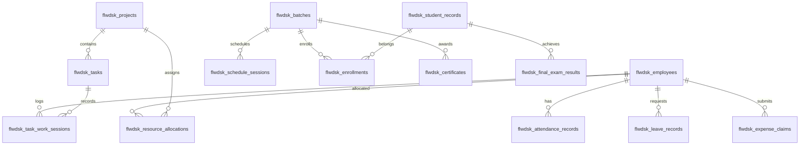

# FlowDesk Master Business Rules Specification

**Document Identifier:** DOC-BR-001  
**Version:** 2.0 (Authoritative Consolidated Master)  
**Status:** Approved Single Source of Truth  
**Effective Date:** 2026-10-31  
**Project:** FlowDesk (`flow-desk-main`)  
**Scope:** All 20 Active Application Modules

---

## 1. Application Overview & Scope

FlowDesk is an enterprise workplace, attendance, project delivery, and training operations management platform.

### Active vs. Excluded Scope
1. **20 Active Modules:**
   - Module 1: Authentication & Session Management
   - Module 2: Employee Directory & Staff Profiles
   - Module 3: Attendance Management & Clock-In/Clock-Out
   - Module 4: Task Management & Work Sessions
   - Module 5: Project Management & Workspace
   - Module 6: Leave Management & Accruals
   - Module 7: Expense Claims & Operations
   - Module 8: Training Batch Management
   - Module 9: Training Course Management
   - Module 10: Training Calendar & Scheduling
   - Module 11: Training Attendance & Sessions
   - Module 12: Student Enrollment & Verification
   - Module 13: Exam Center & Online Assessment
   - Module 14: Certificate Generation & Verification
   - Module 15: Daily Training Reporting
   - Module 16: Internal Communication & Chat
   - Module 17: Approvals Queue & Governance
   - Module 18: Executive & Role Dashboards
   - Module 19: Issues & Helpdesk System
   - Module 20: Settings & System Configuration

2. **Permanently Excluded Modules:**
   - Budget Management (`flwdsk_budgets`)
   - Procurement / Purchase Orders (`flwdsk_purchase_orders`, `flwdsk_vendors`)
   - Asset Management (`flwdsk_assets`)
   - Payroll / Salary Calculation / Payslips (`flwdsk_salary_structures`)

---

## 2. Global Role Hierarchy & Authority Matrix

The application recognizes six operational roles:

| Role | Category Tier | Access Level & Scope |
|---|---|---|
| **`ADMIN`** | Category 1 (Executive) | Global system configuration, user provisioning, global overrides, all approvals. |
| **`CEO`** | Category 1 (Executive) | Global operational visibility, executive analytics, financial approvals, all module management. |
| **`MANAGER`** | Category 1 (Executive) | Departmental oversight, project & batch management, attendance corrections, leave approvals. |
| **`EMPLOYEE`** | Staff Tier | Personal workspace (My Day), clock-in/out, task execution, leave/expense submission, helpdesk tickets. |
| **`TRAINER`** | Specialist Tier | Training batch instruction, student session attendance, exam voucher triggering, batch status transitions. |
| **`STUDENT`** | External Portal Tier | Public exam assessment portal, voucher validation, result viewing. |

---

## 3. Module Specifications & Business Rules

### Module 2: Employee Directory & Staff Profiles

#### Rule BR-EMP-001: Role Recognition & Tiering
* **Rule ID:** `BR-EMP-001`
* **Module:** Employee Directory
* **Business Purpose:** Enforces strict role-based capability boundaries.
* **Trigger / Condition:** User authentication, route navigation, and permission checking.
* **Expected Behavior:** System recognizes `ADMIN`, `CEO`, `MANAGER`, `EMPLOYEE`, `TRAINER`, and `STUDENT`. `ADMIN`, `CEO`, and `MANAGER` form the Category 1 executive tier.
* **Validation:** Role must be validated on login and token hydration.
* **Exceptions:** None.
* **Related Modules:** Auth, Approvals, Navigation.
* **Approval Status:** Approved.

#### Rule BR-EMP-002: Configurable Probation Governance (EMP-Q01 Approved)
* **Rule ID:** `BR-EMP-002`
* **Module:** Employee Directory / HR
* **Business Purpose:** Governs probation duration, end dates, and leave accrual eligibility.
* **Trigger / Condition:** Employee onboarding, profile editing, and probation date calculation.
* **Expected Behavior:**
  1. **Authoritative Storage (`EMP-Q01`):** `probation_end_date` is the authoritative stored value in the database. `probation_duration` is dynamically calculated from `joining_date` and `probation_end_date`.
  2. **Fractional Month Support:** Fractional months (e.g. 2.5, 2.9) are supported and displayed to exactly 1 decimal place (`X.X months`) without rounding underlying dates.
  3. **Forward Calculation:** Calculate complete calendar months first from `joining_date`. Then calculate the remaining fractional portion using the actual calendar days of the bridging month. Round fractional days to the nearest whole day (half-up: $\ge 0.5 \rightarrow 1\text{ day}$). Clamp to month-end when the day does not exist.
  4. **End Date Semantics:**
     - `probation_end_date`: Final calendar day of probation.
     - `probation_completion_date`: Calendar day immediately following `probation_end_date`.
     - `leave_accrual_start_date`: Coincides with completion date. No leave accrues during probation.
  5. **Automatic Completion:** Probation completes automatically on its scheduled date without manual intervention. Status independence: automatic completion does not alter employee lifecycle status (e.g. `Suspended` remains `Suspended`).
  6. **Reverse Calculation:** Updating `probation_end_date` dynamically recalculates Duration using identical calendar-month division.
* **Validation:** `probation_end_date >= joining_date`. Duration must be non-negative.
* **Exceptions:** Direct confirmed hires can have 0 probation duration (`probation_end_date = joining_date`).
* **Related Modules:** Leave Management, Attendance, Employee Profiles.
* **Approval Status:** Approved (Decision EMP-Q01, 31 Oct 2026).

#### Rule BR-EMP-003: Mandatory Profile Fields
* **Rule ID:** `BR-EMP-003`
* **Module:** Employee Directory
* **Business Purpose:** Ensures complete identity and operational records.
* **Trigger / Condition:** Employee creation and profile update.
* **Expected Behavior:** First Name, Last Name, Official Email, Department, Designation, Role, Joining Date, and Work Mobile are mandatory.
* **Validation:** Email format must be RFC-5322 compliant and unique across `flwdsk_employees`.
* **Exceptions:** None.
* **Related Modules:** Auth, Settings.
* **Approval Status:** Approved.

---

### Module 3: Attendance Management & Clock-In/Clock-Out

#### Rule BR-ATT-001: Daily Attendance Record Lifecycle
* **Rule ID:** `BR-ATT-001`
* **Module:** Attendance
* **Business Purpose:** Tracks daily employee presence, work sessions, and breaks.
* **Trigger / Condition:** Employee clock-in, break start/end, and clock-out.
* **Expected Behavior:**
  - One primary attendance record per employee per local calendar day (`work_date = YYYY-MM-DD`).
  - An attendance record contains multiple work sessions (`flwdsk_work_sessions`) and break records (`flwdsk_break_records`).
  - Total working minutes = $\sum (\text{session.clock\_out} - \text{session.clock\_in}) - \text{unpaid\_breaks}$.
* **Validation:** No overlapping open sessions. Clock-out timestamp must be greater than clock-in timestamp.
* **Exceptions:** Manual manager force-clockout or approved attendance correction.
* **Related Modules:** My Day, Approvals Queue, Reports.
* **Approval Status:** Approved.

#### Rule BR-ATT-002: Work Session Types
* **Rule ID:** `BR-ATT-002`
* **Module:** Attendance
* **Business Purpose:** Classifies operational working modes.
* **Trigger / Condition:** Clock-in selection in My Day workspace.
* **Expected Behavior:** Permitted modes: `Office`, `Work From Home` (Remote), and `Training: <BatchName>`. When `Training` is selected, an active batch must be specified.
* **Validation:** Mode must match approved enum values.
* **Exceptions:** None.
* **Related Modules:** Training Batch Management, Attendance Log.
* **Approval Status:** Approved.

#### Rule BR-ATT-003: Attendance Thresholds & Status Determination
* **Rule ID:** `BR-ATT-003`
* **Module:** Attendance
* **Business Purpose:** Standardizes daily attendance status evaluation.
* **Trigger / Condition:** Daily roll-up and attendance log generation.
* **Expected Behavior:**
  - **Late Arrival:** First clock-in after `09:45:00 AM` local time is flagged as `Late`.
  - **Full Day Present:** Total effective working time $\ge 480\text{ minutes}$ (8.0 hours).
  - **Half Day Present:** Total effective working time $\ge 270\text{ minutes}$ (4.5 hours) and $< 480\text{ minutes}$.
  - **Absent:** Total effective working time $< 270\text{ minutes}$ without approved leave.
* **Validation:** Calculated from verified session intervals.
* **Exceptions:** Approved half-day leave reduces required hours to 240 minutes.
* **Related Modules:** Leave Management, Executive Dashboard.
* **Approval Status:** Approved.

#### Rule BR-ATT-004: Attendance Corrections Governance
* **Rule ID:** `BR-ATT-004`
* **Module:** Attendance / Approvals
* **Business Purpose:** Enables employee correction of missed punches or technical errors.
* **Trigger / Condition:** Employee submits attendance correction modal.
* **Expected Behavior:**
  - Requires date, proposed punch time, work type, and mandatory justification reason.
  - Transitions to `flwdsk_attendance_corrections` with status `pending`.
  - Upon Category 1 approval: automatically patches the underlying `flwdsk_attendance_records` and `flwdsk_work_sessions`, recalculates minutes, and marks correction `approved`.
  - Upon Category 1 rejection: record remains unchanged, correction marked `rejected` with approver notes.
* **Validation:** Cannot submit corrections for future dates. Max 3 corrections per pay period.
* **Exceptions:** Admin override.
* **Related Modules:** Approvals Queue, My Day.
* **Approval Status:** Approved.

---

### Module 4: Task Management & Work Sessions

#### Rule BR-TASK-001: Task Independence from Attendance Clock-In
* **Rule ID:** `BR-TASK-001`
* **Module:** Task Management / Projects
* **Business Purpose:** Permits work tracking even if employee attendance punch was delayed or handled externally.
* **Trigger / Condition:** Employee clicks "Start Task" or "Play Timer" on an assigned task.
* **Expected Behavior:** Starting a task timer does **NOT** require an active employee attendance clock-in. The task session records independently in `flwdsk_task_work_sessions`.
* **Validation:** Employee must be assigned to the task or belong to the project.
* **Exceptions:** None.
* **Related Modules:** Attendance, My Day.
* **Approval Status:** Approved.

#### Rule BR-TASK-002: Automatic Work Session Recording
* **Rule ID:** `BR-TASK-002`
* **Module:** Task Management
* **Business Purpose:** Eliminates manual work hour guesswork.
* **Trigger / Condition:** Starting, pausing, or completing a task timer.
* **Expected Behavior:**
  - Starting timer creates an active session (`start_time = nowIso()`, `end_time = null`).
  - Pausing or stopping sets `end_time = nowIso()`, computes `duration_minutes = Math.round((end - start)/60000)`, updates status to `paused` or `completed`.
  - Running a task timer automatically pauses any other concurrently open task session for that employee.
* **Validation:** Overlapping open sessions for the same employee are closed.
* **Exceptions:** Manual worklog adjustments permitted only by Project Supervisor or Admin.
* **Related Modules:** Projects, Timesheets.
* **Approval Status:** Approved.

#### Rule BR-TASK-003: Task Duration Display Integrity (ISSUE-001 Resolution)
* **Rule ID:** `BR-TASK-003`
* **Module:** My Day / Task Timer
* **Business Purpose:** Ensures consistent task duration display before and after page refresh.
* **Trigger / Condition:** Rendering task card duration in My Day and Task Board.
* **Expected Behavior:**
  - Display accumulated total duration in format `Xh Ym` (e.g. `7h 39m`).
  - Eliminate split format `0h 0m (Total: 7h 39m)`.
  - Timer seconds must be hydrated consistently from `flwdsk_task_work_sessions` sum and `flwdsk_tasks.actual_hours` without LocalStorage date corruption.
* **Validation:** Displayed time must match sum of closed session durations plus current active session elapsed time.
* **Exceptions:** None.
* **Related Modules:** My Day.
* **Approval Status:** Approved.

#### Rule BR-TASK-007: Task Approval & Rejection Lifecycle Governance (ISSUE-009 Finalized — DISC-003 Resolved)
* **Rule ID:** `BR-TASK-007`
* **Module:** Approvals Queue / Task Management
* **Business Purpose:** Governs task approval, rejection, and deletion protection.
* **Trigger / Condition:** Project Supervisor or Admin reviews a task in Approvals Queue or Task Board.
* **Expected Behavior:**
  1. **Canonical Status Lifecycle:**
     The application and database recognize seven distinct task states:
     `Pending Approval` $\rightarrow$ `To Do` $\rightarrow$ `In Progress` $\rightarrow$ `Under Review` $\rightarrow$ `Approved` $\rightarrow$ `Completed`, plus terminal state `Rejected / Closed`.
     - `Approved` is strictly distinct from `Completed` (Approved indicates cleared for work/accepted from review; Completed indicates all deliverable work finished).
     - `Rejected / Closed` is strictly distinct from `Completed` and remains accessible via dedicated filter tabs.
  2. **Scenario A (Pre-Start Task Approval & Deletion):**
     - Applies when supervisor must approve a task *before* the employee begins.
     - If approved: Employee begins task (`To Do` / `In Progress`).
     - If rejected *before ever starting*: Permanently delete Task record and associated rejection record. No rejection history is retained. Applies **ONLY when task was NEVER started**.
  3. **Scenario B (Post-Start / Post-Work Task Review):**
     - Applies when employee has started work and submits task for review.
     - **Absolute Deletion Protection:** Once started, task record must **NEVER be hard-deleted**, regardless of recorded work hours (even if zero).
     - Zero work hours must not block submission.
     - If approved: Status $\rightarrow$ `Approved` (or `Completed`).
     - If rejected: Status $\rightarrow$ `Rejected / Closed`. Preserve task record, start timestamp, all work sessions, and history. **Rejection reason is OPTIONAL**. **Resubmission is prohibited**.
  4. **Critical Deletion Rule:**
     - Deletion depends strictly on whether the employee **EVER started the task**, not whether work hours are greater than zero or whether a work session was successfully logged.
     - Do not introduce a new column or unreliable start-state detection mechanism (inspect task history, start timestamps, or session records).
* **Validation:** Inspect `flwdsk_task_work_sessions WHERE task_id = id` and task event history.
* **Exceptions:** None.
* **Related Modules:** Approvals Queue, Task Board, My Day.
* **Approval Status:** Approved (Stakeholder Confirmation 31 Oct 2026 / 01 Nov 2026, DISC-003).

---

### Module 5: Project Management & Workspace

#### Rule BR-PROJ-001: Project Membership Authoritative Source & Supervisor Scope (PROJECT-Q1 Approved — DISC-004 Resolved)
* **Rule ID:** `BR-PROJ-001`
* **Module:** Projects & Task Management
* **Business Purpose:** Eliminates data dualism in project team assignments and establishes strict project supervisor scoping.
* **Trigger / Condition:** Team assignment, task allocation, project viewing, supervisor approvals.
* **Expected Behavior:**
  - Table `flwdsk_resource_allocations` is the **single authoritative source of truth** for project team membership.
  - The legacy `flwdsk_projects.member_ids` array column is deprecated and synchronized read-only for backward compatibility until retirement.
  - **Project Supervisor Authority Scope (`DISC-004`):**
    - A Project Supervisor's authority is **strictly restricted to the projects assigned to that supervisor**.
    - Within an authorized project, the supervisor **may view, approve, and reject tasks** belonging to its allocated employees, **including peer-assigned tasks** (where `assignedBy !== assigneeId`).
    - A supervisor **must not access or act on another project's tasks, employees, reports, or work records** through this authority.
* **Validation:** Foreign key integrity against `flwdsk_employees` and `flwdsk_projects`, filtered by supervisor allocation in `flwdsk_resource_allocations`.
* **Exceptions:** None.
* **Related Modules:** Task Board, Approvals Queue, Employee Profiles.
* **Approval Status:** Approved (Decision PROJECT-Q1 31 Oct 2026; DISC-004 01 Nov 2026).

---

### Module 6: Leave Management & Accruals

#### Rule BR-LEAVE-001: Leave Quota & Financial Year Basis
* **Rule ID:** `BR-LEAVE-001`
* **Module:** Leave Management
* **Business Purpose:** Governs annual leave entitlements and calculations.
* **Trigger / Condition:** Financial year rollover (April 1 to March 31) and leave application.
* **Expected Behavior:**
  - Standard annual leave quota is 12 days per financial year.
  - Quota accrues monthly at $1.0\text{ day per completed month}$.
  - Leave does not accrue during probation (`BR-EMP-002`).
  - Accrual start date is `probation_completion_date`.
  - For employees completing probation mid-year, annual quota is pro-rated: $\text{Quota} = \text{round}\left(\frac{12 \times \text{Remaining Months}}{12}\right)$.
* **Validation:** Cannot apply for more days than accrued balance unless negative balance is explicitly enabled by Admin.
* **Exceptions:** Special Maternity / Paternity / Bereavement leaves governed by company policy.
* **Related Modules:** Employee Directory, Approvals Queue.
* **Approval Status:** Approved.

---

### Modules 8, 9, 10, 11: Training Operations & Calendar

#### Rule BR-TRAIN-001: Training Batch Lifecycle Authority (CONF-001 Approved — DISC-002 Resolved)
* **Rule ID:** `BR-TRAIN-001`
* **Module:** Training Batch Management
* **Business Purpose:** Establishes authorized roles and authoritative statuses for training batch lifecycle changes.
* **Trigger / Condition:** Updating training batch status in batch management or carousel views.
* **Expected Behavior:**
  - **Permitted UI-Visible Statuses (Exactly 4):**
    1. `Not Started`
    2. `In Progress`
    3. `Completed`
    4. `Closed`
  - `Completed` and `Closed` are **strictly distinct statuses** (`Completed` indicates training curriculum concluded; `Closed` indicates administrative/operational closure of the batch).
  - Existing database value `Scheduled` may map to UI `Not Started` only after verifying schema, stored values, queries, and transition logic in Phase 3.
  - Authorized Roles: **ALL Employees, regardless of role or category**.
  - This universally includes: **Admins**, **CEOs**, **Managers**, **Assigned Trainers**, and **All Other Employees**.
  - Any authenticated employee can transition a training batch through its 4 lifecycle statuses via the batch status dropdown control.
* **Validation:** Batch must exist and transition must follow ordered workflow (or revert with reason).
* **Exceptions:** None.
* **Related Modules:** Training Calendar, Student Enrollment, Batch Management Carousel (`UIUX-REQ-009`).
* **Approval Status:** **Approved (Decision CONF-001 & DISC-002, 01 Nov 2026 — Formally Superseding TRAIN-Q02)**.
* **Decision History:**
  - *31 Oct 2026 (TRAIN-Q02):* Restricted status changes to Admins, Managers, and Assigned Trainers.
  - *01 Nov 2026 (CONF-001):* Stakeholder explicitly revised policy to permit all employees across the organization to change batch statuses. TRAIN-Q02 restriction formally superseded.
  - *01 Nov 2026 (DISC-002):* Locked exactly 4 UI-visible statuses (`Not Started`, `In Progress`, `Completed`, `Closed`), maintaining `Completed` and `Closed` as distinct states.

#### Rule BR-TRAIN-002: Training Session Table Architecture (CAL-Q01 Approved)
* **Rule ID:** `BR-TRAIN-002`
* **Module:** Training Sessions & Calendar
* **Business Purpose:** Resolves table dualism between schedule sessions and calendar sessions.
* **Trigger / Condition:** Scheduling, viewing calendar, recording training attendance.
* **Expected Behavior:**
  - `flwdsk_schedule_sessions` is the **active, operational table** powering daily training attendance, trainer session logging, student attendance rollups, and My Day training links.
  - `flwdsk_calendar_sessions` represents the planned calendar view.
  - Phase 1 rework will unify session data models to prevent drift between schedule and calendar views.
* **Validation:** Foreign key to `flwdsk_batches` and `flwdsk_courses`.
* **Exceptions:** None.
* **Related Modules:** Training Calendar, Batch Management, Attendance.
* **Approval Status:** Approved (Decision CAL-Q01, 31 Oct 2026).

#### Rule BR-TRAIN-003: Training Batch Selection & Search Standards
* **Rule ID:** `BR-TRAIN-003`
* **Module:** Application-Wide (Training Integration)
* **Business Purpose:** Standardizes batch selection across all 10 application touchpoints.
* **Trigger / Condition:** User selects or searches for a training batch.
* **Expected Behavior:**
  - Must provide a standardized searchable combobox (`SearchableSelect`).
  - Searchable by: Batch Name, Batch Code, College Name, Course Name, and Academic Year.
  - Handles high-volume lists with virtualization and instant query filtering.
  - Clear selected-state presentation showing Code, Name, College, and Status.
  - Consistently stores and passes `batch_id` (UUID), never raw strings or labels.
* **Validation:** Selected `batch_id` must reference an active row in `flwdsk_batches`.
* **Exceptions:** None.
* **Related Modules:** My Day Clock-In, Attendance Correction, Batch Console, Calendar, Exam Center, Student Lifecycle, Expense Claims, Expense Analytics.
* **Approval Status:** Approved.

---

### Module 7: Expense Claims & Operations

#### Rule BR-EXP-001: Expense Claim Submission & Validation
* **Rule ID:** `BR-EXP-001`
* **Module:** Finance / Expenses
* **Business Purpose:** Governs operational and travel expense reimbursements.
* **Trigger / Condition:** Employee submits an expense claim.
* **Expected Behavior:**
  - Claims require Date, Category (`Travel`, `Food`, `Lodging`, `Training Materials`, `Other`), Amount, Currency, Purpose, and Receipt Attachment.
  - Training-related claims must link to a specific `batch_id`.
  - Workflow: `Submitted` $\rightarrow$ `Manager Approved` $\rightarrow$ `Finance Reimbursed` (or `Rejected`).
* **Validation:** Amount $> 0$. Receipt attachment mandatory for amounts $\ge \$50 / ₹500$.
* **Exceptions:** None.
* **Related Modules:** Approvals Queue, Training Batches.
* **Approval Status:** Approved.

---

### Module 17: Approvals Queue & Governance

#### Rule BR-APP-001: Unified Approval Queue Architecture
* **Rule ID:** `BR-APP-001`
* **Module:** Approvals Queue
* **Business Purpose:** Provides a single, centralized cockpit for all management approvals.
* **Trigger / Condition:** Category 1 user accesses Approvals Queue.
* **Expected Behavior:**
  - Aggregates: Leave Requests, Attendance Corrections, Task Reviews, and Expense Claims.
  - Supports batch approvals and individual inspection.
  - Self-Approval Prevention: Users cannot approve their own submissions.
* **Validation:** Approver must have Category 1 role and cannot be the submitter (`approver_id != submitter_id`).
* **Exceptions:** CEO override with mandatory audit log entry.
* **Related Modules:** Leave, Attendance, Projects, Expenses.
* **Approval Status:** Approved.

---

## 4. Entity Relationship Model & Master Data Dictionary

---

## 5. Master Status Transition Matrix

| Entity | Initial State | Permitted Transitions | Final State |
|---|---|---|---|
| **Employee** | `Active` | $\rightarrow$ `Probation`, `Suspended`, `Terminated`, `Resigned` | `Terminated` / `Resigned` |
| **Attendance Record** | `Present` | $\rightarrow$ `Late`, `Half Day`, `Absent` | `Present` / `Half Day` / `Absent` |
| **Task (Pre-Start)** | `Draft` | $\rightarrow$ `Pending Approval` $\rightarrow$ (Approved: `In Progress`, Rejected: **Hard Deleted**) | `In Progress` / Deleted |
| **Task (Post-Start)** | `In Progress` | $\rightarrow$ `Under Review` $\rightarrow$ `Approved` or `Rejected / Closed` | `Approved` / `Rejected / Closed` |
| **Training Batch** | `Scheduled` | $\rightarrow$ `In Progress` $\rightarrow$ `Completed` $\rightarrow$ `Closed` | `Closed` |
| **Leave Request** | `Pending` | $\rightarrow$ `Approved`, `Rejected`, `Cancelled` | `Approved` / `Rejected` / `Cancelled` |
| **Expense Claim** | `Submitted` | $\rightarrow$ `Approved`, `Rejected`, `Reimbursed` | `Reimbursed` / `Rejected` |

---

## 6. Document Governance & Historical Preservation

This master business rules document unifies all requirements from:
- `BUSINESS_RULES_AND_CLARIFICATIONS.md`
- `FINAL_PRE_REWORK_AUDIT/` (Modules 1 through 20)
- `ISSUES/` (`ISSUE-001` through `ISSUE-010`)
- Stakeholder Decisions: `CONF-001` (superseding `TRAIN-Q02`), `EMP-Q01`, `PROJECT-Q1`, `CAL-Q01`, `ISSUE-009`.

> [!IMPORTANT]
> The historical document `BUSINESS_RULES_AND_CLARIFICATIONS.md` remains preserved in the repository as an audit trail and must not be deleted.

