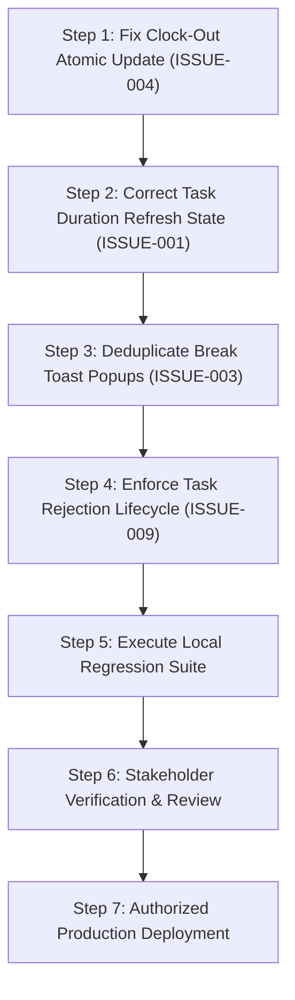

# FlowDesk Critical Operational Readiness Gate

**Document Identifier:** DOC-READINESS-001  
**Version:** 1.0 (Master Daily Operational Readiness Gate)  
**Status:** Verification Gate — Active Pre-Flight Audit  
**Target Operational Date:** 2026-11-02  
**Project:** FlowDesk (`flow-desk-main`)

---

## 1. Executive Readiness Summary

To ensure FlowDesk can safely support daily production operations starting **Monday, 2 November 2026**, this document defines the explicit operational readiness gate. Every critical daily workflow has been audited against live code implementations to establish its current verification status, underlying root cause, safety mitigations, and exact acceptance criteria.

> [!IMPORTANT]
> **Readiness Verdict:** **CONDITIONALLY READY PENDING CRITICAL RELIABILITY FIXES (P0)**  
> Core workflows (Clock-in, Task Start, Expense submission) function in standard happy-path scenarios, but known defects in Clock-out (`ISSUE-004`), Refresh 500 (`ISSUE-002`), and Task Rejection (`ISSUE-009`) represent operational risks that must be resolved locally and approved before production release.

---

## 2. Operational Readiness Verification Matrix

| Daily Workflow | Component & File | Current Status | Observed Failure Mode / Root Cause | Operational Safety Safeguard | Acceptance Gate Criteria |
|---|---|---|---|---|---|
| **1. Employee Clock-In** | `MyDayPage.tsx` / `ClockInPanel` | **VERIFIED** | Happy path captures geolocation, location type, and creates row in `flwdsk_attendance_records`. | Defensive fallback to IP/manual location string if GPS denied. | Employee can clock in; active status displays `"Present"`; work date defaults to current date. |
| **2. Off-Shift Task Start** | `MyDayPage.tsx` / `TaskWidget` | **VERIFIED** | Task timer starts independent of attendance clock status per `BR-ATT-004`. | No attendance gating added to task start handler. | Employee can start task timers while clocked out; seconds increment accurately. |
| **3. Employee Clock-Out** | `useAttendance.ts` / `syncWorkSessions` | **BLOCKED (P0 DEFECT)** | Destructive `DELETE + INSERT` pattern causes foreign-key constraint violations on child work sessions. Overnight shifts fail date clamping. | Atomic in-place `UPDATE` replacing destructive delete; midnight rollover resolution. | Clock-out completes cleanly; attendance status updates to `"Clocked Out"`; unclosed session alert disappears. |
| **4. Break Start & End** | `useAttendance.ts` / `startBreak` | **UNVERIFIED (P0 DEFECT)** | Duplicate toast notifications displayed when transitioning break states. | Remove duplicate toast triggers in hook vs. component. | Clicking "Start Break" displays a single toast; break timer displays; clicking "End Break" resumes shift. |
| **5. Task Duration Correctness** | `MyDayPage.tsx` / `TaskWidget` | **UNVERIFIED (P0 DEFECT)** | Refresh causes task card to confuse today's duration with lifetime total hours. | Disentangle historical total seconds from active session elapsed seconds. | Task displays accumulated lifetime hours; running timer increments continuously across page reloads. |
| **6. Page Refresh Stability** | `App.tsx` / `AuthProvider.tsx` | **UNVERIFIED (P0 DEFECT)** | Sporadic HTTP 500 error reported during browser page reload. | Diagnostic logging gate; defensive ErrorBoundary fallback without altering JWT/auth. | Hard refresh (`Cmd+Shift+R` / `F5`) retains valid user session and restores active workspace cleanly. |
| **7. Task Creation & Assignment** | `TaskFormModal.tsx` | **VERIFIED** | Form captures title, project, assignee, dates, estimated hours, and saves to `flwdsk_tasks`. | Validation requires Title, Category/Project, and Assignee. | Task created appears immediately on assignee's My Day Today's Tasks card. |
| **8. Task Approvals Scoping** | `ApprovalsQueue.tsx` | **VERIFIED** | Pending tasks displayed for review by Project Supervisors and Category 1. | Supervisor restricted to assigned project scope; Category 1 has org-wide view. | Project Supervisor sees only supervised tasks; unauthorized staff cannot view other teams' tasks. |
| **9. Task Rejection Lifecycle** | `ApprovalsQueue.tsx` | **BLOCKED (P1 DEFECT)** | Hard deletion of rejected tasks risks destroying work logs for ever-started tasks (`ISSUE-009`). | Enforce `BR-TASK-007`: never-started tasks may delete; ever-started tasks transition to `Rejected / Closed`. | Rejecting pre-start task deletes it; rejecting post-start task preserves historical task row and sessions. |
| **10. Expense Submission & Rates** | `ExpenseClaims.tsx` | **VERIFIED** | Employees submit claims with receipts; travel KM rate auto-calculates total reimbursement. | Central rates loaded from `flwdsk_system_settings` (`travel_rates`). | Entering KM automatically applies configured vehicle rate; submitted claim appears in approval queue. |
| **11. Training Batch Selection** | `TrainingBatchCarousel.tsx` | **VERIFIED** | Batches load from `flwdsk_batches`; student count derived from enrollments map. | Defensive mapping for batches lacking explicit course foreign keys. | Selecting a batch loads accurate course details, trainer assignment, and live student roster count. |
| **12. Training Calendar Consistency**| `TrainingCalendar.tsx` | **VERIFIED** | Schedule sessions display on monthly/weekly calendar grid. | Canonical reads from `flwdsk_schedule_sessions` per `CAL-Q01`. | Sessions display on correct dates/times; duplicate creation is prevented. |

---

## 3. Minimum-Step Critical Path for 2 November 2026

To achieve full operational readiness without destabilizing the application:

### Execution Details:
1. **Clock-Out Stabilization (`ISSUE-004`):**
   - File: `src/modules/attendance/attendance.repository.ts` & `src/modules/attendance/hooks/useAttendance.ts`.
   - Action: Replace `DELETE FROM flwdsk_attendance_work_sessions` with in-place `UPDATE flwdsk_attendance_work_sessions SET clock_out = :now WHERE id = :activeSessionId`.
   - Resolution: Eliminates foreign key violations; ensures unclosed sessions prompt clears on clock-out.
2. **Task Duration Display Stabilization (`ISSUE-001`):**
   - File: `src/app/pages/workspaces/MyDayPage.tsx`.
   - Action: Separate `task.total_duration_seconds` (historical lifetime total) from `activeSession.elapsed_seconds`.
   - Resolution: Total duration displays lifetime accumulated work; page refresh does not reset display to zero.
3. **Break Toast Deduplication (`ISSUE-003`):**
   - File: `src/modules/attendance/hooks/useAttendance.ts`.
   - Action: Remove secondary toast call from hook callback; ensure only single feedback toast triggers.
4. **Task Rejection Compliance (`ISSUE-009`):**
   - File: `src/modules/attendance/pages/ApprovalsQueue.tsx`.
   - Action: Query work sessions for `task_id`; if exists, update status to `'Rejected / Closed'`; if none, permit deletion.

---

## 4. Emergency Incident & Rollback Protocols

If an operational regression occurs during daily production:
1. **Immediate Freeze:** Developer stops all branch merges.
2. **Diagnostic Snapshot:** Capture browser HAR file, console logs, and Supabase database error logs.
3. **Automated Rollback:** Revert git commit to previous stable release tag `v2026.10.31-baseline`.
4. **Manual Clock-Out Fallback:** If an employee remains stuck clocked in due to network error, Category 1 administrators can utilize `ForceClockOutModal` in Attendance Management to cleanly terminate the session.

