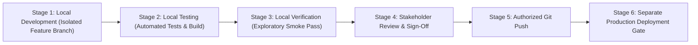

# FlowDesk Local Testing & Release Governance Checklist

**Document Identifier:** DOC-RELEASE-GOV-001  
**Version:** 1.0 (Master Release Protocol)  
**Status:** Mandatory Production Release Protocol  
**Effective Date:** 2026-11-01  
**Project:** FlowDesk (`flow-desk-main`)

---

## 1. Governance Principles & Strict Release Pipeline

FlowDesk is an active production enterprise platform. To eliminate the risk of production outages, regressions, and data corruption, all engineering modifications must strictly traverse the following six-stage gated release lifecycle:

> [!CAUTION]
> **MANDATORY RULES OF ENGAGEMENT:**
> 1. All code changes must initially remain strictly local.
> 2. Never push unverified code to remote repositories.
> 3. Never deploy directly to production without testing.
> 4. Never connect to production databases or run destructive scripts (`DROP`, `TRUNCATE`, `DELETE WHERE 1=1`) during testing.
> 5. Never reset or rebuild the production database schema.
> 6. Never drop tables or delete historical records across the 20 active modules or 4 excluded modules.
> 7. A completed Git Push is **NOT authorization to deploy**. Deployment requires a separate, explicit stakeholder approval gate.

---

## 2. Six-Stage Verification & Release Checklist

### Stage 1: Local Development & Isolation
- [ ] Development performed on an isolated feature branch (e.g. `fix/issue-004-clock-out` or `uiux/batch-01`).
- [ ] No direct commits to `main`.
- [ ] Zero changes to security configuration, RLS policies, or authentication middleware.
- [ ] Zero changes to `Mobile App/` directory.

### Stage 2: Local Automated Testing & Compiler Checks
Before seeking any review, the developer must run and pass all automated verification commands:
- [ ] **Typecheck Execution:** `npm run typecheck` (or `tsc --noEmit`) passes with zero compiler errors.
- [ ] **Linter Check:** `npm run lint` passes without fatal errors.
- [ ] **Automated Test Suite:** `npm test` passes 100% of calculation and repository unit tests.
- [ ] **Production Build Check:** `npm run build` succeeds cleanly, producing distribution assets without rollup bundle failures.

### Stage 3: Local Functional Verification & Regression Checklist
Manual end-to-end verification performed against local development data:
- [ ] **Clock-In / Clock-Out:**
  - Clock-in captures coordinates and updates state to "Present".
  - Off-shift task timer can start and increment without being clocked in (`BR-ATT-004`).
  - Clock-out completes cleanly, persists work hours, and clears the unclosed sessions prompt (`ISSUE-004`).
- [ ] **Breaks:**
  - Start Break triggers a single toast; break timer runs; End Break resumes normal shift (`ISSUE-003`).
- [ ] **Task Tracking:**
  - Task cards render accumulated historical duration accurately; page refresh does not reset counter (`ISSUE-001`).
  - Hard page refresh (`Cmd+Shift+R` / `F5`) restores state cleanly without HTTP 500 error (`ISSUE-002`).
- [ ] **Approvals & Rejections:**
  - Task Approvals tab correctly filters by Employee and Supervisor for Category 1 and Project Supervisors.
  - Rejecting a never-started task deletes the draft (`BR-TASK-007`).
  - Rejecting a post-start task transitions status to `Rejected / Closed`, preserving all time logs (`ISSUE-009`).
- [ ] **Form Persistence Audit:**
  - Newly created tasks, leaves, and batches are verified in local database inspection (field-to-column parity).
- [ ] **UI Preservation Guardrail:**
  - `AttendanceLogPage`, `AttendanceCalendarView`, and `ExpenseClaims` summary layouts remain untouched (`UIUX-REQ-004`).

### Stage 4: Stakeholder Presentation & Approval Gate
- [ ] Prepare Local Verification Summary Report detailing:
  - Exact files modified and lines changed.
  - Automated test execution logs.
  - Manual verification video / screenshots / walkthrough notes.
  - Database schema impact (confirming 0 DDL migrations without approval).
  - Preservation of historical data confirmed.
- [ ] Present changes to the stakeholder.
- [ ] **Obtain explicit written stakeholder authorization to push.**

### Stage 5: Authorized Git Push
- [ ] Ensure local branch is up to date with `origin/main`.
- [ ] Commit with conventional changelog message (e.g. `fix(attendance): resolve clock-out foreign-key conflict [ISSUE-004]`).
- [ ] Push to authorized remote branch.
- [ ] Verify CI/CD pipeline builds successfully on GitHub/GitLab.
- [ ] **HALT AND WAIT:** Do not trigger production deployment.

### Stage 6: Separate Production Deployment Gate
- [ ] Staging environment dry-run executed.
- [ ] Production database snapshot / backup verified in Supabase dashboard.
- [ ] Rollback script and commit hash tagged and ready for instant revert.
- [ ] **Obtain explicit written stakeholder authorization to deploy to production.**
- [ ] Trigger deployment via hosting platform (Vercel / Netlify / Supabase).
- [ ] Perform post-deployment live sanity check (Clock-in, Task Start, Refresh, Expense Claims).
- [ ] Document final release in `19-implementation-log.md`.

---

## 3. Database Migration Governance Protocol

For any phase requiring database changes (specifically Phase 2):
1. **DDL Script Review:** The exact SQL script must be documented in a markdown artifact with rollback SQL.
2. **Non-Destructive Guarantee:** Must use `ADD COLUMN IF NOT EXISTS`, avoiding `DROP COLUMN` or table rebuilds.
3. **Dry-Run Inspection:** Execute SQL in local PostgreSQL / Supabase staging container first.
4. **Data Preservation Verification:** Run pre- and post-migration record count queries to guarantee 0 lost rows.
5. **Stakeholder Sign-Off:** Migration is executed only after explicit **Tier 2 Database Migration Approval**.

