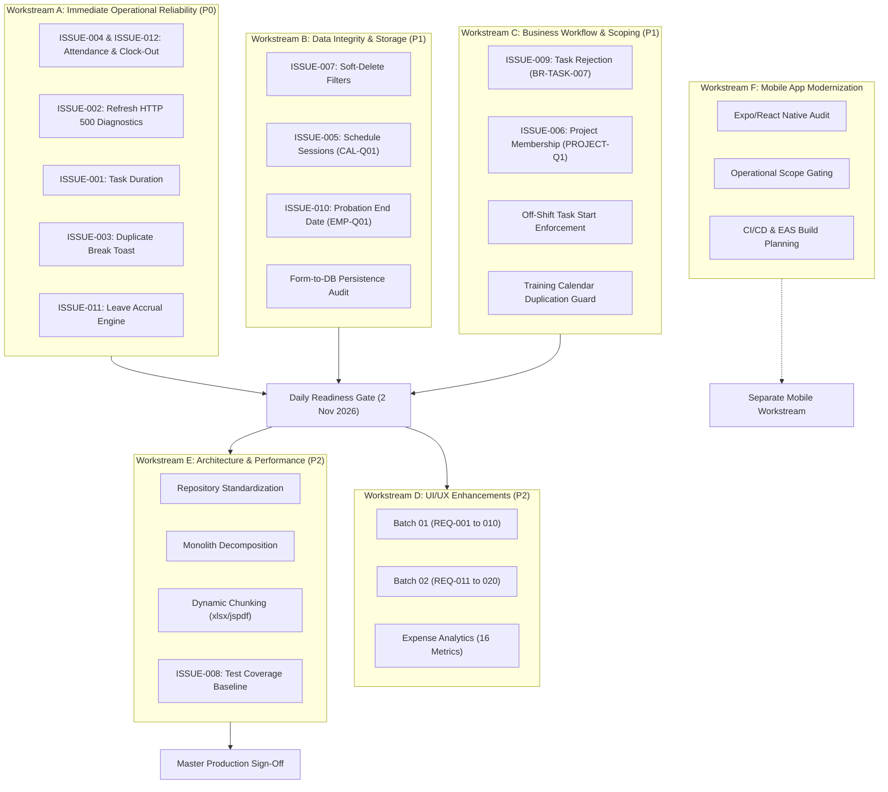

# FlowDesk Master Execution Roadmap

**Document Identifier:** DOC-ROADMAP-002  
**Version:** 4.0 (Synchronized Master Execution Roadmap)  
**Status:** Approved Implementation Baseline — Local-First Execution  
**Effective Date:** 2026-11-02  
**Engineering Baseline:** 32.0 Dedicated Engineering Days (Effort Estimate)  
**Project:** FlowDesk (`flow-desk-main`)

---

## 1. Executive Summary & Objective

The primary objective of this Master Execution Roadmap is to deliver the complete FlowDesk engineering rework through a disciplined, risk-managed, local-first engineering lifecycle across ten defined execution phases.

### Engineering Effort Baseline vs Calendar Schedule
- **Effort Estimate Baseline:** The complete rework represents **32.0 dedicated engineering days** of technical labor across decoupled, test-driven workstreams. This figure is an **engineering effort estimate**, not a guaranteed calendar completion timeframe. Actual calendar elapsed time will vary according to local verification pacing, automated testing results, and formal stakeholder review turnarounds for Tier 2 and Tier 3 gates.
- **Operational Transition Strategy:** Initial planning targeted an aggressive 2 November 2026 operational release. However, rigorous engineering governance confirms that Phase 0A (Test Harness), Phase 0B (Package Pruning), and Phase 1 (Critical Operational Fixes) require **5.0 dedicated engineering days** of implementation, testing, and forensic verification.
- **Production Safety Commitment:** FlowDesk will **NOT** cut testing, skip verification, or rush unverified code into production to meet an artificial calendar date. Daily business operations continue undisturbed on current stable components, while Phase 1 is executed and verified in the local staging environment. Production deployment occurs strictly upon passing the Tier 3 Operational Readiness Gate.

This roadmap consolidates all previous architectural audits, technical feasibility studies, issue registers (`ISSUE-001` through `ISSUE-010`), approved stakeholder decisions (`CONF-001` superseding `TRAIN-Q02`, `EMP-Q01`, `PROJECT-Q1`, `CAL-Q01`, `BR-TASK-007`), UI/UX requirement batches 01 and 02 (`UIUX-REQ-001` through `UIUX-REQ-020`), and local release governance protocols into **one unified source of truth**.

### Core Execution Principles
1. **Operational Reliability Over Cosmetic Redesign:** Fix verified critical defects (clock-out, refresh 500, task duration, break toasts) before cosmetic layout polish.
2. **Local-First Safety Lifecycle:** `LOCAL DEV → LOCAL TESTS → LOCAL VERIFICATION → STAKEHOLDER APPROVAL → GIT PUSH → SEPARATE DEPLOYMENT APPROVAL`.
3. **Data Integrity & Non-Destructive Migrations:** Zero table drops, zero destructive scripts against production, and strict preservation of historical records across all 20 active modules and 4 excluded modules.
4. **Security System Boundary:** Authentication, authorization, RLS policies, and JWT mechanisms are strictly out of scope until authorized separately.
5. **Parallel Workstream Strategy:** Independent tasks are executed concurrently across decoupled workstreams to minimize total completion time without file conflicts.

---

## 2. Six Concurrent Workstreams

---

## 3. Workstream Execution Plans

### Workstream A: Immediate Reliability (Priority P0 — Target: 2 Nov 2026)
* **Goal:** Eliminate operational disruptions preventing staff from completing daily work.
* **Tasks:**
  1. **A.1 (`ISSUE-004` & `ISSUE-012`): Unified Attendance & Clock-Out Lifecycle Remediation**  
     - **Consolidated Defect Analysis:** Retain both issue IDs in the traceability matrix while unifying engineering under Attendance Lifecycle remediation:
       * *Repository FK Constraint Failure (`ISSUE-004`):* In `SupabaseAttendanceRepository.update()`, `syncWorkSessions()` executes destructive deletes on `flwdsk_work_sessions` while child `flwdsk_break_records` reference them, throwing PostgreSQL FK violation `23503`.
       * *Service Midnight Rollover Failure (`ISSUE-012`):* In `AttendanceService.clockOut()`, `findActiveRecord(employeeId, todayStr())` evaluates to today's date string, failing to locate yesterday's open session for overnight shifts spanning past midnight.
     - **Formal Investigation & Verification Gate:** Replace untested assumptions (that replacing `DELETE + INSERT` with `UPDATE` is sufficient) with an empirical gate verifying: parent work-session persistence, child break synchronization FK constraints, child-before-parent update ordering, overnight session resolution, and atomic transaction rollback.
     - **Mandatory Regression Scenarios:** Verify standard shifts, multi-break shifts, midnight-crossing shifts (e.g. 23:00 to 07:00), and rapid re-clocking. Ensure clocked-out employees are immediately removed from the Unclosed Sessions prompt.
  2. **A.2 (`ISSUE-002`): Refresh HTTP 500 Forensic Diagnostic Gate**  
     - **Read-Only Diagnostic Nature:** The 20-refresh test is strictly a read-only diagnostic/regression test in staging.
     - **Strict Security Boundaries:** Zero modification of authentication middleware, session tokens, JWTs, Supabase Edge Functions, or PostgreSQL security/RLS rules.
     - **Separated Gating:** Staging diagnostic reproduction (Network HAR capture & client hydration check) is conducted locally; inspecting production server/edge function logs is an explicit external gate requiring separate stakeholder authorization.
  3. **A.3 (`ISSUE-001`): Task Duration Display Correction**  
     - Disentangle accumulated lifetime task duration from today's active work session duration.
     - Ensure `MyDayPage` and `TaskWidget` correctly render accumulated historical hours plus current running session seconds upon refresh.
  4. **A.4 (`ISSUE-003`): Duplicate Break Toast Elimination**  
     - Remove redundant toast notifications in `startBreak()` and `endBreak()` lifecycle hooks.
     - Ensure break state transitions cleanly with a single, clear user feedback alert.
  5. **A.5 (`ISSUE-011`): Leave Accrual & Balance Engine Decoupling**  
     - **Decoupled Work Package:** Map strictly to Leave Management business logic in Phase 1; decouple completely from Phase 6 progressive type safety and `TaskStatus`.
     - **Business Rule Enforcement:** Refactor `LeaveService.getLeaveBalance()` to calculate pro-rata leave quotas strictly based on active tenure (`date_of_joining`) and probation status (`probation_end_date`) per `BR-LEAVE-011` and `EMP-Q01`.
     - **Automated Verification:** Unit test suite in `src/tests/leave-accrual.test.ts` verifying pro-rata accrual for mid-year joiners and probationers.

### Workstream B: Data Integrity & Persistence (Priority P1)
* **Goal:** Guarantee that all saved data conforms to canonical tables and is preserved against loss.
* **Tasks:**
  1. **B.1 (`ISSUE-007`): Comprehensive Soft-Delete Auditing**  
     - Audit all direct Supabase queries across active repositories.
     - Enforce `.is('deleted_at', null)` across `flwdsk_tasks`, `flwdsk_attendance_records`, `flwdsk_leave_records`, and `flwdsk_expense_claims`.
  2. **B.2 (`ISSUE-005`): Training Session Table Canonicalization (`CAL-Q01`)**  
     - Confirm `flwdsk_schedule_sessions` as the sole canonical storage table.
     - Prepare staging migration and backfill script to merge legacy `flwdsk_calendar_sessions` records into `flwdsk_schedule_sessions` (held for migration approval).
  3. **B.3 (`ISSUE-010`): Probation End Date Schema Alignment (`EMP-Q01`)**  
     - Prepare DDL migration: `ALTER TABLE flwdsk_employees ADD COLUMN IF NOT EXISTS probation_end_date DATE NULL;`.
     - Update employee repository to store `probation_end_date` as authoritative and derive duration dynamically (held for migration approval).
  4. **B.4: Comprehensive Form-to-Database Persistence Audit (`UIUX-REQ-012`)**  
     - Verify 100% field mapping across 8 core forms: Frontend Form Field $\rightarrow$ Validation Schema $\rightarrow$ Repository DTO $\rightarrow$ Supabase Column $\rightarrow$ Database Row $\rightarrow$ UI Reload.

### Workstream C: Business Workflow & Scoping (Priority P1)
* **Goal:** Enforce finalized business rules across task and training management.
* **Tasks:**
  1. **C.1 (`ISSUE-009`): Task Rejection Lifecycle Compliance (`BR-TASK-007`)**  
     - Inspect `ApprovalsQueue.tsx` task rejection logic.
     - Pre-Start Rejection: If `NOT EXISTS (SELECT 1 FROM flwdsk_task_work_sessions WHERE task_id = :id AND deleted_at IS NULL)`, task is deleted upon supervisor rejection.
     - Post-Start Rejection: If task was ever started, supervisor rejection transitions status to `Rejected / Closed`, preserving all submission metadata and work logs.
  2. **C.2 (`ISSUE-006`): Canonical Project Membership (`PROJECT-Q1` & `MIG-004`)**  
     - Standardize all project membership reads to query `flwdsk_resource_allocations`.
     - Author `MIG-004` backfill with migration metadata tracking (`flwdsk_migration_log`) to distinguish backfilled rows from pre-existing allocations.
     - Establish forward-recovery as the default rollback protocol; prohibit indiscriminate bulk deletes to protect pre-existing allocations and role assignments.
     - Deprecate ad-hoc JSON array membership columns.
  3. **C.3: Off-Shift Task Start Verification**  
     - Confirm that employees can start task timers without being clocked into attendance (`BR-ATT-004`).
  4. **C.4: Training Calendar Usability & Duplicate Guard (`UIUX-REQ-014`)**  
     - Implement copy/paste and drag-and-drop on `TrainingCalendar.tsx`.
     - Enforce unique key constraint checks on `(batch_id, session_date, start_time)` to eliminate duplicate session creation.
  5. **C.5: Training Batch Status Authority (`CONF-001` Resolved)**  
     - Enforce the approved stakeholder resolution permitting **ALL employees, regardless of role or category, to transition Training Batch Status** (`Scheduled / Not Started → In Progress → Completed → Closed`), formally superseding `TRAIN-Q02`.

### Workstream D: UI/UX Modernization (Priority P2 — Batches 01 & 02)
* **Goal:** Deliver clean, accessible, stakeholder-approved user interface enhancements.
* **Tasks:**
  - Implement Batch 01 (`UIUX-REQ-001` through `UIUX-REQ-010`) in Phase 7.
  - Implement Batch 02 (`UIUX-REQ-011` through `UIUX-REQ-020`) in Phase 7.
  - Deliver complete 16-metric Power BI-inspired Expense Analytics dashboard canvas (`UIUX-REQ-018`).
  - Preserve `AttendanceLogPage`, `AttendanceCalendarView`, and `ExpenseClaims` summary layouts (`UIUX-REQ-004`).

### Workstream E: Engineering Standards & Performance (Priority P2)
* **Goal:** Hardened type safety, bundle optimization, and test coverage baseline.
* **Tasks:**
  1. **E.1 (`ISSUE-008`): Practical Test Baseline Baseline**  
     - Configure Vitest test runner.
     - Implement unit test suites for critical calculations (`probation-calc.test.ts`, `leave-accrual.test.ts`, `expense-math.test.ts`, `task-session-dedup.test.ts`).
  2. **E.2: Repository Layer Standardization**  
     - Route all 68 direct Supabase calls through typed repositories.
  3. **E.3: Monolithic Page Decomposition**  
     - Decompose monolithic pages (`MyDayPage` 3,290 LOC, `AttendanceLogPage` 1,420 LOC, `ProjectList` 1,884 LOC) into modular containers $< 500$ LOC.
  4. **E.4: Dynamic Imports & Export Splitting**  
     - Lazy-load `xlsx`, `jspdf`, and `html2canvas` on demand, reducing main bundle to $< 200\text{ kB}$.

### Workstream F: Mobile Application Modernization (Priority P3 — Separate Track)
* **Goal:** Evolve the React Native / Expo application into a focused operational mobile companion.
* **Tasks:**
  - Scope strictly to field essentials (Clock-in/out, breaks, task view/create/approve, expenses).
  - Define shared API integration, EAS build pipeline, and push notification architecture.
  - Leave `Mobile App/` directory completely untouched during web rework.

---

## 4. Phase-by-Phase Roadmap Schedule

| Phase ID | Phase Name | Estimated Effort | Workstreams Covered | Focus / Key Deliverables & Primary Gate | Risk Level |
|---|---|:---:|---|---|---|
| **Phase 0A** | Automated Test Harness & Safety Net | 1.0 Day | Workstream E.1 | Vitest harness with `happy-dom`, 3 calculation test suites (`ISSUE-008`). | Low |
| **Phase 0B** | Verified Package Pruning | 0.5 Day | Workstream E.1 | Pruning of 5 verified dead packages (`googleapis`, `nodemailer`, `dotenv`, `socket.io-client`, `axios`). Clean build verification. | Low |
| **Phase 1** | Critical Operational Reliability | 3.5 Days | Workstream A.1–A.5, C.1, C.3 | Clock-out fix & overnight rollover (`ISSUE-004`/`012`), refresh diagnostics (`ISSUE-002`), task duration (`ISSUE-001`), break toasts (`ISSUE-003`), leave accrual engine (`ISSUE-011`), task rejection (`ISSUE-009`). **Tier 3 Operational Readiness Gate**. | High (Critical) |
| **Phase 2** | Database Migrations & Session/Membership Consolidation | 3.0 Days | Workstream B.2, B.3, C.2 | `probation_end_date` migration (`MIG-001`), `flwdsk_schedule_sessions` backfill (`MIG-002`), composite indexes (`MIG-003`), project allocations backfill (`MIG-004`). **Tier 2 DB Migration Gate**. | High (DB DDL) |
| **Phase 3** | Universal `SearchableBatchSelect` & Training Touchpoints | 3.5 Days | Workstream C.2, D (Batch 01) | SearchableBatchSelect overhaul across 10 touchpoints, batch cards cleanup, enable all-employee batch status changes (`CONF-001` resolved), lifecycle adapter (`ISSUE-013`). | Medium |
| **Phase 4** | Incremental Repository Standardization & Soft-Delete Rules | 3.5 Days | Workstream B.1, E.2 | Standardize 68 direct queries through typed repositories with mandatory soft-delete filtering (`ISSUE-006`, `ISSUE-007`). | Medium |
| **Phase 5** | Monolith Component Decomposition | 4.0 Days | Workstream E.3 | Decompose `MyDayPage`, `AttendanceLogPage`, `ProjectList` into sub-components $< 500$ LOC. | Medium |
| **Phase 6** | Progressive Type Safety & Dead Code Elimination | 3.0 Days | Workstream E | Progressive type safety (7-state `TaskStatus`), eliminate dead in-memory engines (`src/core/engines/`). Decoupled from leave logic. Clean `typecheck`. | Low |
| **Phase 7** | Dynamic Imports & UI/UX Requirements (Batch 01 & 02) | 7.0 Days | Workstream D (001–020) | Execute all 20 UI/UX requirements; implement 16-metric Expense Analytics canvas (`UIUX-REQ-018`); dynamic chunk imports (`ISSUE-014`). | Medium |
| **Phase 8** | Comprehensive Regression & Sign-Off | 3.0 Days | All Workstreams | End-to-end operational verification across 20 active modules against `BUSINESS_RULES.md`. **Tier 3 Final Executive Sign-Off Gate**. | Critical Gate |
| **TOTAL** | **Comprehensive End-to-End Engineering Rework** | **32.0 Days** | **All 6 Workstreams** | **Complete Rework Handover (Effort Estimate)** | Full Rework |

---

## 5. Phase 1 Operational Readiness Gate Checklist

Before staff begin daily operations on 2 November 2026, the following minimum-step critical path must be verified locally and signed off:
- [ ] Clock-in succeeds with valid GPS address.
- [ ] Off-shift task start works without clocked-in attendance requirement.
- [ ] Active task timers track and persist seconds accurately.
- [ ] Clock-out completes without foreign-key constraint violations and removes unclosed session prompt.
- [ ] Breaks start and end with a single, clean toast notification.
- [ ] Task submission and approval queue filtering works for authorized supervisors.
- [ ] Task rejection strictly enforces `BR-TASK-007` (ever-started preserved as `Rejected / Closed`).
- [ ] Page refresh retains accurate session state without HTTP 500 crash.

