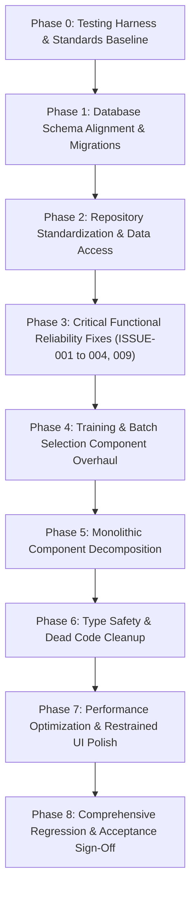

# FlowDesk Master Phased Implementation Roadmap

**Document Identifier:** DOC-ROADMAP-001  
**Version:** 2.0  
**Status:** Master Implementation Proposal  
**Effective Date:** 2026-10-31  
**Project:** FlowDesk (`flow-desk-main`)

---

## 1. Executive Roadmap Summary

This master implementation roadmap defines the sequential, dependency-driven engineering rework of FlowDesk. The sequence ensures that data integrity, testing infrastructure, and core architectural layers are established before high-level UI workflows are decomposed.

---

## 2. Detailed Phase Specifications

---

### Phase 0: Testing Harness & Standards Baseline

1. **Phase ID & Name:** `PHASE-00: Testing Infrastructure & Dependency Cleanup`
2. **Business & Technical Objective:** Establish automated test execution so that all subsequent refactoring is protected by regression safety nets; remove dead Node.js server dependencies.
3. **Scope:** Setup Vitest and React Testing Library; configure `vitest.config.ts`; author Tier 1 calculation test suites; remove dead packages from `package.json`.
4. **Exact Modules Affected:** Global Infrastructure, Package Dependencies.
5. **Files Affected:** `package.json`, `vite.config.js`, `vitest.config.ts`, `src/tests/*`.
6. **Dependencies:** None (Baseline Phase).
7. **Tasks in Execution Order:**
   - 0.1: Install `vitest`, `@testing-library/react`, `happy-dom`, `@vitest/coverage-v8` as devDependencies.
   - 0.2: Configure `vitest.config.ts` and add `"test"`, `"test:coverage"` scripts to `package.json`.
   - 0.3: Remove dead dependencies: `googleapis`, `nodemailer`, `dotenv`, `socket.io-client`, `axios`.
   - 0.4: Implement pure unit test suite for Probation Forward/Reverse Calculations (`src/tests/probation.test.ts`).
   - 0.5: Implement pure unit test suite for Leave Quota Pro-rata Math (`src/tests/leave-accrual.test.ts`).
   - 0.6: Implement pure unit test suite for Attendance Thresholds & Late Rules (`src/tests/attendance.test.ts`).
8. **Expected Deliverables:** Functional test runner executing 3 master business calculation test suites with 100% pass rate; clean `package.json`.
9. **Data-Preservation Requirements:** N/A (Client tooling only).
10. **Testing Strategy:** Verify Vitest passes cleanly in under 5 seconds; verify `npm run build` succeeds.
11. **Regression Testing Requirements:** Run `npm run build` and `npm run typecheck` to ensure package removals cause no import breaks.
12. **Acceptance Criteria:** `npm test` runs and passes; build succeeds; dead packages removed.
13. **Risks & Rollback:** Low risk. Rollback via git commit revert of `package.json`.
14. **Estimated Effort:** 1.5 Days.
15. **Explicit Approval Checkpoint:** Stakeholder review and sign-off on test runner output before proceeding to Phase 1.

---

### Phase 1: Database Schema Alignment & Migrations

1. **Phase ID & Name:** `PHASE-01: Database Schema Alignment & Dualism Resolution`
2. **Business & Technical Objective:** Resolve schema defects `ISSUE-010`, `ISSUE-005`, and `ISSUE-006` in Supabase PostgreSQL; add missing probation columns; create performance composite indexes.
3. **Scope:** Author versioned migrations; create probation columns on `flwdsk_employees`; establish backward-compatible view/trigger for `flwdsk_resource_allocations` (`PROJECT-Q1`); align `flwdsk_schedule_sessions` (`CAL-Q01`).
4. **Exact Modules Affected:** Employee Directory, Projects, Training Operations, Database.
5. **Files Affected:** `supabase/migrations/20261101000000_add_probation_columns_to_employees.sql`, `supabase/migrations/20261101010000_composite_performance_indexes.sql`.
6. **Dependencies:** Completion of Phase 0.
7. **Tasks in Execution Order:**
   - 1.1: Author migration to add `probation_end_date`, `probation_duration`, and `leave_accrual_start_date` to `flwdsk_employees` (`ISSUE-010`).
   - 1.2: Author migration creating composite indexes on attendance, task work sessions, and training schedules.
   - 1.3: Create synchronization trigger from `flwdsk_resource_allocations` to `flwdsk_projects.member_ids` to preserve backward compatibility during rework (`PROJECT-Q1`).
   - 1.4: Align column definitions between `flwdsk_schedule_sessions` and `flwdsk_calendar_sessions` (`CAL-Q01`).
8. **Expected Deliverables:** Executable versioned SQL migration files; updated database schema.
9. **Data-Preservation Requirements:** Zero data loss on existing employee joining dates or task work sessions.
10. **Testing Strategy:** Verify migrations execute idempotently (`IF NOT EXISTS`); inspect PostgREST schema cache.
11. **Regression Testing Requirements:** Verify existing employee queries and project views continue returning valid data without schema errors (`PGRST204`).
12. **Acceptance Criteria:** `flwdsk_employees` schema includes verified probation columns; indexes created; no query regressions.
13. **Risks & Rollback:** Medium risk. Rollback script prepared to drop added columns/indexes if migration fails.
14. **Estimated Effort:** 2 Days.
15. **Explicit Approval Checkpoint:** Stakeholder review of migration scripts and DB schema verification.

---

### Phase 2: Repository Standardization & Data Access Layer

1. **Phase ID & Name:** `PHASE-02: Data Access Standardization & Soft-Delete Enforcement`
2. **Business & Technical Objective:** Eliminate all 68 direct `supabase.from(` calls in UI views and custom hooks; enforce `deleted_at IS NULL` universally (`ISSUE-007`).
3. **Scope:** Refactor Repositories (`AttendanceRepository`, `TaskRepository`, `TrainingRepository`, `ExpenseRepository`); replace direct UI calls with typed repository methods.
4. **Exact Modules Affected:** All 20 Active Modules.
5. **Files Affected:** `src/shared/integration/supabase-repository.ts`, `src/modules/*/repositories/*`.
6. **Dependencies:** Phase 1 (Schema Alignment).
7. **Tasks in Execution Order:**
   - 2.1: Enhance base repository in `supabase-repository.ts` with mandatory soft-delete filtering.
   - 2.2: Refactor `useTaskSessions.ts` to replace direct `supabase.from('flwdsk_task_work_sessions')` queries with `TaskWorkSessionRepository`.
   - 2.3: Refactor `ExpenseClaims.tsx` (11 calls) and `ExpenseClaimModal.tsx` (5 calls) to use `ExpenseRepository`.
   - 2.4: Refactor `AttendanceLogPage.tsx` (5 calls) and `useAttendance.ts` (2 calls) to use `AttendanceRepository`.
   - 2.5: Refactor `FinalExamModule.tsx` (7 calls) to use `TrainingRepository`.
8. **Expected Deliverables:** Zero direct `supabase.from(` calls in presentation components; standardized typed repositories across all modules.
9. **Data-Preservation Requirements:** All query filters and data-mapping must preserve existing entity structures.
10. **Testing Strategy:** Author repository integration unit tests using mocked Supabase client.
11. **Regression Testing Requirements:** Verify soft-deleted items remain excluded from all list views.
12. **Acceptance Criteria:** `grep -rn "supabase.from(" src/modules/*/pages/` returns 0 results.
13. **Risks & Rollback:** Low to Medium risk. Component queries tested against integration tests before merging.
14. **Estimated Effort:** 3 Days.
15. **Explicit Approval Checkpoint:** Stakeholder review of repository layer and clean grep audit.

---

### Phase 3: Critical Functional Reliability Fixes

1. **Phase ID & Name:** `PHASE-03: Critical Bug Fixes & Workflow Governance`
2. **Business & Technical Objective:** Implement permanent, verified technical fixes for `ISSUE-001`, `ISSUE-002`, `ISSUE-003`, `ISSUE-004`, and `ISSUE-009`.
3. **Scope:** Fix Task Duration refresh inconsistency (`ISSUE-001`); decompose ErrorBoundary and fix refresh crashes (`ISSUE-002`); eliminate duplicate break popups (`ISSUE-003`); fix clock-out FK violation (`ISSUE-004`); implement Scenario A vs. Scenario B Task Approval/Rejection Governance (`ISSUE-009`).
4. **Exact Modules Affected:** My Day, Attendance, Projects & Tasks, Approvals Queue, Runtime.
5. **Files Affected:**
   - `src/app/pages/workspaces/MyDayPage.tsx`
   - `src/modules/attendance/hooks/useAttendance.ts`
   - `src/modules/project/hooks/useTaskSessions.ts`
   - `src/modules/attendance/pages/ApprovalsQueue.tsx`
   - `src/app/ErrorBoundary.tsx`
6. **Dependencies:** Phase 2 (Repository Standardization).
7. **Tasks in Execution Order:**
   - 3.1: **ISSUE-001 Fix:** Refactor `TaskWidget` duration rendering to display single total `Xh Ym`; remove split rendering and fix LocalStorage date reconciliation.
   - 3.2: **ISSUE-002 Fix:** Add widget-level error boundaries; safeguard JWT refresh token initialization on direct page reload.
   - 3.3: **ISSUE-003 Fix:** Eliminate redundant second toast call in `MyDayPage.tsx:3278` during break start.
   - 3.4: **ISSUE-004 Fix:** Replace hard-deletion of `flwdsk_work_sessions` with soft-close on clock-out to prevent FK violations.
   - 3.5: **ISSUE-009 Fix:** Refactor `ApprovalsQueue.tsx:472` to implement approved governance:
     * Pre-Start Rejection (never started): Hard-delete task & rejection record without history.
     * Post-Start Rejection (started, hours $\ge 0$): Transition status to `Rejected / Closed`, preserve all history and hours, make reason optional, block resubmission.
8. **Expected Deliverables:** Fully resolved and verified issues ISSUE-001 through ISSUE-004, and ISSUE-009.
9. **Data-Preservation Requirements:** Strict preservation of all task work sessions and employee attendance history.
10. **Testing Strategy:** Author targeted test suites for each issue; execute manual and automated browser verification.
11. **Regression Testing Requirements:** Full clock-in $\rightarrow$ task start $\rightarrow$ break $\rightarrow$ clock-out $\rightarrow$ refresh cycle tested across multiple roles.
12. **Acceptance Criteria:** Tasks display consistent durations across refreshes; refresh does not throw 500; single break popup; clock-out completes cleanly; started tasks are never deleted upon rejection.
13. **Risks & Rollback:** Medium risk. Each issue fix is isolated in a separate git commit with rollbacks available.
14. **Estimated Effort:** 3.5 Days.
15. **Explicit Approval Checkpoint:** Formal demonstration of all 5 bug fixes to stakeholder; issues updated in `ISSUES_REGISTER.md`.

---

### Phase 4: Training & Batch Selection Component Overhaul

1. **Phase ID & Name:** `PHASE-04: Universal SearchableBatchSelect & Training Overhaul`
2. **Business & Technical Objective:** Build and deploy a standardized, high-performance `SearchableBatchSelect` component across all 10 application touchpoints (`BR-TRAIN-003`); unify training session scheduling.
3. **Scope:** Create `SearchableBatchSelect` with fuzzy search, virtualization, college filtering, and clear selected state; integrate into My Day Clock-In, Attendance Correction, Batch Console, Calendar, Exam Center, Student Lifecycle, and Expense Claims.
4. **Exact Modules Affected:** Training Operations, Attendance, Finance, My Day.
5. **Files Affected:** `src/shared/ui/SearchableBatchSelect.tsx`, `src/modules/training/*`, `src/app/pages/workspaces/MyDayPage.tsx`.
6. **Dependencies:** Phase 3 (Critical Reliability).
7. **Tasks in Execution Order:**
   - 4.1: Develop `SearchableBatchSelect` component supporting virtualized rendering, batch code search, college filtering, and status badges.
   - 4.2: Replace unsearchable dropdowns in `MyDayPage.tsx` clock-in modal with `SearchableBatchSelect`.
   - 4.3: Integrate `SearchableBatchSelect` into `AttendanceCorrectionModal.tsx`.
   - 4.4: Integrate `SearchableBatchSelect` into `FinalExamModule.tsx` and `StudentLifecycle.tsx`.
   - 4.5: Integrate `SearchableBatchSelect` into `ExpenseClaimModal.tsx` and `ExpenseAnalyticsPage.tsx`.
   - 4.6: Implement batch lifecycle status transitions authority (`CONF-001`: ALL employees, regardless of role or category).
8. **Expected Deliverables:** High-performance searchable batch selection operational across all 10 touchpoints.
9. **Data-Preservation Requirements:** Ensure persisted batch foreign keys correctly store `batch_id` UUIDs.
10. **Testing Strategy:** Unit tests for batch search filter matching; integration tests for selection state persistence.
11. **Regression Testing Requirements:** Verify existing training records, sessions, and attendance links remain intact.
12. **Acceptance Criteria:** Batch search returns instant results across hundreds of batches; selection correctly updates form state.
13. **Risks & Rollback:** Low risk. Controlled component replacement.
14. **Estimated Effort:** 3 Days.
15. **Explicit Approval Checkpoint:** Stakeholder demonstration of batch selection across My Day, Attendance, and Exam Center.

---

### Phase 5: Monolithic Component Decomposition

1. **Phase ID & Name:** `PHASE-05: Monolithic Page Refactoring (< 400 LOC)`
2. **Business & Technical Objective:** Decompose massive monolithic files into clean, maintainable presentational sub-components adhering to `DOC-STD-001`.
3. **Scope:** Refactor `MyDayPage.tsx` (3,290 LOC), `ExpenseAnalyticsPage.tsx` (2,737 LOC), `AttendanceLogPage.tsx` (2,603 LOC), and `BatchManagement.tsx` (1,663 LOC).
4. **Exact Modules Affected:** My Day, Attendance, Finance, Training.
5. **Files Affected:** `src/app/pages/workspaces/MyDayPage.tsx`, `src/modules/attendance/pages/AttendanceLogPage.tsx`, `src/modules/finance/pages/ExpenseAnalyticsPage.tsx`, `src/modules/training/pages/BatchManagement.tsx`.
6. **Dependencies:** Phase 4.
7. **Tasks in Execution Order:**
   - 5.1: Decompose `MyDayPage.tsx` into `MyDayHeader`, `AttendanceCard`, `TaskTimerSection`, `DailyWorklogTable`, and modal containers.
   - 5.2: Decompose `AttendanceLogPage.tsx` into `AttendanceFilterBar`, `AttendanceSummaryCards`, `AttendanceSessionTable`, and export actions.
   - 5.3: Decompose `ExpenseAnalyticsPage.tsx` into `ExpenseKpiPanel`, `BatchExpenseBreakdown`, and `ExpenseChartViews`.
   - 5.4: Decompose `BatchManagement.tsx` into focused tab containers.
8. **Expected Deliverables:** All refactored components under 400 lines of code; improved rendering performance.
9. **Data-Preservation Requirements:** Strict visual and functional equivalence.
10. **Testing Strategy:** Automated component smoke tests; visual regression verification.
11. **Regression Testing Requirements:** Complete user journey testing across all decomposed screens.
12. **Acceptance Criteria:** Zero individual component files exceeding 400 LOC in target pages; zero functional regressions.
13. **Risks & Rollback:** Medium risk. Decompose page by page with dedicated git branches.
14. **Estimated Effort:** 4 Days.
15. **Explicit Approval Checkpoint:** Code review and walkthrough of decomposed page architectures.

---

### Phase 6: Type Safety & Dead Code Cleanup

1. **Phase ID & Name:** `PHASE-06: TypeScript Hardening & Dead Code Elimination`
2. **Business & Technical Objective:** Eliminate 834 `any` types; remove dead in-memory engines (`src/core/engines/`); archive obsolete files.
3. **Scope:** Type hardening across project; deprecate and remove `src/core/engines/`; move loose root assets; update `tsconfig.json`.
4. **Exact Modules Affected:** Entire Application Codebase.
5. **Files Affected:** `src/**/*.ts`, `src/**/*.tsx`, `src/core/engines/*`.
6. **Dependencies:** Phase 5.
7. **Tasks in Execution Order:**
   - 6.1: Replace `any` types in `ProjectList.tsx` (97), `AttendanceLogPage.tsx` (75), `training.service.ts` (69), `TaskBoard.tsx` (59) with strict domain interfaces.
   - 6.2: Deprecate and safely remove unused stubs in `src/core/engines/` (`workflow.ts`, `automation.ts`, `scheduler.ts`, etc.).
   - 6.3: Consolidate loose root assets (`logo.png`, `KVJ analytics Logo.png`) into `src/assets/branding/`.
   - 6.4: Enable `noImplicitAny: true` in `tsconfig.json`.
8. **Expected Deliverables:** Clean TypeScript compilation with zero `any` warnings; streamlined core directory.
9. **Data-Preservation Requirements:** N/A.
10. **Testing Strategy:** Execute `npm run typecheck` and `npm run test`.
11. **Regression Testing Requirements:** Full build verification (`npm run build`).
12. **Acceptance Criteria:** `npm run typecheck` passes with zero errors under strict typing.
13. **Risks & Rollback:** Low risk.
14. **Estimated Effort:** 3 Days.
15. **Explicit Approval Checkpoint:** Clean TypeScript compiler output presented for approval.

---

### Phase 7: Performance Optimization & Approved UI/UX Enhancements (Batch 01)

1. **Phase ID & Name:** `PHASE-07: Dynamic Imports, Export Splitting & Approved UI/UX Enhancements`
2. **Business & Technical Objective:** Code-split heavy libraries (`xlsx`, `jspdf`, `html2canvas`); reduce initial bundle sizes below 200 kB; implement accessible, restrained micro-interactions (`@media (prefers-reduced-motion)`); execute stakeholder-approved UI/UX enhancements from `docs/UI_UX_REQUIREMENTS_REGISTER.md` (`UIUX-REQ-001` through `UIUX-REQ-010`).
3. **Scope:** Vite dynamic imports; route lazy loading; animation system audit; approved UI/UX enhancements across AppShell, MyDayPage, Announcements, LeaveBoard, ApplyLeaveModal, ApprovalsQueue, Idle-Time Notifications, and Training Batch Management.
4. **Exact Modules Affected:** Build configuration, Navigation/AppShell, Workspaces (MyDay), Communications (Announcements), Leave Management, Attendance/Approvals, Training Management.
5. **Files Affected:** `vite.config.js`, `src/app/router.tsx`, `src/shared/layout/AppShell.tsx`, `src/app/pages/workspaces/MyDayPage.tsx`, `src/modules/leave/pages/LeaveBoard.tsx`, `src/modules/leave/forms/ApplyLeaveModal.tsx`, `src/modules/attendance/pages/ApprovalsQueue.tsx`, `src/modules/attendance/components/AttendanceCorrectionDetailsModal.tsx`, `src/shared/components/GlobalIdleTimer.tsx`, `src/modules/training/pages/BatchManagement.tsx`, `src/modules/training/components/TrainingBatchCarousel.tsx`, `src/modules/training/components/BatchExpenseDetailsDrawer.tsx`.
6. **Dependencies:** Phase 6 (and Phase 5 monolithic component decomposition).
7. **Tasks in Execution Order:**
   - 7.1: Configure Vite manual chunks for `xlsx` and `jspdf` to load dynamically on export action.
   - 7.2: Verify all routes in `src/app/router.tsx` use `React.lazy()` with suspense boundaries.
   - 7.3: Audit UI transitions to ensure GPU-only acceleration (`transform`, `opacity`) and strict `prefers-reduced-motion` compliance.
   - 7.4: Implement `UIUX-REQ-001` (AppShell remove unnecessary `[` shortcut indicator beside Collapse Sidebar control; preserve label, icon, and collapse/expand functionality).
   - 7.5: Implement `UIUX-REQ-002` (MyDay personal task ordering: top-insertion for new tasks, drag-and-drop, cross-device persistence via employee preference metadata/sync).
   - 7.6: Implement `UIUX-REQ-003` (Announcements lifecycle: My Day user-scoped dismissal & expiry filtering + Announcements Board calendar month hiding & historical archive filtering; zero global deletion).
   - 7.7: Implement `UIUX-REQ-004` (Guardrail preservation of Attendance Details Log, Attendance Panel Calendar, and Expense Summary).
   - 7.8: Implement `UIUX-REQ-005` (LeaveBoard stat cards removal, pending row highlight, and exact filter suite: Employee, Current Month, Last Month, Last 6 Months, Current Financial Year, Custom Range; no unsupported week/quarter substitutions).
   - 7.9: Implement `UIUX-REQ-006` (ApplyLeaveModal visual redesign with deduction badge, preserving all fields and calculation engine).
   - 7.10: Implement `UIUX-REQ-007` (ApprovalsQueue: Task Approvals Employee & Supervisor filters; strict role scoping for Category 1, Project Supervisors, and other employees; Leave Applications Employee filter verification; Attendance Corrections vertical split sessions & clean batch names).
   - 7.11: Implement `UIUX-REQ-008` (15-min idle notification to Admin: clocked in, no task running, not on break; deduplicated; breaks never idle).
   - 7.12: Implement `UIUX-REQ-009` (Training batch carousel action cleanup: remove redundant "Batch:" header; remove 3 buttons: Student Details, Daily Report, Certificate Receipt; prominently retain Expense Details; sort newest created first; enable batch status changes for all employees per `CONF-001`).
   - 7.13: Implement `UIUX-REQ-010` (Training batch modal redesign & verified employee work hours breakdown; zero fabricated hours).
8. **Expected Deliverables:** Main bundle size reduced from 641 kB to < 200 kB; instant route transitions; polished, accessible, stakeholder-approved UI/UX enhancements across all 10 Batch 01 requirements.
9. **Data-Preservation Requirements:** N/A for DDL; preserve all existing business rules, historical session calculations, and attendance logs.
10. **Testing Strategy:** Lighthouse performance and accessibility audits; Vitest unit tests for task reordering and idle notification logic; component rendering smoke tests.
11. **Regression Testing Requirements:** Verify Excel and PDF exports trigger and download seamlessly; verify leave calculation integrity and attendance session integrity.
12. **Acceptance Criteria:** Main initial bundle < 200 kB gzip; Lighthouse Performance $\ge 90$; animations disabled when reduced motion is preferred; all 10 UI/UX acceptance criteria met.
13. **Risks & Rollback:** Low to Medium risk. `CONF-001` conflict resolved (all employees permitted to change batch status). Rollback via feature branch revert per requirement.
14. **Estimated Effort:** 4.5 Days.
15. **Explicit Approval Checkpoint:** Bundle analysis report, Lighthouse audit sign-off, and visual acceptance sign-off for UI/UX Batch 01.

---

### Phase 8: Comprehensive Regression & Acceptance Sign-Off

1. **Phase ID & Name:** `PHASE-08: End-to-End Regression & Master Acceptance`
2. **Business & Technical Objective:** Complete end-to-end operational verification across all 20 active modules against `docs/BUSINESS_RULES.md`; obtain formal stakeholder sign-off.
3. **Scope:** Execution of all test suites; verification of all 20 modules; verification of approved decisions (`CONF-001` superseding `TRAIN-Q02`, `EMP-Q01`, `PROJECT-Q1`, `CAL-Q01`, `ISSUE-009`).
4. **Exact Modules Affected:** All 20 Active Modules.
5. **Files Affected:** All documentation and application files.
6. **Dependencies:** Phases 0 through 7 complete.
7. **Tasks in Execution Order:**
   - 8.1: Execute complete Vitest test suite (`npm run test:coverage`).
   - 8.2: Perform end-to-end regression testing on all 20 active modules.
   - 8.3: Verify issues register: confirm all issues `ISSUE-001` through `ISSUE-010` are resolved, tested, and documented.
   - 8.4: Prepare Master Handover and Deployment Runbook.
8. **Expected Deliverables:** 100% test pass report; verified application ready for production deployment.
9. **Data-Preservation Requirements:** Complete data validation check.
10. **Testing Strategy:** Full automated and manual regression suite.
11. **Regression Testing Requirements:** Zero open defects.
12. **Acceptance Criteria:** Stakeholder sign-off on all 20 active modules.
13. **Risks & Rollback:** Low risk (staged environment release).
14. **Estimated Effort:** 2.5 Days.
15. **Explicit Approval Checkpoint:** Final Executive Sign-Off.

