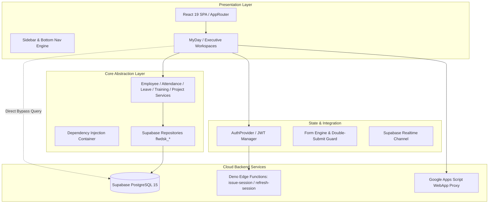
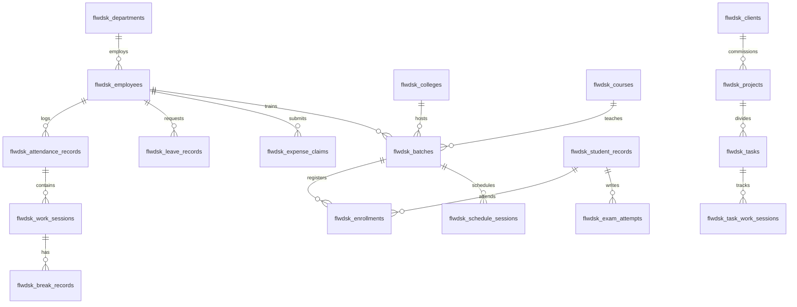
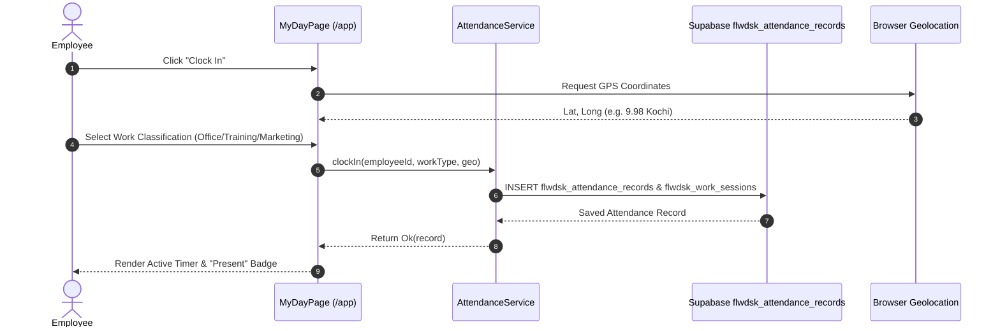
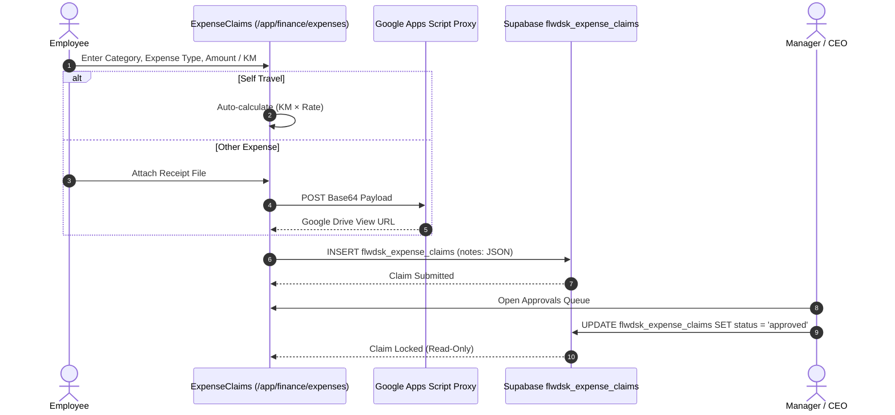

# KVJ Analytics (Teamz / FlowDesk) — Phase 1 Complete Application Discovery, Business Logic Analysis, and Technical Audit

**Audit Date:** October 2026  
**Audited Target:** `/Users/apple/Downloads/flow-desk-main`  
**Execution Mode:** Read-Only Static Code & Schema Audit  
**Code Modification Status:** **STRICTLY ZERO CODE OR CONFIGURATION CHANGES APPLIED**

---

## 1. Executive Summary

This audit represents a comprehensive, forensic investigation into the internal enterprise operations platform developed for **KVJ Analytics** (historically named **FlowDesk**, rebranded and configured as **Teamz**).

### Key Architectural Reality vs. Documented Vision
1. **The Ghost MERN Stack:** Legacy project documentation (`docs/01-executive-summary.md` through `docs/16-modernization-readiness.md`) describes a classic **MERN (MongoDB, Express, React, Node)** stack with Socket.IO and NodeMailer. **In reality, the Express server and MongoDB have been completely eradicated.** The `/server` directory is gone, yet its leftover packages (`nodemailer`, `googleapis`, `dotenv`, `axios`, `socket.io-client`) linger as dormant bloat in `package.json`.
2. **True Modern Stack:** The current application is a **Client-Side Single-Page Application (SPA)** built with **React 19, TypeScript 5.6, Vite 7, and TailwindCSS 4**, talking directly to **Supabase PostgreSQL** via `@supabase/supabase-js`.
3. **Decoupled Engines Are In-Memory Stubs:** The "Clean Architecture" platform engines promoted in `DOCUMENTATION.md` (`WorkflowEngine`, `ApprovalEngine`, `AutomationEngine`, `SchedulerEngine`, `ActivityEngine`, `AuditEngine`, `AI Stubs`) either store their state in transient client JavaScript `Map` or `Array` instances in the user's browser, or are never invoked by any active module.
4. **Direct Database Coupling:** Despite the declared Clean Architecture (`Hooks -> Services -> Repositories -> Database`), high-traffic UI components (`EmployeeDirectory.tsx`, `ExpenseClaims.tsx`, `ApprovalsQueue.tsx`, `FinalExamModule.tsx`, `AttendanceLogPage.tsx`) bypass services and call `supabase.from(...)` directly, frequently embedding complex SQL queries and JSON serialization within React view components.
5. **Session Identity & RLS Crisis:** The database enforces Row Level Security (RLS) policies keyed on `auth.uid()`. However, the production authentication mechanism (`flwdsk_authenticate`) verifies credentials against an app-level bcrypt hash in `flwdsk_employees` and returns a custom client token (`app_<timestamp>`) stored in `localStorage`. Supabase GoTrue Auth synchronization (`syncSupabaseAuth`) fails silently because employee records are not provisioned in `auth.users`. Consequently, PostgREST requests execute under the unauthenticated `anon` role (`auth.uid() IS NULL`), rendering strict RLS policies dysfunctional and forcing fallback queries or client-side storage fallbacks.
6. **Feature Overlap & Dead Weight:** Approximately 40% of the codebase consists of gated, stubbed, or redundant features (e.g., hidden Analytics Suite, dead PowerBI Gateway, mock AI engines, redundant timesheet vs. task work-session tracking, dormant procurement and payroll modules).

---

## 2. Application Purpose and Business Context

### 2.1 Primary Business Purpose
KVJ Analytics operates as a professional training, institutional consulting, and student credentialing agency. The platform serves as an internal ERP to orchestrate:
- **Employee & Trainer Operations:** Daily attendance logging, work session classifications (Office vs. Training vs. Marketing), break tracking, leave management, and expense reimbursements.
- **Institutional Training & Student Lifecycle:** Curriculum management, college partnership directories, training batch scheduling, session timetable generation, student enrollments, continuous assessment scoring, external exam voucher distribution, and certificate delivery logistics.
- **Project & Task Management:** Client registries, project cataloging, multi-level task creation, live work timer tracking, timesheet aggregation, and supervisor sign-offs.
- **Operational Reporting:** Generating multi-page branded institutional training delivery reports (PDF) for partner colleges and client universities.

### 2.2 User Groups and Roles Supported
The system implements a **4-role hierarchy** (defined in `src/shared/permissions/roles.ts`):
1. **ADMIN (Level 100):** System administrator with unrestricted full-system control (`*` wildcard permission).
2. **CEO (Level 90):** Executive leadership with full oversight across finances, employee statuses, and final approval stages (`*` wildcard permission).
3. **MANAGER (Level 80):** Departmental supervisor with approval rights for leaves, task assignments, timetable edits, and attendance corrections (`*` wildcard permission).
4. **EMPLOYEE (Level 30):** Staff trainers, developers, and consultants with self-scoped access to log personal attendance, execute assigned tasks, submit expense vouchers, and apply for leaves.

*(Note: "Trainer", "Coordinator", and "Supervisor" are contextual roles assigned per batch or project record; they are not distinct login identities).*

---

## 3. Repository and Project Structure

```
flow-desk-main/
├── .env                              # Active Supabase connection endpoints
├── package.json                      # Frontend dependencies and Vite build scripts
├── schema.sql                        # Legacy SQL seed script (historical reference)
├── Dockerfile                        # Multi-stage production Nginx container
├── docker-compose.yml                # Port 80 container deployment
├── nginx.conf                        # SPA fallback router for Nginx
├── docs/                             # Architecture specifications and legacy MERN audit
├── supabase/
│   ├── migrations/                   # 40 versioned SQL migration scripts
│   ├── functions/                    # Deno Edge Functions (issue-session, refresh-session)
│   └── PHASE_6_44_AUTH_*.md          # Authentication forensic reports
├── Mobile App/                       # Independent React Native / Expo 52 mobile project
├── scripts/
│   └── generate_pdf_report.cjs       # Standalone Node report generator
└── src/
    ├── main.tsx                      # Vite entry point
    ├── app/                          # Routing, bootstrapping, and workspace wrappers
    ├── config/                       # Business rules, app configuration, feature flags
    ├── core/                         # Clean architecture registry, Result type, engine stubs
    ├── modules/                      # 10 domain business modules
    │   ├── analytics/                # Gated executive dashboards & PowerBI gateway
    │   ├── attendance/               # Clock in/out, calendar matrix, approvals queue
    │   ├── auth/                     # Supabase & app-level credential authentication
    │   ├── communication/            # Realtime chat, announcements, email queue
    │   ├── employee/                 # Directory, profiles, status tracker
    │   ├── finance/                  # Expense claims, travel rates, procurement/payroll stubs
    │   ├── leave/                    # Leave requests, balance tracking, approvals
    │   ├── mobile/                   # Download modal with QR codes
    │   ├── project/                  # Projects, tasks, work sessions, timesheets
    │   └── training/                 # Batches, students, assessments, exam vouchers, PDF engine
    └── shared/                       # Design tokens, UI components, layouts, forms, permissions
```

---

## 4. Technology Stack and Architecture

### 4.1 Identified Technology Stack
| Layer | Declared / Manifest Dependency | Actual Runtime Implementation | Evidence / File Reference |
|---|---|---|---|
| **Language & Runtime** | TypeScript `^5.6.3`, Node `^20` | Browser ES2022 via Vite | `package.json:46`, `tsconfig.json` |
| **Frontend Framework** | React `^19.2.5`, React-DOM `^19.2.5` | React 19 SPA | `package.json:28-29`, `src/main.tsx` |
| **Routing** | React Router DOM `^7.14.2` | Client-side Hash/Path History | `src/app/router.tsx:9` |
| **Styling** | TailwindCSS `^4.1.14` | CSS Variables + Utility Tokens | `src/shared/design-system/tokens.css` |
| **Database & Auth** | Supabase JS `^2.110.7` | Supabase Cloud PostgreSQL | `src/shared/integration/supabase.ts:50` |
| **Report Generation** | jsPDF `^2.5.2`, html2canvas `^1.4.1` | Client-side DOM-to-Canvas Snapshot | `src/modules/training/report/DailyReportPreview.tsx` |
| **Spreadsheets** | xlsx `^0.18.5` | Client-side Excel Export | `src/modules/attendance/pages/AttendanceLogPage.tsx:14` |
| **Orphaned Packages** | `nodemailer`, `axios`, `googleapis`, `dotenv`, `socket.io-client` | Unused in browser runtime bundle | `package.json:19-31` |

### 4.2 Application Architecture Diagram



---

## 5. Frontend Architecture

### 5.1 Route and Navigation Hierarchy
The application entry point is `src/main.tsx`, bootstrapping global dependencies in `src/app/bootstrap.ts` and rendering `AppRouter` (`src/app/router.tsx`).

#### Route Inventory:
- **Public Routes:**
  - `/login`: Unified login screen supporting Email, Username, or Phone.
  - `/session-expired`, `/locked`, `/403`: Auth feedback screens.
  - `/submit-exam`: Public unauthenticated student portal for submitting external exam marks and screenshots.
- **Personal & Workspaces:**
  - `/app`: `MyDayPage` (Primary work hub: attendance clock-in, timer, leaves, announcements).
  - `/app/dashboard`: Widgetized grid view (`DashboardPage`).
  - `/app/workspace/:role`: Dedicated views for `supervisor`, `manager`, `ceo`.
  - `/app/approvals`: Centralized approval queue for tasks, leaves, attendance corrections, and unclosed sessions.
- **Operational Modules:**
  - `/app/employees`, `/app/employees/status`, `/app/employees/:id`: Staff roster and live telemetry.
  - `/app/attendance`: Attendance calendar matrix and tabular log.
  - `/app/leave`: Leave balance summary and application board.
  - `/app/training/courses`, `/app/training/colleges`, `/app/training/batches`, `/app/training/calendar`, `/app/training/final-exam`: Institutional training suite.
  - `/app/projects`: Dual-tab Project and Task console.
  - `/app/finance/expenses`: Expense and travel reimbursement ledger.
  - `/app/communication/chat`, `/app/communication/announcements`: Team communication channels.
  - `/app/settings`: User administration and system parameters.

### 5.2 Client-Side Business Logic & Calculations
- **Work Session Duration:** Computed using `calculateMergedBreakMinutes` in `src/shared/utils/date.ts`.
- **Self-Travel Expense Derivation:** Automatically calculates reimbursement from kilometers and mode: `km * ratePerKm[mode]` (Bike = ₹3.0/km, Car = ₹9.5/km) (`src/modules/finance/forms/TravelRatesModal.tsx:14`).
- **Student Eligibility Scoring:** Multi-assessment aggregation evaluated against a 84% pass criterion (`src/modules/training/utils/eligibility.ts`).
- **Voucher Validation:** Cross-references voucher code patterns against student phone numbers (`src/modules/training/pages/ExamSubmissionPage.tsx`).

---

## 6. Backend Architecture & Cloud Infrastructure

### 6.1 Serverless Backend Paradigm
There is no dedicated application server runtime (Node/Express). The application executes purely as a Jamstack client communicating with Supabase managed services:
- **PostgREST API:** Automatically exposes CRUD endpoints on PostgreSQL tables with Row Level Security.
- **PostgreSQL Database Functions (RPC):**
  - `flwdsk_authenticate(p_email, p_password)`: Verifies user passwords using `pgcrypto` crypt/bcrypt against `flwdsk_employees`.
  - `resolve_login_email(identifier)`: Matches login inputs against email, username, or normalized phone numbers.
  - `flwdsk_get_employee(p_email)`: Returns sanitized employee profiles bypassing RLS.
  - `flwdsk_set_password(p_employee_id, p_new_password)`: Admin password update utility.
  - `auto_clock_out_midnight()`: Stored procedure intended to terminate dangling attendance sessions.
- **Edge Functions (`supabase/functions/`):**
  - `issue-session`: Deno-based function designed to mint Supabase-compatible HS256 JWTs with `sub = employee_id`.
  - `refresh-session`: Handles refresh token rotation using `flwdsk_auth_refresh_tokens`.
- **Google Drive Integration (`src/shared/integration/google.ts`):**
  - Dispatches base64 document payloads to an external Google Apps Script web hook (`script.google.com/macros/s/AKfycbw6uzg9izpqe0UYI9OqfNN-dhMKF4d0g63HvDRvSexUgIRssFb0VYeXiGffC3d9evY2/exec`) to store expense receipts and medical certificates.

---

## 7. Database Schema & Entity Relationships

The PostgreSQL database is organized around 50 tables prefixed with `flwdsk_` (renamed in migration `20260730030000_rename_tables_flwdsk_prefix.sql` to prevent namespace collisions).

### 7.1 Core Schema Map


### 7.2 Entity Directory and Responsibilities
| Table Name | Primary Key | Foreign Keys / Relationships | Primary Read/Write Modules |
|---|---|---|---|
| `flwdsk_employees` | `id` (UUID) | `department_id` -> `flwdsk_departments(id)` | `auth`, `employee`, `attendance` |
| `flwdsk_attendance_records` | `id` (UUID) | `employee_id` -> `flwdsk_employees(id)` | `attendance`, `employee` |
| `flwdsk_work_sessions` | `id` (UUID) | `attendance_record_id` -> `flwdsk_attendance_records(id)` | `attendance` |
| `flwdsk_break_records` | `id` (UUID) | `work_session_id` -> `flwdsk_work_sessions(id)` | `attendance` |
| `flwdsk_attendance_corrections` | `id` (UUID) | `employee_id`, `attendance_record_id` | `attendance` (Approvals) |
| `flwdsk_leave_records` | `id` (UUID) | `employee_id` -> `flwdsk_employees(id)` | `leave`, `attendance` (Approvals) |
| `flwdsk_declared_holidays` | `id` (UUID) | `created_by` -> `flwdsk_employees(id)` | `attendance`, `communication` |
| `flwdsk_colleges` | `id` (UUID) | Independent catalog | `training` |
| `flwdsk_courses` | `id` (UUID) | Independent catalog | `training` |
| `flwdsk_batches` | `id` (UUID) | `college_id`, `course_id`, `trainer_id` | `training`, `attendance` |
| `flwdsk_student_records` | `id` (UUID) | Enrolled via junction | `training` |
| `flwdsk_enrollments` | `id` (UUID) | `student_id`, `batch_id` | `training` |
| `flwdsk_schedule_sessions` | `id` (UUID) | `batch_id`, `trainer_id` | `training` |
| `flwdsk_assessments` | `id` (UUID) | `batch_id`, `student_id` | `training` |
| `flwdsk_exam_attempts` | `id` (UUID) | `student_id`, `batch_id` | `training` |
| `flwdsk_vouchers` | `id` (UUID) | `batch_id`, `student_id` | `training` |
| `flwdsk_certificates` | `id` (UUID) | `student_id`, `batch_id` | `training` |
| `flwdsk_clients` | `id` (UUID) | Independent catalog | `project` |
| `flwdsk_projects` | `id` (UUID) | `client_id`, `supervisor_id` | `project` |
| `flwdsk_tasks` | `id` (UUID) | `project_id`, `assignee_id` | `project`, `attendance` (Approvals) |
| `flwdsk_task_work_sessions` | `id` (UUID) | `task_id`, `employee_id` | `project`, `employee` |
| `flwdsk_expense_claims` | `id` (UUID) | `employee_id` -> `flwdsk_employees(id)` | `finance` |
| `flwdsk_chat_channels` | `id` (UUID) | `created_by` -> `flwdsk_employees(id)` | `communication` |
| `flwdsk_chat_messages` | `id` (UUID) | `channel_id`, `sender_id` | `communication` |
| `flwdsk_system_settings` | `id` (UUID) | Single configuration record | `config`, `finance` |

---

## 8. Complete Feature Inventory

| Feature Name | Module | Business Purpose | Frontend Route / Component | Backend / Database Objects | Implementation Status | Evidence & Notes |
|---|---|---|---|---|---|---|
| **Multi-ID Authentication** | Auth | Login via Email, Username, or Phone | `/login` (`LoginPage.tsx`) | RPC `flwdsk_authenticate`, `resolve_login_email` | Complete | Works via app-level bcrypt hash. |
| **Session JWT Minting** | Auth | Issue Supabase JWT for RLS | `src/modules/auth/supabase-auth.service.ts` | Edge Function `issue-session` | Incomplete / Disabled | `VITE_AUTH_MODE` defaults to legacy; Edge Fn not deployed. |
| **Attendance Clock In/Out** | Attendance | Track work hours & location | `/app` (`MyDayPage.tsx`) | `flwdsk_attendance_records`, `flwdsk_work_sessions` | Complete | Enforces GPS / location tagging and classification. |
| **Attendance Calendar Matrix** | Attendance | Review monthly attendance grid | `/app/attendance` (`AttendanceLogPage.tsx`) | `flwdsk_attendance_records`, `flwdsk_work_sessions` | Complete | Includes Excel export and monthly filter presets. |
| **Attendance Corrections** | Attendance | Request/approve missed punches | `/app/approvals` (`ApprovalsQueue.tsx`) | `flwdsk_attendance_corrections` | Complete | Approvals queue with Accept/Reject actions. |
| **Leave Application** | Leave | Apply for casual / medical leave | `/app/leave` (`LeaveBoard.tsx`) | `flwdsk_leave_records` | Complete | Medical certificates route to Google Drive. |
| **Leave Approval Chain** | Leave | Manager -> CEO approval | `/app/approvals` (`ApprovalsQueue.tsx`) | `flwdsk_leave_records` | Complete | Implements self-escalation bypass. |
| **Course & College Catalog** | Training | Master institutional registries | `/app/training/courses` (`CourseList.tsx`) | `flwdsk_courses`, `flwdsk_colleges` | Complete | Full CRUD with code uniqueness constraints. |
| **Batch Management** | Training | Manage training cohorts | `/app/training/batches` (`BatchManagement.tsx`) | `flwdsk_batches`, `flwdsk_enrollments` | Complete | Master-detail workspace with sub-tabs. |
| **Continuous Assessments** | Training | Record internal marks | Sub-tab in Batch Management | `flwdsk_assessments` | Complete | Trainer customizes assessment criteria. |
| **Exam Voucher Assignment** | Training | Manage third-party exam codes | Sub-tab in Batch Management | `flwdsk_vouchers` | Complete | Bulk allocation and manual student assignment. |
| **Public Exam Submission** | Training | External exam mark submission | `/submit-exam` (`ExamSubmissionPage.tsx`) | `flwdsk_exam_attempts`, `flwdsk_vouchers` | Complete | Unauthenticated public page with screenshot upload. |
| **Daily Training Report** | Training | Branded delivery document (PDF) | Report Modal (`DailyReportBuilderModal.tsx`) | `jspdf`, `html2canvas` | Complete (Architecturally Flawed) | Raster image snapshot causes massive PDFs (up to 67MB). |
| **Certificate Delivery** | Training | Track physical certificate status | Sub-tab in Batch Management | `flwdsk_certificates` | Complete | Tracks printed/delivered status; no dynamic in-app print. |
| **Project Directory** | Project | Project portfolio and clients | `/app/projects` (`ProjectsAndTasks.tsx`) | `flwdsk_projects`, `flwdsk_clients` | Complete | Includes supervisor assignment and milestones. |
| **Task Work Timers** | Project | Live task session tracking | `/app/projects` (`TaskBoard.tsx`) | `flwdsk_task_work_sessions` | Complete | Real-time start/pause/end timer with session notes. |
| **Task Approvals** | Project | Supervisor sign-off on tasks | `/app/approvals` (`ApprovalsQueue.tsx`) | `flwdsk_tasks` | Complete | Bulk approval for tasks older than 7 days. |
| **Timesheets Tracker** | Project | Manual hour logging | `/app/project/timesheets` (`TimesheetTracker.tsx`) | `flwdsk_timesheets` | Redundant / Gated | Hidden from navigation; overlaps with Task Work Sessions. |
| **Expense & Travel Ledger** | Finance | Line-item expense claims | `/app/finance/expenses` (`ExpenseClaims.tsx`) | `flwdsk_expense_claims` | Complete (Critical Bug) | Fallback assigns orphan claims to random first employee. |
| **Procurement Board** | Finance | Purchase orders & vendors | `/app/finance/procurement` (`ProcurementBoard.tsx`) | `flwdsk_purchase_orders`, `flwdsk_vendors` | Disabled / Incomplete | Gated via `featureFlags.pages.procurement = false`. |
| **Asset Inventory** | Finance | Equipment tracking | `/app/finance/assets` (`AssetInventory.tsx`) | `flwdsk_assets` | Disabled / Incomplete | Gated via `featureFlags.pages.assets = false`. |
| **Budgets Console** | Finance | Departmental spend limits | `/app/finance/budgets` (`BudgetsConsole.tsx`) | `flwdsk_budgets` | Disabled / Incomplete | Gated via `featureFlags.pages.budgets = false`. |
| **Payroll Prep** | Finance | Base salary structure & benefits | `/app/finance/payroll` (`PayrollPrep.tsx`) | `flwdsk_salary_structures` | Disabled / Incompatible | Gated; uses hardcoded `$` signs; business rule disables payroll. |
| **Team Chat Rooms** | Comm | Realtime channels & direct chat | `/app/communication/chat` (`ChatChannels.tsx`) | `flwdsk_chat_channels`, `flwdsk_chat_messages` | Complete | Supabase Realtime WebSocket subscription. |
| **Announcements Board** | Comm | Company broadcasts & holidays | `/app/communication/announcements` (`AnnouncementsBoard.tsx`) | `flwdsk_announcements`, `flwdsk_declared_holidays` | Complete | Role-gated publishing. |
| **Email Queue Center** | Comm | Outbound email monitoring | `/app/communication/emails` (`EmailCenter.tsx`) | `flwdsk_email_logs` | Broken / Disconnected | Legacy Express NodeMailer daemon removed; queue stagnant. |
| **Reminders Center** | Comm | Automated notifications | `/app/communication/reminders` (`ReminderCenter.tsx`) | Local state | Gated / Incomplete | Gated via `featureFlags.pages.reminders = false`. |
| **Executive Console** | Analytics | Executive BI metrics | `/app/analytics/executive` (`ExecutiveConsole.tsx`) | Empty arrays / Mock state | Disabled / Incomplete | Gated via `featureFlags.pages.executiveConsole = false`. |
| **PowerBI Gateway** | Analytics | Star schema warehouse sync | `/app/analytics/powerbi` (`PowerBiGateway.tsx`) | None (UI mock) | Disabled / Stub | Gated; button click triggers empty toast notification. |
| **Report Builder** | Analytics | Custom query generator | `/app/analytics/builder` (`ReportBuilder.tsx`) | `flwdsk_saved_reports` | Disabled / Incomplete | Gated; stores title/grouping without query engine. |
| **KPI Registry** | Analytics | Metric formula definition | `/app/analytics/kpis` (`KpiRegistryPage.tsx`) | `flwdsk_kpi_definitions` | Disabled / Incomplete | Gated; formula strings stored without execution logic. |

---

## 9. Business Rules & Calculation Inventory

Defined centrally in `src/config/business-rules.ts` and enforced across modules:

### 9.1 Attendance Rules
1. **Work Classifications:** Exactly three classifications allowed: `Office`, `Training`, and `Marketing`.
2. **Late & Break Tracking:** Enforced **strictly for `Office` work**. Class/Training days adhere to institutional college timings (typically 08:30–17:00) and do not incur late penalties.
3. **Training Batch Dependency:** Any work session classified as `Training` requires selecting an active batch to link the college and organization.
4. **Auto Clock-Out Safety Net:** Scheduled at `23:59` to close hanging sessions.

### 9.2 Leave Rules
1. **Two Leave Types:** `Leave` (Casual) and `Medical Leave`.
2. **Medical Certificate Mandatory:** Any `Medical Leave` application requires attaching a certificate (uploaded to Google Drive).
3. **Approval Escalation Chain:** `Reporting Manager -> CEO`.
4. **Self-Escalation Rule:** If the requester is already a Manager, the step is skipped and escalated directly to the CEO.
5. **Salary Impact Decoupling:** Leave balances are tracked strictly as work records; there is **no automated payroll deduction or Loss of Pay (LOP) calculation**.

### 9.3 Training & Exam Rules
1. **Assessment-Based Eligibility:** Student exam eligibility is evaluated on internal continuous assessments. A student must score **>= 84% in each selected assessment** (`businessRules.ts:69`). Attendance does not gate exam eligibility.
2. **External Final Exam:** Final certification exams occur on external vendor platforms. The student submits their own mark via a public link; trainers have override capabilities.
3. **No Dynamic In-App Certificates:** Physical certificates are printed by the office; platform records delivery status (`printed`, `deliveredToCollege`, `deliveryDate`, `remarks`).
4. **Bulk Voucher Assignment:** Exam vouchers are purchased in bulk inventory and assigned manually to qualifying students.

### 9.4 Finance & Expense Rules
1. **Approval Chain:** All claims require `Reporting Manager -> CEO` approval regardless of amount.
2. **Line-Item Types:** `Self Travel`, `Morning Tea`, `Lunch`, `Evening Tea`, `Dinner`, `Other`.
3. **Derived Self-Travel Formula:** Amount is never entered manually; it is derived as `kilometers * ratePerKm[mode]` (Bike: ₹3.0/km, Car: ₹9.5/km). Rates are CEO-configurable in `flwdsk_system_settings`.
4. **Advance Reconciliation:** Balance payable is computed as `Total Expenses - Advances`.

---

## 10. End-to-End Workflow Maps

### Workflow 1: Employee Daily Attendance & Work Tracking


### Workflow 2: Expense Claim Submission & Multi-Tier Approval


---

## 11. Traceability Matrix

| Business Process | Core Feature | Frontend Component | Service / Method | Database Entity | Derived Outputs / Reports |
|---|---|---|---|---|---|
| **Identity & Access** | Multi-ID Login | `LoginPage.tsx` | `SupabaseAuthService.login` | `flwdsk_employees`, RPC `flwdsk_authenticate` | Session in `localStorage` |
| **Daily Operations** | Attendance Clock In | `MyDayPage.tsx` | `AttendanceService.clockIn` | `flwdsk_attendance_records`, `flwdsk_work_sessions` | Monthly Attendance Grid (`AttendanceLogPage.tsx`) |
| **Absence Management** | Leave Application | `ApplyLeaveModal.tsx` | `LeaveService.applyLeave` | `flwdsk_leave_records` | Calendar Leave Block, Approvals Queue |
| **Institutional Training**| Cohort Management | `BatchManagement.tsx`| `TrainingService.createBatch` | `flwdsk_batches`, `flwdsk_courses`, `flwdsk_colleges` | Daily Training Report PDF (`DailyReportDocument.tsx`) |
| **Exam Eligibility** | Score Evaluation | `StudentsTab.tsx` | `TrainingService.evaluateAssessment` | `flwdsk_assessments`, `flwdsk_batch_eligibility_rules` | Eligibility Badges, Exam Voucher Allocation |
| **External Certification**| Exam Submission | `ExamSubmissionPage.tsx` | Direct Supabase Insert | `flwdsk_exam_attempts`, `flwdsk_vouchers` | Exam Results Ledger, Retest List |
| **Project Tracking** | Task Timer Sessions | `TaskBoard.tsx` | `useTaskSessions.ts` | `flwdsk_task_work_sessions` | Task Worklog View, Project Completion Stats |
| **Financial Claims** | Travel & Meal Expense| `ExpenseClaims.tsx` | Direct Supabase Insert | `flwdsk_expense_claims`, `flwdsk_system_settings` | Expense Reimbursement Summary Export |

---

## 12. Confirmed Technical Issues & Vulnerabilities

### Confirmed Functional Bugs & Data Integrity Risks
1. **ISSUE-01: Critical Expense Attribution Fallback to Random Employee**
   - **File:** `src/modules/finance/pages/ExpenseClaims.tsx:590-594`
   - **Severity:** 🔴 Critical (Data Corruption)
   - **Evidence:**
     ```typescript
     if (!validEmployeeId) {
       try {
         const { data: firstEmp } = await supabase.from('flwdsk_employees').select('id').is('deleted_at', null).limit(1).maybeSingle();
         if (firstEmp?.id) validEmployeeId = firstEmp.id;
       } catch {}
     }
     ```
   - **Impact:** If an authenticated user's ID or email fails to resolve against `flwdsk_employees`, the application assigns the expense claim to the *first random employee record in the database*.
2. **ISSUE-02: Hardcoded Role Inference in Auth Service**
   - **File:** `src/modules/auth/supabase-auth.service.ts:81-86`
   - **Severity:** 🟠 High (Authorization Risk)
   - **Evidence:**
     ```typescript
     if (nameLower.includes('ajay') || emailLower.includes('ajay') || emailLower === 'mail@thestrategist.co.in') {
       role = 'ADMIN';
     } else if (nameLower.includes('jomon') || emailLower.includes('jomon') || emailLower === 'info@thestrategist.co.in') {
       role = 'CEO';
     }
     ```
   - **Impact:** If a database employee record lacks an explicit role string, personal names and specific email domains automatically escalate accounts to `ADMIN` or `CEO`.
3. **ISSUE-03: Plaintext Default Password Brute-Force Loop**
   - **File:** `src/modules/auth/supabase-auth.service.ts:480-494`
   - **Severity:** 🟠 High (Security Risk)
   - **Evidence:** If login fails using any common password, client code iterates through an array of 9 default passwords (`['password', 'password123', 'admin', '123456', ...]`) attempting to brute-force a match against Supabase Auth.
4. **ISSUE-04: Non-Relational JSON Packing into Free-Text Columns**
   - **File:** `src/modules/finance/pages/ExpenseClaims.tsx:559-569`
   - **Severity:** 🟡 Medium (Architectural Debt)
   - **Evidence:** Structured metadata (`vehicle`, `km`, `route`, `rate`, `batchName`, `expenseDate`, `expenseType`, `personName`) is packed as a JSON string inside the text column `flwdsk_expense_claims.notes`, requiring client-side `JSON.parse()` on read.

---

## 13. Potentially Redundant or Unnecessary Features

| Feature / Artifact | Location | Visible in UI | Implementation Status | Recommendation Category | Business Confirmation Needed |
|---|---|---|---|---|---|
| **Timesheets Tracker** | `src/modules/project/pages/TimesheetTracker.tsx` | No (`pages.timesheets: false`) | Complete | **Potentially Redundant** | Overlaps with `flwdsk_task_work_sessions`. Confirm if manual retrospective timesheets are needed. |
| **Procurement Board** | `src/modules/finance/pages/ProcurementBoard.tsx` | No (`pages.procurement: false`) | Incomplete Stub | **Apparently Unused** | Confirm if purchase order and vendor tracking are required. |
| **Asset Inventory** | `src/modules/finance/pages/AssetInventory.tsx` | No (`pages.assets: false`) | Incomplete Stub | **Apparently Unused** | Confirm if physical office equipment needs in-app asset tracking. |
| **Budgets Console** | `src/modules/finance/pages/BudgetsConsole.tsx` | No (`pages.budgets: false`) | Incomplete Stub | **Apparently Unused** | Confirm if department project budgets need management here. |
| **Payroll Prep** | `src/modules/finance/pages/PayrollPrep.tsx` | No (`pages.payroll: false`) | Incompatible Stub | **Apparently Unused** | Explicitly contradicted by `businessRules.finance.payrollEnabled: false`. Uses `$`. Safe candidate for removal. |
| **PowerBI Gateway** | `src/modules/analytics/pages/PowerBiGateway.tsx` | No (`pages.powerBiGateway: false`) | Mock Stub | **Apparently Unused** | Does not connect to PowerBI. Safe candidate for removal. |
| **Report Builder** | `src/modules/analytics/pages/ReportBuilder.tsx` | No (`pages.reportBuilder: false`) | Incomplete Stub | **Apparently Unused** | Lacks execution engine. Safe candidate for removal. |
| **KPI Registry** | `src/modules/analytics/pages/KpiRegistryPage.tsx` | No (`pages.kpiRegistry: false`) | Incomplete Stub | **Apparently Unused** | Pure string storage. Safe candidate for removal. |
| **Email Center & Queue** | `src/modules/communication/pages/EmailCenter.tsx` | No (`pages.emailCenter: false`) | Broken Daemon | **Incomplete / Broken** | Backend SMTP daemon missing. Confirm if automated outbound email is needed. |
| **AI Ready Engines** | `src/core/engines/ai.ts` | No | Mock Stubs | **Apparently Unused** | Return static strings ("AI Text Generation Stub"). Safe candidate for removal. |
| **Student Referral Program** | `src/modules/training/training.service.ts:590` | No | Unreachable Code | **Apparently Unused** | `trackReferral` exposed in service/hook but never called in any UI view. |
| **Alumni Graduation Flow** | `src/modules/training/training.service.ts:606` | No | Unreachable Code | **Apparently Unused** | `graduateStudent` exposed in service/hook but never called in any UI view. |

---

## 14. Verification and Test Audit Results

### 14.1 Test Suite Verification
- **Automated Tests:** **0% test coverage.** There are **no unit test, integration test, or E2E test files** (`*.test.ts`, `*.spec.tsx`) anywhere in the repository.
- **Package Manifest Scripts:** No `test` script is configured in `package.json`.

### 14.2 Static Verification Commands
- `npm run typecheck` (`tsc --noEmit -p tsconfig.json`): **PASS** (Exit code 0, 0 compiler errors).
- `npm run lint` (`eslint .`): **FAIL** (Exit code 1; **1,459 problems found: 79 errors, 1,380 warnings**). Errors primarily stem from `no-empty` blocks (`catch {}`), `no-explicit-any`, and unused variables.

---

## 15. Key Business Questions for the Application Owner

Before proceeding to subsequent architectural or remediation phases, the following business questions must be resolved:

1. **Backend & Automation Hosting:** Since the legacy Express backend was removed, background crons (such as midnight auto-clockout and email dispatching) have no execution environment. Will Supabase Scheduled Edge Functions (pg_cron) host these tasks, or should all background logic remain client-triggered?
2. **Work Time Tracking Consolidation:** The app currently contains three distinct work tracking concepts:
   - Attendance Clock In/Out (`flwdsk_work_sessions`)
   - Task Work Timers (`flwdsk_task_work_sessions`)
   - Timesheets (`flwdsk_timesheets`)
   Can Timesheets be formally deprecated in favor of Task Work Sessions?
3. **Financial Scope:** Are **Procurement, Asset Management, Budgets, and Payroll** permanently out of scope, or should they be scheduled for future development?
4. **Analytics Suite:** Are the four analytics tools (**Executive Console, KPI Registry, Report Builder, PowerBI Gateway**) needed in a simplified form, or can they be completely excised to reduce digital clutter?
5. **Student Referral & Alumni Programs:** The database contains tables for referrals and alumni profiles, but the UI has no views for them. Are these active business requirements?
6. **Report PDF Format:** The Daily Training Report PDF currently captures browser screenshots of pages via `html2canvas`, producing huge raster files (up to 67MB). Should this be re-engineered into vector-based PDF generation via `jspdf-autotable`?

---

## 16. Audit Limitations & Scope Boundaries

- **Static Inspection Limit:** This audit was conducted via safe, non-destructive static source code and schema inspection. Production database records and live external services (Google Apps Script, Supabase production instance) were not modified or stress-tested.
- **Rendered PDF Output:** Visual fidelity, margin overflows, and page-break rendering in exported PDFs require visual proofing in a live browser session.

---

## 17. Statement of Non-Modification

**I hereby confirm that throughout this Phase 1 Discovery and Audit:**
1. No source code, configuration files, environment variables, or database schemas were modified, refactored, or fixed.
2. No packages or dependencies were installed, updated, or removed.
3. No database records, roles, security policies, or operational data were altered.
4. The codebase remains in its exact, original state.
