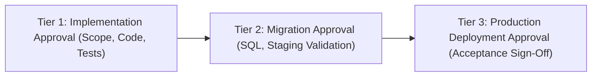

# FlowDesk Phase Approval Matrix & Governance Protocol

**Document Identifier:** DOC-APPR-001  
**Version:** 1.0 (Master Authoritative Matrix)  
**Status:** Approved Governance Protocol  
**Effective Date:** 2026-10-31  
**Project:** FlowDesk (`flow-desk-main`)

---

## 1. Governance Principles & Three-Tier Approval

To ensure safety, data preservation, and architectural integrity, rework activities require explicit stakeholder approval across three separate tiers:

1. **Tier 1 (Implementation Approval):** Authorized to begin code refactoring or test authoring on a feature branch.
2. **Tier 2 (Database Migration Approval):** Required *prior* to executing any DDL or migration script in any environment.
3. **Tier 3 (Production Deployment Approval):** Required *prior* to merging into main and deploying to production.

---

## 2. Phase-by-Phase Approval Matrix

| Phase ID & Name | Scope / Focus | Implementation Approval Gate | Database Migration Approval Gate | Production Deployment Approval Gate | Current Approval Status |
|---|---|---|---|---|---|
| **Phase 0A: Testing Harness Baseline** | Vitest, `@testing-library/react`, calculation unit test suites. | Required (Review vitest config & test suites) | **None** (No DB changes) | Required | **PROPOSED — UNAUTHORIZED** |
| **Phase 0B: Package Dependency Pruning** | Prune `googleapis`, `nodemailer`, `dotenv`, `socket.io-client`, `axios`. | Required (Review 0-import audit report) | **None** (No DB changes) | Required | **PROPOSED — UNAUTHORIZED** |
| **Phase 1: Critical Bug Fixes (001-004, 009)** | Fix Task Duration, Refresh 500 diagnostics, Break toast, Clock-out, Task rejection. | Required (Review reproduction & test scripts) | **None** (No DDL changes) | Required | **PROPOSED — UNAUTHORIZED** |
| **Phase 2: Database Schema & Indexes** | Add `probation_end_date` to `flwdsk_employees`; composite indexes. | Required (Review migration DDL & rollback SQL) | **MANDATORY** (Staging schema inspection & query plan) | Required | **PROPOSED — UNAUTHORIZED** |
| **Phase 3: SearchableBatchSelect Overhaul** | Build & deploy `SearchableBatchSelect` across 10 touchpoints; enforce `CONF-001` (all-employee batch status authority). | Required (Review component API & touchpoint list) | **None** (No DB changes) | Required | **PROPOSED — UNAUTHORIZED** |
| **Phase 4: Incremental Repo Standardization** | Route 68 direct queries through typed repositories; enforce `deleted_at IS NULL`. | Required (Review repo interfaces module-by-module) | **None** (No DB changes) | Required | **PROPOSED — UNAUTHORIZED** |
| **Phase 5: Monolithic Component Decomposition** | Break down `MyDayPage`, `AttendanceLogPage`, etc. into < 500 LOC components. | Required (Review sub-component architecture per page) | **None** (No DB changes) | Required | **PROPOSED — UNAUTHORIZED** |
| **Phase 6: Type Safety & Engine Decoupling** | Eliminate `any` in domain models; decouple services from `src/core/engines/`. | Required (Review strict typecheck & decoupling plan) | **None** (No DB changes) | Required | **PROPOSED — UNAUTHORIZED** |
| **Phase 7: Bundle Optimization & Approved UI/UX** | Dynamic imports for `xlsx`/`jspdf`; reduced motion CSS; implement `UIUX-REQ-001` through `UIUX-REQ-020` (`CONF-001` resolved). | Required (Review bundle analysis & UI/UX register items) | **None** (No DB changes) | Required | **PROPOSED — UNAUTHORIZED** |
| **Phase 8: Master Acceptance Sign-Off** | End-to-end regression testing across 20 active modules against `BUSINESS_RULES.md`. | Required (Review test results & runbook) | **None** (No DB changes) | **EXECUTIVE SIGN-OFF** | **PROPOSED — UNAUTHORIZED** |

---

## 3. Mandatory Sign-Off Protocol

For every phase:
1. No implementation may commence without an explicit stakeholder authorization recorded for that specific phase.
2. Completing a phase triggers an automated test demonstration and code review before seeking sign-off.
3. Sign-off on one phase does not automatically authorize the next phase. Each phase requires its own independent checkpoint approval.

