# FlowDesk — Stage 1 Implementation Plan Finalization Report

**Document Identifier:** DOC-STAGE1-REP-001  
**Version:** 1.0 (Stage 1 Completion & Governance Sign-Off)  
**Effective Date:** 2026-11-02  
**Evaluation Baseline:** Master Implementation Plan v5.0, Master Execution Roadmap v4.0, Approval & Blocker Register v1.1, UI/UX Requirements Register v2.0, Database Architecture Specification v2.1  
**Project:** FlowDesk (`flow-desk-main`)  
**Stage 1 Status:** **COMPLETE & LOCKED — READY FOR STAKEHOLDER APPROVAL**  
**Governance Directive:** STRICT DOCUMENTATION FINALIZATION ONLY — NO IMPLEMENTATION, GIT PUSH, OR DEPLOYMENT AUTHORIZED  

---

## 1. Executive Summary & Objective

In accordance with the stakeholder mandate for the **Three-Stage Comprehensive Rework Execution**, this report formally concludes **Stage 1 — Implementation Plan Finalization**.

The primary objective of Stage 1 was to consolidate, reconcile, and harden all existing audit reports, business rules, architectural decisions, issue registers, database designs, and UI/UX specifications into a **unified, internally consistent, implementation-ready documentation baseline**.

Stage 1 is confirmed **COMPLETE**. All genuine audit, documentation, business-rule, dependency, and planning gaps have been resolved. Every phase and work package across the entire 32.0-day engineering effort estimate baseline is fully specified with scope, technical approach, prerequisites, deliverables, automated test requirements, local verification checks, completion criteria, and recovery protocols.

In strict compliance with governance rules, **Antigravity has STOPPED at the Stage 1 boundary**. No application source code was modified, no database migrations were executed, no Git Push was performed, and no automated progression to Stage 2 has occurred.

---

## 2. Audit Performed & Methodology

A comprehensive, read-only audit was conducted across the active repository and documentation baseline, examining:
1. **Business-Rule Authority & Conflict Resolution:** Cross-referenced `docs/BUSINESS_RULES.md`, `docs/APPROVAL_AND_BLOCKER_REGISTER.md`, and historical audit findings to confirm authoritative status for `CONF-001`, `EMP-Q01`, `PROJECT-Q1`, `CAL-Q01`, `BR-TASK-007`, `BR-ATT-004`, `BR-LEAVE-011`, and `DISC-001` through `DISC-004`.
2. **Issue Registry Coverage (`ISSUE-001` through `ISSUE-014`):** Verified that all 14 confirmed issues have dedicated investigation gates, phase assignments, acceptance criteria, and automated test definitions.
3. **UI/UX Requirements Coverage (`UIUX-REQ-001` through `UIUX-REQ-020`):** Verified that all 20 UI/UX specifications preserve permissions, form mappings, filters, and business rules, including the exact 16-metric Expense Analytics specification.
4. **Database Schema & Migration Integrity:** Audited all proposed SQL migrations against existing PostgreSQL schemas in `supabase/migrations/` to identify unverified structures, transaction safety constraints, and rollback protocols.
5. **Engineering Baseline & Timeline Consistency:** Reconciled the 32.0 dedicated engineering days effort estimate against earlier calendar targets to eliminate planning ambiguity.

---

## 3. Audit Findings & Systematic Corrections

| Area Audited | Prior State / Discrepancy Found | Systematic Technical Correction Applied | Impacted Documents |
|:---|:---|:---|:---|
| **Database Design Probation Schema** | `docs/DATABASE_DESIGN.md` contained an outdated 3-column SQL snippet (`probation_end_date`, `probation_duration`, `leave_accrual_start_date`) contradicting approved decision `DISC-001`. | Replaced with strictly `ALTER TABLE flwdsk_employees ADD COLUMN IF NOT EXISTS probation_end_date DATE NULL;`. Documented dynamic derivation of duration and leave accrual start date in application code. | `docs/DATABASE_DESIGN.md` |
| **Migration Provenance Audit Table** | `flwdsk_migration_log` was referenced in `MIG-004` rollback planning but did not exist in the database schema. | Formally classified `flwdsk_migration_log` as a proposed schema addition. Authored exact DDL specification (`MIG-000`) and logged `APPR-MIG-000` in the Pending Approvals Register. | `docs/MASTER_IMPLEMENTATION_PLAN.md`, `docs/DATABASE_DESIGN.md`, `docs/APPROVAL_AND_BLOCKER_REGISTER.md` |
| **Engineering Effort vs Calendar Duration** | Early roadmap drafts referenced an aggressive "2 November 2026" operational release, whereas the plan requires 32.0 engineering days (5.0 days for Phase 0A/0B/1). | Formally harmonized both documents: the 32.0-day baseline is documented as an **effort estimate**, not a calendar guarantee. Confirmed daily operations continue on stable modules while Phase 1 is tested in local staging. | `docs/MASTER_IMPLEMENTATION_PLAN.md`, `docs/MASTER_EXECUTION_ROADMAP.md` |
| **Complete Work Package Specifications** | Prior plan versions lacked uniform subsections for all 10 phases. | Expanded Section 8 into the **Master Work Package Catalog** with full 8-attribute specifications for all phases (Phase 0A through Phase 8). | `docs/MASTER_IMPLEMENTATION_PLAN.md` |
| **ISSUE-011 Decoupling** | Historical references conflated ISSUE-011 (leave accrual from April 1) with Phase 6 TypeScript `TaskStatus` refactoring. | Moved strictly to Phase 1 / Phase 2 Leave Management (`WP-1F`); completely decoupled from Phase 6 type safety. Preserved `BR-LEAVE-011` and `EMP-Q01`. | `docs/MASTER_IMPLEMENTATION_PLAN.md`, `docs/MASTER_EXECUTION_ROADMAP.md` |
| **ISSUE-004 & ISSUE-012 Attendance Consolidation** | Prior drafts assumed `DELETE + INSERT → UPDATE` was a confirmed sufficient fix without empirical evidence. | Established formal **Investigation and Verification Gate** examining parent session persistence, child break FK `23503` constraints, cascading ordering, overnight session resolution in `findActiveRecord()`, and atomic rollback across 4 regression scenarios. | `docs/MASTER_IMPLEMENTATION_PLAN.md`, `docs/MASTER_EXECUTION_ROADMAP.md` |
| **ISSUE-002 Diagnostic Gating** | Unclear distinction between staging diagnostic reproduction and production log inspection. | Clarified that the 20-refresh test is a **read-only diagnostic/regression test** in staging. Access to production Edge Function logs is isolated as an external gate requiring separate authorization (`APPR-DIAG-001`). Zero security/auth changes. | `docs/MASTER_IMPLEMENTATION_PLAN.md`, `docs/APPROVAL_AND_BLOCKER_REGISTER.md` |
| **Expense Analytics Scope & Metric 7** | Average Amount was ambiguously mentioned in older drafts, and Metric 7 denominator logic allowed an invalid claim-date fallback. | Completely excluded Average Amount. Locked Metric 7 denominator strictly to `flwdsk_schedule_sessions` actual distinct dates, prohibiting claim dates, with `"1 day (pre-commencement)"` and `"Session Data Unavailable"` badges. | `docs/MASTER_IMPLEMENTATION_PLAN.md`, `docs/UI_UX_REQUIREMENTS_REGISTER.md` |

---

## 4. Finalized Documentation Baseline

The following authoritative documentation files have been completely reconciled, synchronized, and locked:

1. **[`docs/MASTER_IMPLEMENTATION_PLAN.md`](file:///Users/apple/Downloads/flow-desk-main/docs/MASTER_IMPLEMENTATION_PLAN.md)** (v5.0):
   - Mandatory scope and safety boundaries (Security System untouched, Mobile App frozen, Excluded modules preserved).
   - Deep-dive forensic work packages (A through E).
   - Package dependency pruning validation (Phase 0B).
   - Comprehensive database migration plan (`MIG-000` through `MIG-004`).
   - Selective soft-delete enforcement strategy (Phase 4).
   - Full issue-to-phase and UI/UX traceability matrices (`ISSUE-001`–`014`, `UIUX-REQ-001`–`020`).
   - Complete 16-metric Expense Analytics technical specification.
   - 32.0-day realistic engineering timeline estimate.
   - Master Work Package Catalog across all 10 execution phases with all 8 mandatory attributes.
2. **[`docs/MASTER_EXECUTION_ROADMAP.md`](file:///Users/apple/Downloads/flow-desk-main/docs/MASTER_EXECUTION_ROADMAP.md)** (v4.0):
   - Six concurrent workstreams (A through F).
   - Local-first execution lifecycle.
   - Phase-by-phase schedule synchronized with 32.0-day engineering effort estimate.
   - Phase 1 Operational Readiness Gate checklist.
3. **[`docs/APPROVAL_AND_BLOCKER_REGISTER.md`](file:///Users/apple/Downloads/flow-desk-main/docs/APPROVAL_AND_BLOCKER_REGISTER.md)** (v1.1):
   - Locked approvals (`CONF-001`, `EMP-Q01`, `PROJECT-Q1`, `CAL-Q01`, `BR-TASK-007`, `BR-ATT-004`, `EXCL-MOD`, `UIUX-BATCH-01`, `UIUX-BATCH-02`).
   - Pending approvals register (`APPR-MIG-000` through `APPR-MIG-004`, `APPR-DIAG-001`, `APPR-REL-PH1`, `APPR-UIUX-020`).
   - Active blockers (`BLCK-SEC-001` Security Boundary, `BLCK-EXP-001` Table Drop Cancellation, `BLCK-MOB-001` Mobile Freeze).
   - Resolved conflicts (`CONF-001`, `DISC-001`–`DISC-004`).
4. **[`docs/UI_UX_REQUIREMENTS_REGISTER.md`](file:///Users/apple/Downloads/flow-desk-main/docs/UI_UX_REQUIREMENTS_REGISTER.md)** (v2.0):
   - Detailed specifications for Batch 01 (`UIUX-REQ-001` through `010`) and Batch 02 (`UIUX-REQ-011` through `020`).
   - Exact 16-metric Expense Analytics specification locked (Average Amount excluded, Metric 7 corrected).
5. **[`docs/DATABASE_DESIGN.md`](file:///Users/apple/Downloads/flow-desk-main/docs/DATABASE_DESIGN.md)** (v2.1):
   - Corrected `EMP-Q01` / `DISC-001` single-column schema (`probation_end_date`).
   - Added `flwdsk_migration_log` schema definition.
   - Canonical training session architecture (`CAL-Q01`) and project membership (`PROJECT-Q1`).
6. **[`docs/FINAL_MASTER_PLAN_APPROVAL_CHECKLIST.md`](file:///Users/apple/Downloads/flow-desk-main/docs/FINAL_MASTER_PLAN_APPROVAL_CHECKLIST.md)** (v1.0):
   - Comprehensive compliance evaluation across business decisions, issue coverage, UI/UX specs, migration readiness, and execution governance.

---

## 5. Confirmed Scope & Strict Exclusions

### Strictly In Scope:
- **Phase 0A & 0B:** Vitest test runner setup, calculation safety harness, and pruning 5 verified dead packages (`googleapis`, `nodemailer`, `dotenv`, `socket.io-client`, `axios`).
- **Phase 1:** Critical operational reliability fixes (`ISSUE-001`, `ISSUE-002`, `ISSUE-003`, `ISSUE-004`, `ISSUE-009`, `ISSUE-011`, `ISSUE-012`).
- **Phase 2:** Non-destructive additive database migrations (`MIG-000` through `MIG-004`), session consolidation (`CAL-Q01`), project allocations backfill (`PROJECT-Q1`).
- **Phase 3:** Standardized `SearchableBatchSelect` combobox across 10 touchpoints, all-employee batch status changes (`CONF-001`), 4 exact statuses (`DISC-002`), lifecycle adapter (`ISSUE-013`).
- **Phase 4:** 100% repository standardization, selective soft-delete enforcement (`ISSUE-007`), project supervisor authority scoping (`DISC-004`).
- **Phase 5:** Monolithic component decomposition ($< 500$ LOC) for `MyDayPage`, `AttendanceLogPage`, `ProjectList` with strict functional/visual equivalence.
- **Phase 6:** Progressive type safety (7-state `TaskStatus` `DISC-003`), elimination of `any` types in core domain models, pruning dead in-memory engines.
- **Phase 7:** Dynamic chunk imports for `xlsx`, `jspdf`, `html2canvas` (`ISSUE-014`), full implementation of all 20 UI/UX requirements, delivery of 16-metric Expense Analytics canvas (`UIUX-REQ-018`).
- **Phase 8:** Comprehensive master regression across all 20 active modules against `docs/BUSINESS_RULES.md`, final acceptance report, Tier 3 Executive Sign-Off.

### Strictly Out of Scope / Frozen:
1. **Security Architecture Untouched:** Authentication middleware, login/session management, JWT token parsing, Supabase Edge Functions, and PostgreSQL Row Level Security (RLS) policies are 100% frozen.
2. **Permanently Excluded Modules:** Budgets, Procurement, Assets, and Payroll are excluded. All tables (`flwdsk_budgets`, `flwdsk_vendors`, `flwdsk_purchase_orders`, `flwdsk_assets`, `flwdsk_salary_structures`) and historical data are permanently preserved. Table-drop migration `20261029000000_remove_excluded_modules_tables.sql` is cancelled.
3. **Mobile Application Directory Frozen:** The `Mobile App/` directory is completely isolated and untouched. `UIUX-REQ-020` covers operational architecture planning only; mobile implementation requires separate authorization after web rework.

---

## 6. Final Phase & Work Package Execution Sequence

```mermaid
flowchart TD
    subgraph P0["Phase 0: Safety Net & Hygiene (1.5 Days)"]
        WP0A["WP-0A: Automated Test Harness (ISSUE-008)"] --> WP0B["WP-0B: Package Dependency Pruning"]
    end

    subgraph P1["Phase 1: Operational Reliability (3.5 Days)"]
        WP1A["WP-1A: Task Duration Sync (ISSUE-001)"]
        WP1B["WP-1B: Refresh HTTP 500 Diagnostic Gate (ISSUE-002)"]
        WP1C["WP-1C: Duplicate Break Toast Removal (ISSUE-003)"]
        WP1D["WP-1D: Unified Attendance & Clock-Out (ISSUE-004/012)"]
        WP1E["WP-1E: Task Rejection Governance (ISSUE-009 / BR-TASK-007)"]
        WP1F["WP-1F: Leave Accrual Engine (ISSUE-011 / BR-LEAVE-011)"]
        WP1G["WP-1G: Off-Shift Task Start (BR-ATT-004)"]
    end

    subgraph GATE1["Gate 1: Tier 3 Operational Readiness Gate"]
        G1["Verify 20 Refreshes, Midnight Clock-Out, Leave Math, Rejection"]
    end

    subgraph P2["Phase 2: Database Consolidation (3.0 Days)"]
        WP2A["WP-2A: Migration Log Setup (MIG-000)"] --> WP2B["WP-2B: Probation End Date (MIG-001)"]
        WP2A --> WP2C["WP-2C: Session Consolidation (MIG-002)"]
        WP2A --> WP2D["WP-2D: Composite Indexes (MIG-003)"]
        WP2A --> WP2E["WP-2E: Project Membership Backfill (MIG-004)"]
    end

    subgraph P3["Phase 3: Searchable Select & Touchpoints (3.5 Days)"]
        WP3["WP-3: SearchableBatchSelect Across 10 Touchpoints (CONF-001, DISC-002, ISSUE-013)"]
    end

    subgraph P4["Phase 4: Repositories & Soft-Deletes (3.5 Days)"]
        WP4["WP-4: Repository Standardization & Selective Soft-Delete Rules (ISSUE-007, DISC-004)"]
    end

    subgraph P5["Phase 5: Monolith Decomposition (4.0 Days)"]
        WP5["WP-5: Decompose Pages < 500 LOC (MyDay, AttendanceLog, ProjectList)"]
    end

    subgraph P6["Phase 6: Progressive Type Safety (3.0 Days)"]
        WP6["WP-6: 7-State TaskStatus (DISC-003) & Dead Engine Elimination"]
    end

    subgraph P7["Phase 7: UI/UX & Expense Analytics (7.0 Days)"]
        WP7["WP-7: UI/UX Batches 01 & 02 + 16 Expense Metrics (UIUX-REQ-001 to 020, ISSUE-014)"]
    end

    subgraph P8["Phase 8: End-to-End Regression (3.0 Days)"]
        WP8["WP-8: Master Regression Across All 20 Modules & Tier 3 Final Sign-Off Gate"]
    end

    P0 --> P1
    P1 --> GATE1
    GATE1 --> P2
    P2 --> P3
    P3 --> P4
    P4 --> P5
    P5 --> P6
    P6 --> P7
    P7 --> P8
```

---

## 7. Remaining External Approvals Register

Before specific dependent execution phases are initiated in Stage 2, the following formal approval tiers must be granted by the stakeholder:

| Approval ID | Target Phase | Description & Required Authorization | Prerequisite Status | Approval Tier |
|:---|:---:|:---|:---|:---:|
| **`APPR-STG2-KICKOFF`** | Phase 0A | **Formal Stage 2 Implementation Kickoff:** Authorization to commence Phase 0A and Phase 0B. | Stage 1 documentation baseline complete and locked. | **Tier 1 (Implementation)** |
| **`APPR-REL-PH1`** | Phase 1 release | **Operational Release of Phase 1:** Deployment of Phase 1 fixes following passing local verification of the Operational Readiness Gate. | 5.0 engineering days of implementation, testing, and 20-refresh verification. | **Tier 3 (Production Deploy)** |
| **`APPR-MIG-000`** | Phase 2 | Execution of DDL creating proposed audit table `public.flwdsk_migration_log`. | DDL script drafted; safe additive table. | **Tier 2 (DB Migration)** |
| **`APPR-MIG-001`** | Phase 2 | Execution of `ALTER TABLE flwdsk_employees ADD COLUMN IF NOT EXISTS probation_end_date DATE NULL;`. | DDL script drafted; rollback SQL prepared. | **Tier 2 (DB Migration)** |
| **`APPR-MIG-002`** | Phase 2 | Additive visual planning columns on `flwdsk_schedule_sessions` and non-destructive backfill from `flwdsk_calendar_sessions`. | Additive DDL drafted; backfill matching composite key verified. | **Tier 2 (DB Migration)** |
| **`APPR-MIG-003`** | Phase 2 | Creation of composite performance indexes (`idx_flwdsk_att_emp_date`, `idx_flwdsk_tws_emp_open`, `idx_flwdsk_sched_batch_date`). | Transaction safety verified (non-concurrent). | **Tier 2 (DB Migration)** |
| **`APPR-MIG-004`** | Phase 2 | Idempotent backfill from `flwdsk_projects.member_ids` to `flwdsk_resource_allocations` logging IDs to `flwdsk_migration_log`. | Backfill SQL drafted; foreign key validation verified; forward recovery default. | **Tier 2 (DB Migration)** |
| **`APPR-DIAG-001`** | Phase 1 | Conditional authorization to inspect production Supabase Edge Function logs if staging reproduction for `ISSUE-002` is inconclusive. | Staging read-only reproduction protocol and HAR analysis drafted. | **Tier 1 (Diagnostic)** |
| **`APPR-UIUX-020`** | Post-Web Rework | Implementation kickoff for Mobile App operational companion (React Native/Expo). | Architecture plan completed; `Mobile App/` frozen. | **Tier 1 (Implementation)** |

---

## 8. Stage 1 Completion Gate Verification

The Stage 1 Completion Gate has been systematically verified against all required exit criteria:

- [x] **All planned requirements represented:** Every confirmed issue (`ISSUE-001`–`014`), UI/UX requirement (`UIUX-REQ-001`–`020`), and approved business decision is represented.
- [x] **All phases and dependencies clear:** Ten sequential execution phases (Phases 0A through 8) are fully mapped with dependencies and gates.
- [x] **Work packages implementation-ready:** Every phase in Section 8.3 contains Scope & Exclusions, Technical Approach, Prerequisites, Deliverables, Test Requirements, Local Verification, Completion Criteria, and Failure/Recovery Approach.
- [x] **Test and verification criteria defined:** Test suites and passing thresholds are documented for Vitest, typechecking, and manual walkthroughs.
- [x] **Zero unresolved documentation contradictions:** All discrepancies (`DISC-001` through `DISC-004`, `CONF-001`, `EMP-Q01`, `CAL-Q01`, `PROJECT-Q1`, `BR-TASK-007`) are resolved and locked.
- [x] **Remaining approvals explicitly identified:** Tier 1, Tier 2, and Tier 3 approvals are enumerated in Section 7 above.
- [x] **Implementation-ready baseline available for review:** All core documentation files are updated and verified on disk.

---

## 9. Stage 1 Final Status & Formal Stop Notice

### **STAGE 1 STATUS:** **COMPLETE & LOCKED**

> [!IMPORTANT]
> **MANDATORY STOPPING DIRECTIVE:**  
> In accordance with the governance directives, **Stage 1 is formally concluded and locked**.  
> 
> **Antigravity is STOPPED and standing by.**  
> 
> No application source code has been modified. No database changes have been executed. No Git Push or deployment has occurred. Progression to **Stage 2 (Implementation Execution)** will commence **ONLY after explicit stakeholder authorization of this report and the finalized documentation baseline**.

