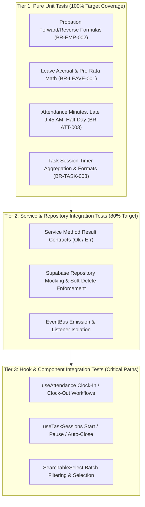

# FlowDesk Comprehensive Testing Strategy & Quality Assurance Plan

**Document Identifier:** DOC-TEST-001  
**Version:** 2.0  
**Status:** Approved Quality Assurance Plan  
**Effective Date:** 2026-10-31  
**Project:** FlowDesk (`flow-desk-main`)

---

## 1. Executive Summary & Defect Rationale

Currently, FlowDesk has **zero automated test coverage** ([`ISSUE-008`](file:///Users/apple/Downloads/flow-desk-main/ISSUES/ISSUE-008_ZERO_AUTOMATED_TEST_COVERAGE.md)). There is no test runner configured in `package.json`, no test configuration file, and zero `.test.ts` or `.spec.ts` files in the repository.

This lack of automated testing has resulted in:
1. High regression risks during refactoring.
2. Undetected calculation anomalies (e.g. `ISSUE-001` Task Duration inconsistency, `NaN%` attendance metrics on zero-day months).
3. Inability to guarantee adherence to approved business formulas (e.g. `BR-EMP-002` probation forward/reverse calendar-month calculations).

Establishing an automated testing harness is designated as **Phase 0 Priority 1** before commencing application rework.

---

## 2. Test Architecture & Tooling Stack

| Component | Selected Technology | Purpose |
|---|---|---|
| **Test Runner** | `vitest` (v2.x) | Ultra-fast native Vite test runner sharing existing Vite configuration. |
| **DOM Environment** | `happy-dom` or `jsdom` | Lightweight headless browser environment for React hook and component tests. |
| **React Testing Kit** | `@testing-library/react` | User-centric component rendering and interaction testing. |
| **Assertion Utilities** | `vitest` built-in `expect` | Standard assertions, spy mocks, and snapshot testing. |
| **Coverage Tool** | `@vitest/coverage-v8` | Code coverage reporting with threshold gating. |

---

## 3. The Three Testing Tiers



---

## 4. Priority Test Suites to Implement in Phase 0 & Phase 1

### Suite 1: Probation Calculation Engine (`BR-EMP-002` / `EMP-Q01`)
* **Test File:** `src/tests/business-rules/probation.test.ts`
* **Test Cases:**
  - Forward calculation with whole months (Joining: Jan 1 + 3.0 months $\rightarrow$ End: Mar 31).
  - Fractional months (Joining: Jan 15 + 2.5 months $\rightarrow$ End: Mar 31 with half-up rounding).
  - Leap year February handling (Joining: Jan 31 in leap year vs non-leap year).
  - Month-end clamping (Joining: Aug 31 + 1 month $\rightarrow$ Sep 30).
  - Reverse calculation: Joining Date + Updated End Date $\rightarrow$ exact dynamic duration (1 decimal place).
  - Zero probation direct confirmed hires.

### Suite 2: Leave Accrual & Pro-Rata Math (`BR-LEAVE-001`)
* **Test File:** `src/tests/business-rules/leave-accrual.test.ts`
* **Test Cases:**
  - 12 days annual quota accrual at 1.0 day per completed month.
  - Zero accrual during probation.
  - Mid-year probation completion pro-rata allocation.
  - Negative balance rejection.

### Suite 3: Attendance Duration & Thresholds (`BR-ATT-001` / `BR-ATT-003`)
* **Test File:** `src/tests/business-rules/attendance.test.ts`
* **Test Cases:**
  - Clock-in at 09:44 AM $\rightarrow$ On Time.
  - Clock-in at 09:46 AM $\rightarrow$ Late.
  - Working time 269 minutes $\rightarrow$ Absent.
  - Working time 270 minutes $\rightarrow$ Half Day.
  - Working time 480 minutes $\rightarrow$ Full Day Present.
  - Overlapping break deduction.

### Suite 4: Task Timer & Session Aggregation (`BR-TASK-002` / `BR-TASK-003` / `ISSUE-001`)
* **Test File:** `src/tests/business-rules/task-timer.test.ts`
* **Test Cases:**
  - Closed session duration summation.
  - Dynamic elapsed time addition for running sessions.
  - Consistent duration formatting `Xh Ym` across simulated page reloads.
  - Auto-pausing of concurrent task sessions when a new task is started.

### Suite 5: Task Approval & Rejection Governance (`BR-TASK-007` / `ISSUE-009`)
* **Test File:** `src/tests/business-rules/task-governance.test.ts`
* **Test Cases:**
  - Pre-start rejection (never started): verify hard-delete of task and rejection record.
  - Post-start rejection (started, hours > 0): verify preservation and status set to `Rejected / Closed`.
  - Post-start rejection (started, hours = 0): verify preservation and status set to `Rejected / Closed`.
  - Prohibit resubmission of rejected/closed tasks.
  - Optional rejection reason handling.

---

## 5. Execution & CI/CD Quality Gates

1. **Local Pre-Commit Hook:** Run typechecking and unit test suite before allowing commits:
   ```bash
   npm run typecheck && npm run test:unit
   ```
2. **Pull Request Quality Gate:**
   - 100% passing tests.
   - Zero `any` additions in modified files.
   - Code coverage threshold: $\ge 80\%$ on all domain services and calculation utilities.

